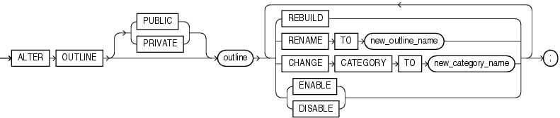

## ALTER OUTLINE

Purpose

Note:

Stored outlines are deprecated. They are still supported for backward compatibility. However, Oracle recommends that you use SQL plan management instead. SQL plan management creates SQL plan baselines, which offer superior SQL performance stability compared with stored outlines.

You can migrate existing stored outlines to SQL plan baselines by using the `MIGRATE_STORED_OUTLINE` function of the `DBMS_SPM` package or Enterprise Manager Cloud Control. When the migration is complete, the stored outlines are marked as migrated and can be removed. You can drop all migrated stored outlines on your system by using the `DROP_MIGRATED_STORED_OUTLINE` function of the `DBMS_SPM` package.

See Also: [Oracle Database SQL Tuning Guide](https://docs.oracle.com/pls/topic/lookup?ctx=en/database/oracle/oracle-database/21/sqlrf&id=TGSQL615) for more information about SQL plan management and [Oracle Database PL/SQL Packages and Types Reference](https://docs.oracle.com/pls/topic/lookup?ctx=en/database/oracle/oracle-database/21/sqlrf&id=ARPLS150) for information about the `DBMS_SPM` package

Use the `ALTER` `OUTLINE` statement to rename a stored outline, reassign it to a different category, or regenerate it by compiling the outline's SQL statement and replacing the old outline data with the outline created under current conditions.

See Also:

[CREATE OUTLINE](CREATE-OUTLINE.md) for information on creating an outline

Prerequisites

To modify an outline, you must have the `ALTER` `ANY` `OUTLINE` system privilege.

Syntax

alter\_outline::=



> ```
> ALTER OUTLINE [ PUBLIC | PRIVATE ] outline
>   { REBUILD
>   | RENAME TO new_outline_name
>   | CHANGE CATEGORY TO new_category_name
>   | { ENABLE | DISABLE }
>   } ...
>   ;
> ```
>
> [  
> Copyright © 1996, 2025, Oracle and/or its affiliates.](https://docs.oracle.com/en/database/oracle/oracle-database/dcommon/html/cpyr.htm)


Semantics

PUBLIC | PRIVATE

Specify `PUBLIC` if you want to modify the public version of this outline. This is the default.

Specify `PRIVATE` if you want to modify an outline that is private to the current session and whose data is stored in the current parsing schema.

outline

Specify the name of the outline to be modified.

REBUILD

Specify `REBUILD` to regenerate the execution plan for `outline` using current conditions.

See Also:

" Rebuilding an Outline: Example "

RENAME TO Clause

Use the `RENAME` `TO` clause to specify an outline name to replace `outline`.

CHANGE CATEGORY TO Clause

Use the `CHANGE` `CATEGORY` `TO` clause to specify the name of the category into which the `outline` will be moved.

ENABLE | DISABLE

Use this clause to selectively enable or disable this outline. Outlines are enabled by default. The `DISABLE` keyword lets you disable one outline without affecting the use of other outlines.

Examples

Rebuilding an Outline: Example

The following statement regenerates a stored outline called `salaries` by compiling the text of the outline and replacing the old outline data with the outline created under current conditions.

```
ALTER OUTLINE salaries REBUILD;
```