## ALTER PLUGGABLE DATABASE

Purpose

Use the `ALTER` `PLUGGABLE` `DATABASE` statement to modify a pluggable database (PDB). The PDB can be a traditional PDB, an application container, or an application PDB.

This statement enables you to perform the following tasks:

- Unplug a PDB from a multitenant container database (CDB) (using the `pdb_unplug_clause`)
- Modify the settings of a PDB (using the `pdb_settings_clauses`)
- Bring PDB data files online or take them offline (using the `pdb_datafile_clause`)
- Back up and recover a PDB (using the `pdb_recovery_clauses`)
- Modify the state of a PDB (using the `pdb_change_state` clause)
- Modify the state of multiple PDBs within a CDB (using the `pdb_change_state_from_root` clause)
- Perform operations on applications in an application container (using the `application_clauses`)
- Create and manage PDB snapshots using the `snapshot_clauses`

Note:

You can perform all `ALTER` `PLUGGABLE` `DATABASE` tasks by connecting to a PDB and running the corresponding `ALTER` `DATABASE` statement. This functionality is provided to maintain backward compatibility for applications that have been migrated to a CDB environment. The exception is modifying PDB storage limits, for which you must use the `pdb_storage_clause` of `ALTER` `PLUGGABLE` `DATABASE`.

Prerequisites

You must be connected to a CDB.

To specify the `pdb_unplug_clause`, the current container must be the root or the application root, you must be authenticated `AS` `SYSDBA` or `AS` `SYSOPER`, and the `SYSDBA` or `SYSOPER` privilege must be either granted to you commonly, or granted to you locally in the root and locally in the PDB you want to unplug.

To specify the `pdb_settings_clauses`, the current container must be the PDB whose settings you want to modify and you must have the `ALTER` `DATABASE` privilege, either granted commonly or granted locally in the PDB. To specify the `pdb_logging_clauses` or the `RENAME` `GLOBAL_NAME` clause, you must also have the `RESTRICTED` `SESSION` privilege, either granted commonly or granted locally in the PDB being renamed, and the PDB must be in `READ` `WRITE` `RESTRICTED` mode.

To specify the `pdb_datafile_clause`, the current container must be the PDB whose datafiles you want to bring online or take offline and you must have the `ALTER` `DATABASE` privilege, either granted commonly or granted locally in the PDB.

To specify the `pdb_recovery_clauses`, the current container must be the PDB you want to back up or recover and you must have the `ALTER` `DATABASE` privilege, either granted commonly or granted locally in the PDB.

To specify the `pdb_change_state` clause, the current container must be the PDB whose state you want to change and you must be authenticated `AS` `SYSBACKUP`, `AS` `SYSDBA`, `AS` `SYSDG`, or `AS` `SYSOPER`.

To specify the `pdb_change_state_from_root` clause, the current container must be the root or the application root, you must be authenticated `AS` `SYSBACKUP`, `AS` `SYSDBA`, `AS` `SYSDG`, or `AS` `SYSOPER`, and the `SYSBACKUP`, `SYSDBA`, `SYSDG`, or `SYSOPER` privilege must be either granted to you commonly, or granted to you locally in the root or application root, and locally in the PDB(s) whose state(s) you want to change.

To specify the `application_clauses`, the current container must be an application container, you must be authenticated `AS` `SYSBACKUP` or `AS` `SYSDBA`, and the `SYSBACKUP` or `SYSDBA` privilege must be either granted to you commonly, or granted to you locally in the application root and locally in the application PDB(s) in which you want to perform application operations.

Syntax

database\_clause::=

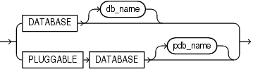

> ```
> { DATABASE db_name | PLUGGABLE DATABASE pdb_name }
> ```
>
> [  
> Copyright © 1996, 2025, Oracle and/or its affiliates.](https://docs.oracle.com/en/database/oracle/oracle-database/dcommon/html/cpyr.htm)


pdb\_unplug\_encrypt::=

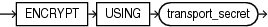

> ```
> ENCRYPT USING 'transport_secret'
> ```
>
> [  
> Copyright © 1996, 2025, Oracle and/or its affiliates.](https://docs.oracle.com/en/database/oracle/oracle-database/dcommon/html/cpyr.htm)


logging\_clause::=


> ```
> { LOGGING | NOLOGGING |  FILESYSTEM_LIKE_LOGGING }
> ```
>
> [  
> Copyright © 1996, 2025, Oracle and/or its affiliates.](https://docs.oracle.com/en/database/oracle/oracle-database/dcommon/html/cpyr.htm)


pdb\_force\_logging\_clause::=

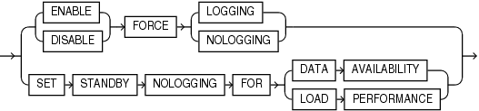

> ```
> {  {ENABLE | DISABLE} FORCE {LOGGING | NOLOGGING} 
>    | SET STANDBY NOLOGGING FOR {DATA AVAILABILITY | LOAD PERFORMANCE} 
> }
> ```
>
> [  
> Copyright © 1996, 2025, Oracle and/or its affiliates.](https://docs.oracle.com/en/database/oracle/oracle-database/dcommon/html/cpyr.htm)


pdb\_refresh\_switchover\_clause::=

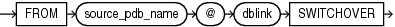

> ```
> FROM source_pdb_name @ dblink SWITCHOVER
> ```
>
> [  
> Copyright © 1996, 2025, Oracle and/or its affiliates.](https://docs.oracle.com/en/database/oracle/oracle-database/dcommon/html/cpyr.htm)


pdb\_general\_recovery::=

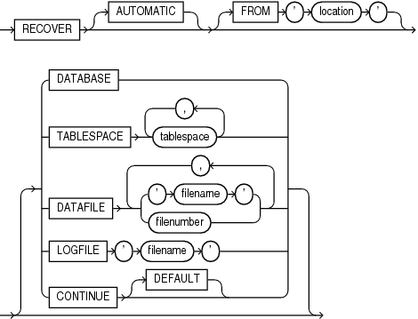

> ```
> RECOVER [ AUTOMATIC ]  [ FROM 'location' ]
>   [ DATABASE
>   |
>   TABLESPACE tablespace [, tablespace ]...
>   |
>   DATAFILE { 'filename' | filenumber }
>              [, 'filename' | filenumber ]...
>   |
>   LOGFILE 'filename'
>   |
>   CONTINUE [ DEFAULT ]
>   ]
> ```
>
> [  
> Copyright © 1996, 2025, Oracle and/or its affiliates.](https://docs.oracle.com/en/database/oracle/oracle-database/dcommon/html/cpyr.htm)


instances\_clause::=

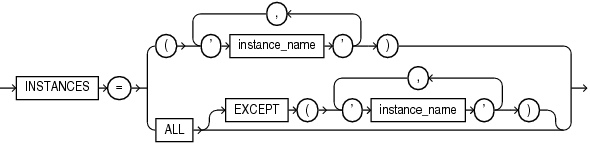

> ```
> INSTANCES = { ( 'instance_name' [, 'instance_name' ]... )
>             | ALL [ EXCEPT ( 'instance_name' [, 'instance_name' ]... ) ] }
> ```
>
> [  
> Copyright © 1996, 2025, Oracle and/or its affiliates.](https://docs.oracle.com/en/database/oracle/oracle-database/dcommon/html/cpyr.htm)


services\_clause::=

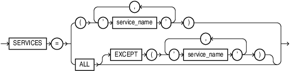

> ```
> SERVICES = { ( 'service_name' [, 'service_name' ]... )
>             | ALL [ EXCEPT ( 'service_name' [, 'service_name' ]... ) ] }
> ```
>
> [  
> Copyright © 1996, 2025, Oracle and/or its affiliates.](https://docs.oracle.com/en/database/oracle/oracle-database/dcommon/html/cpyr.htm)


relocate\_clause::=

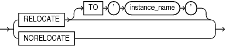

> ```
> RELOCATE [ TO 'instance_name' ] 
> | NORELOCATE
> ```
>
> [  
> Copyright © 1996, 2025, Oracle and/or its affiliates.](https://docs.oracle.com/en/database/oracle/oracle-database/dcommon/html/cpyr.htm)


snapshot\_clauses::=

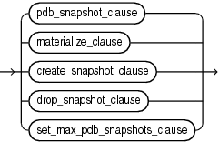

> ```
> { 
>   pdb_snapshot_clause 
>   | materialize_clause 
>   | create_snapshot_clause 
>   | drop_snapshot_clause 
>   | set_max_pdb_snapshots_clause 
> }
> ```
>
> [  
> Copyright © 1996, 2025, Oracle and/or its affiliates.](https://docs.oracle.com/en/database/oracle/oracle-database/dcommon/html/cpyr.htm)


pdb\_snapshot\_clause::=

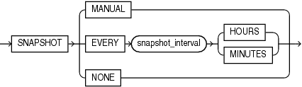

> ```
> ENABLE SNAPSHOT { MANUAL | EVERY snapshot_interval { HOURS | MINUTES } NONE }
> ```
>
> [  
> Copyright © 1996, 2025, Oracle and/or its affiliates.](https://docs.oracle.com/en/database/oracle/oracle-database/dcommon/html/cpyr.htm)


materialize\_clause::=

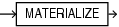

> ```
> MATERIALIZE
> ```
>
> [  
> Copyright © 1996, 2025, Oracle and/or its affiliates.](https://docs.oracle.com/en/database/oracle/oracle-database/dcommon/html/cpyr.htm)


create\_snapshot\_clause::=

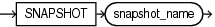

> ```
> SNAPSHOT snapshot_name
> ```
>
> [  
> Copyright © 1996, 2025, Oracle and/or its affiliates.](https://docs.oracle.com/en/database/oracle/oracle-database/dcommon/html/cpyr.htm)


drop\_snapshot\_clause::=

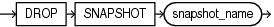

> ```
> DROP SNAPSHOT snapshot_name
> ```
>
> [  
> Copyright © 1996, 2025, Oracle and/or its affiliates.](https://docs.oracle.com/en/database/oracle/oracle-database/dcommon/html/cpyr.htm)


set\_max\_pdb\_snapshots::=

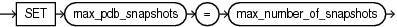

> ```
> SET max_pdb_snapshots = max_number_of_snapshots
> ```
>
> [  
> Copyright © 1996, 2025, Oracle and/or its affiliates.](https://docs.oracle.com/en/database/oracle/oracle-database/dcommon/html/cpyr.htm)


prepare\_clause::=

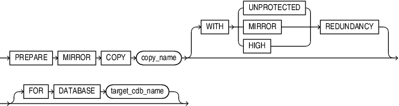

> ```
> PREPARE MIRROR COPY copy_name 
> [ WITH { UNPROTECTED | MIRROR | HIGH } REDUNDANCY ]
> [ FOR DATABASE target_cdb_name ]
> ```
>
> [  
> Copyright © 1996, 2025, Oracle and/or its affiliates.](https://docs.oracle.com/en/database/oracle/oracle-database/dcommon/html/cpyr.htm)


drop\_mirror\_copy::=

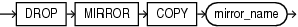

> ```
> DROP MIRROR COPY mirror_name
> ```
>
> [  
> Copyright © 1996, 2025, Oracle and/or its affiliates.](https://docs.oracle.com/en/database/oracle/oracle-database/dcommon/html/cpyr.htm)


lost\_write\_protection::=

The usage for the `lost_write_protection` clause with the `ALTER PLUGGABLE DATABASE` statement is identical to the `ALTER DATABASE` statement. Look here [ALTER DATABASE](ALTER-DATABASE.md) for syntax details.

pdb\_managed\_recovery::=

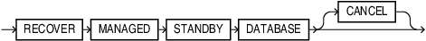

> ```
> RECOVER MANAGED STANDBY DATABASE [ CANCEL ]
> ```
>
> [  
> Copyright © 1996, 2025, Oracle and/or its affiliates.](https://docs.oracle.com/en/database/oracle/oracle-database/dcommon/html/cpyr.htm)


Semantics

database\_clause

Specify the `PLUGGABLE DATABASE` option for a container database.

pdb\_name

Specify the name of the database to be altered. If you omit `db_name`, then Oracle Database alters the database identified by the value of the initialization parameter `DB_NAME`. You can alter only the database whose control files are specified by the initialization parameter `CONTROL_FILES`. The database identifier is not related to the Oracle Net database specification.

pdb\_unplug\_clause

This clause lets you unplug a PDB from a CDB. When you unplug a PDB, Oracle stores information about the PDB in a file on your operating system. You can subsequently use this file to plug the PDB into a CDB.

For `pdb_name`, specify the name of the PDB you want to unplug. The PDB must be closed—that is, the open mode must be `MOUNTED`. In an Oracle Real Application Clusters (Oracle RAC) environment, the PDB must be closed in all Oracle RAC instances

For `filename`, specify the full path name of the operating system file in which to store information about the PDB. The file name that you specify determines the type of information stored and how it is stored.

- If you specify a file name that ends with the extension.xml, then Oracle creates an XML file containing metadata about the PDB. You can then copy the XML file and the PDB's data files to a new location and specify the XML file name when plugging the PDB into a CDB. In this case, you must copy the PDB's data files separately.
- If you specify a file name that ends with the extension.pdb, then Oracle creates a.pdb archive file. This is a compressed file that includes an XML file containing metadata about the PDB, as well as the PDB's data files. You can then copy this single archive file to a new location and specify the archive file name when plugging the PDB into a CDB. This eliminates having to copy the PDB's data files separately. When you use a.pdb archive file when plugging in a PDB, this file is extracted when you plug in the PDB, and the PDB’s files are placed in the same directory as the.pdb archive file.

After a PDB is unplugged, it remains in the CDB with an open mode of `MOUNTED` and a status of `UNPLUGGED`. The only operation you can perform on an unplugged PDB is `DROP` `PLUGGABLE` `DATABASE`, which will remove it from the CDB. You must drop the PDB before you can plug it into the same CDB or another CDB.

pdb\_unplug\_encrypt

You must have the `SYSKM` privilege to execute this command.

United PDBs

- `ENCRYPT USING transport_secret` is optional.
- If TDE is in use, you must specify this clause. If TDE is not in use, the statement throws the following error `ORA-46680:master keys of the container database must be exported.`
- The wallet must be open in `ROOT` if TDE is in use.
- Keys are encrypted using the provided `transport secret` and exported into the `.XML` or archive file

Unplugging a PDB Into an XML Metadata File: Example

```
ALTER PLUGGABLE DATABASE CDB1_PDB2 UNPLUG INTO '/tmp/cdb1_pdb2.xml' ENCRYPT USING transport_secret
```

Unplugging a PDB Into an Archive File: Example

```
ALTER PLUGGABLE DATABASE CDB1_PDB1_1 UNPLUG INTO '/tmp/CDB1_PDB1_1.pdb' ENCRYPT USING transport_secret
```

For PDBs in isolated mode, you need not specify `ENCRYPT USING transport_secret`. This is not required because the wallet file of the PDB is copied during the creation of the pluggable database from an XML file. If you are unplugging a PDB as an archive file, the wallet file of the PDB is added to the zipped archive with the `.pdb` extension.

If the `ewallet.p12` file already exists at the destination, a backup is automatically initiated. The backup file has the following format: `ewallet_PLGDB_2017090517455564.p12`.

pdb\_settings\_clauses

These clauses lets you modify various settings for a PDB.

pdb\_name

You can optionally use `pdb_name` to specify the name of the PDB whose settings you want to modify.

DEFAULT EDITION Clause

Use this clause to designate the specified edition as the default edition for the PDB. For the full semantics of this clause, refer to " [DEFAULT EDITION Clause](ALTER-DATABASE.md) " in the `ALTER` `DATABASE` documentation.

SET DEFAULT TABLESPACE Clause

Use this clause to specify or change the default type of tablespaces subsequently created in the PDB. For the full semantics of this clause, refer to " [SET DEFAULT TABLESPACE Clause](ALTER-DATABASE.md) " in the `ALTER` `DATABASE` documentation.

DEFAULT TABLESPACE Clause

Use this clause to establish or change the default permanent tablespace of the PDB. For the full semantics of this clause, refer to " [DEFAULT TABLESPACE Clause](ALTER-DATABASE.md) " in the `ALTER` `DATABASE` documentation.

DEFAULT TEMPORARY TABLESPACE Clause

Use this clause to change the default temporary tablespace of the PDB to a new tablespace or tablespace group. For the full semantics of this clause, refer to " [DEFAULT \[LOCAL\] TEMPORARY TABLESPACE Clause](https://docs.oracle.com/en/database/oracle/oracle-database/21/sqlrf/ALTER-DATABASE.html#GUID-8069872F-E680-4511-ADD8-A4E30AF67986__BGBEIJJD) " in the `ALTER` `DATABASE` documentation.

RENAME GLOBAL\_NAME TO Clause

Use this clause to change the global name of the PDB. The new global name must be unique within the CDB. For an Oracle Real Application Clusters (Oracle RAC) database, the PDB must be open in `READ` `WRITE` `RESTRICTED` mode on the current instance only. The PDB must be closed on all other instances. For the full semantics of this clause, refer to " [RENAME GLOBAL\_NAME Clause](ALTER-DATABASE.md) " in the `ALTER` `DATABASE` documentation.

Note:

When you change the global name of a PDB, be sure to change the `PLUGGABLE` `DATABASE` property for database services that are used to connect to the PDB.

set\_time\_zone\_clauses

Use this clause to modify the time zone setting for the PDB. For the full semantics of this clause, refer to [set\_time\_zone\_clause](ALTER-DATABASE.md) in the `ALTER` `DATABASE` documentation.

database\_file\_clauses

Use this clause to modify data files and temp files for the PDB. For the full semantics of this clause, refer to [database\_file\_clauses](ALTER-DATABASE.md) in the `ALTER` `DATABASE` documentation.

supplemental\_db\_logging

Use these clauses to instruct Oracle Database to add or stop adding supplemental data into the log stream for the PDB.

- Specify the `ADD` `SUPPLEMENTAL` `LOG` clause to add supplemental data into the log stream for the PDB. In order to issue this clause, supplemental logging must have been enabled for the CDB root with the `ALTER` `DATABASE`... `ADD` `SUPPLEMENTAL` `LOG`... statement. The level of supplemental logging that you specify for the PDB does not need to match that of the CDB root. That is, you can specify any of the clauses `DATA`, `supplemental_id_key_clause`, or `supplemental_plsql_clause` for the PDB, regardless of which clause was specified when enabling supplemental logging for the CDB root.
- Specify the `DROP` `SUPPLEMENTAL` `LOG` clause to stop adding supplemental data into the log stream for the PDB.

ADD SUPPLEMENTAL LOG DATA SUBSET DATABASE REPLICATION, of `ALTER PLUGGABLE DATABASE` enables low impact minimal supplemental logging on the PDB.

- You can only execute this DDL on a pluggable database.
- You can execute this DDL only when the `enable_goldengate_replication` parameter is TRUE, and database compatible is 19.0 or higher.
- You must enable minimal supplemental logging in `CDB$ROOT` to run this command.
- After you execute this DDL, minimal supplemental logging will become low impact for the pluggable database. `SYS.PROP$` will be updated to indicate that low impact minimal supplemental logging is enabled at the PDB level for this pluggable database.

DROP SUPPLEMENTAL LOG DATA SUBSET DATABASE REPLICATION, of `ALTER PLUGGABLE DATABASE` disables low impact minimal supplemental logging on the PDB.

- You can only execute this DDL on a pluggable database.
- You can execute this DDL only when the `enable_goldengate_replication` parameter is TRUE, and database compatible is 19.0 or higher.
- You must enable minimal supplemental logging in `CDB$ROOT` to run this command.
- `SYS.PROP$` will be updated to indicate that supplemental logging for subset database replication is disabled at the PDB level for this pluggable database. If supplemental logging for subset database replication is also disabled at `CDB$ROOT` (CDB level), then low impact minimal supplemental logging will be disabled for this pluggable database.

For the full semantics of this clause, refer to [supplemental\_db\_logging](ALTER-DATABASE.md) in the `ALTER` `DATABASE` documentation.

pdb\_storage\_clause

Use this clause to modify the storage limits for a PDB.

This clause has the same semantics as the [pdb\_storage\_clause](CREATE-PLUGGABLE-DATABASE.md) in the `CREATE` `PLUGGABLE` `DATABASE` documentation, with the following additions:

- If you specify `MAXSIZE` `size_clause`, then the value you specify for `size_clause` must be greater than or equal to the combined size of the existing tablespaces belonging to the PDB. Otherwise, an error occurs.
- If you specify `MAX_AUDIT_SIZE` `size_clause`, then the value you specify for `size_clause` must be greater than or equal to the amount of storage used by the existing unified audit OS spillover (`.bin` format) files in the PDB. Otherwise, an error occurs.
- If you specify `MAX_DIAG_SIZE` `size_clause`, then the value you specify for `size_clause` must be greater than or equal to the amount of storage for diagnostics in the Automatic Diagnostic Repository (ADR) that is currently used by the PDB. Otherwise an error occurs.

pdb\_logging\_clauses

Use these clauses to set or change the logging characteristics of the PDB.

logging\_clause

Use this clause to change the default logging attribute for tablespaces subsequently created within the PDB. This clause has the same semantics as the [logging\_clause](CREATE-PLUGGABLE-DATABASE.md) in the `CREATE` `PLUGGABLE` `DATABASE` documentation.

pdb\_force\_logging\_clause

Use this clause to place a PDB into, or take it out of, one of four logging modes.

Force logging mode instructs the database to log all changes in the PDB, except changes in temporary tablespaces and temporary segments. Force nologging mode instructs the database to not log any changes in the PDB.

Standby nologging instructs the database to not log operations that qualify to be done without logging. The database sends the data blocks that were created by the operation to each qualifying standby database in the Data Guard configuration, typically resulting in those standbys not having invalid blocks.

CDB-wide force logging mode takes precedence over any other setting. PDB-level force logging mode and force nologging mode take precedence over and are independent of any `LOGGING`, `NOLOGGING`, or `FORCE` `LOGGING` settings you specify for individual tablespaces in the PDB and any `LOGGING` or `NOLOGGING` settings you specify for individual database objects in the PDB.

- Specify `ENABLE` `FORCE` `LOGGING` to place the PDB in force logging mode. If the PDB is currently in force nologging mode, then specifying this clause results in an error. You must first specify `DISABLE` `FORCE` `NOLOGGING`.
- Specify `DISABLE` `FORCE` `LOGGING` to take the PDB out of force logging mode. If the PDB is not currently in force logging mode, then specifying this clause results in an error.
- Specify `ENABLE` `FORCE` `NOLOGGING` to place the PDB in force nologging mode. If the PDB is currently in force logging mode, then specifying this clause results in an error. You must first specify `DISABLE` `FORCE` `LOGGING`. The nonlogged operations will use classic invalidation redo, even if the CDB has a standby nologging mode set.
- Specify `DISABLE` `FORCE` `NOLOGGING` to take the PDB out of force nologging mode. If the PDB is not currently in force nologging mode, then specifying this clause results in an error.
- Specify `SET STANDBY NOLOGGING FOR LOAD PERFORMANCE` to put the PDB into standby nologging for load performance mode. In this mode the data loaded as part of the nonlogged task is sent to the qualifying standbys via a private network connection, provided that doing so will not slow down the load process. If a slow down occurs, then the data is not sent but fetched automatically from the primary as each standby encounters the invalidation redo and will be retried until the data blocks are eventually received.
- Specify `SET STANDBY NOLOGGING FOR DATA AVAILABILITY` to put the PDB into standby nologging for data availability mode. In this mode the data loaded as part of the nonlogged task is sent to the qualifying standbys either via a network connection to them, or if that fails, via block images in the redo. That is to say, in this mode the load will switch to be done in a logged fashion if the network connection or related processes prevent the sending of the data over the private network connection.

For the standby nologging modes a qualifying standby is one that is open for read, running managed recovery, and receiving redo into standby redo logs.

This clause does not change the default `LOGGING` or `NOLOGGING` mode of the PDB specified by the logging\_clause.

pdb\_refresh\_mode\_clause

Use this clause to change the refresh mode of a PDB. You can specify this clause only for a refreshable PDB, that is, a PDB whose current refresh mode is `MANUAL` or `EVERY` `refresh_interval` `MINUTES` or `HOURS`. You can switch a PDB from manual refresh to automatic refresh, or from automatic refresh to manual refresh. You can also use this clause to change the number of minutes between automatic refreshes. You can switch a PDB from manual or automatic refresh to no refresh, but you cannot enable manual or automatic refresh for a PDB that is not refreshable. For the complete semantics of this clause, refer to the [pdb\_refresh\_mode\_clause](CREATE-PLUGGABLE-DATABASE.md) in the documentation on `CREATE` `PLUGGABLE` `DATABASE`.

REFRESH

Specify this clause to perform a manual refresh of a refreshable PDB, that is, a PDB whose current refresh mode is `MANUAL` or `EVERY` `number` `MINUTES`. The PDB must be closed. For more information on refreshable PDBs, refer to the [pdb\_refresh\_mode\_clause](CREATE-PLUGGABLE-DATABASE.md) in the documentation on `CREATE` `PLUGGABLE` `DATABASE`.

pdb\_refresh\_switchover\_clause

Use this clause to reverse roles between a refreshable clone PDB and a primary PDB. This clause makes the refreshable clone PDB into a primary PDB, which can be opened in read write mode. The former primary PDB becomes the refreshable clone..

- This command must be executed from the primary PDB.
- `REFRESH MODE NONE` may not be specified when issuing this statement.
- The `dblink` should point to the Root of the CDB where the refreshable clone PDB currently resides.
- After this operation, the current PDB will become the refreshable clone and can only be opened in READ ONLY mode.
- The database link user must exist in the primary PDB, if the refreshable clone exists in a different CDB.

SET CONTAINER\_MAP

Use this clause to specify the `CONTAINER_MAP` database property for an application container. The current container must be the application root. The `map_object` is of the form `[``schema``.]` `table`. For `schema`, specify the schema containing `table`. If you omit `schema`, then the database assumed that the table is in your own schema. For `table`, specify a range-, list-, or hash-partitioned table.

CONTAINERS DEFAULT TARGET

Use this clause to specify the default container for DML statements in an application container. You must be connect to the application root.

- For `container_name`, specify the name of the default container. The default container can be any container in the application container, including the application root or an application PDB. You can specify only one default container.
- If you specify `NONE`, then the default container is the CDB root. This is the default.

When a DML statement is issued in the application root without specifying containers in the `WHERE` clause, the DML statement affects the default container for the application container.

CONTAINERS HOST and PORT

Use the `HOST` and `PORT` clauses if you want to create a PDB that you plan to reference from a proxy PDB. This type of PDB is called a referenced PDB.

The following statements can be executed within a PDB:

```
ALTER PLUGGABLE DATABASE CONTAINERS HOST='myhost.example.com';
```
```
ALTER PLUGGABLE DATABASE CONTAINERS PORT=1599;
```

The following statements can be executed within CDB Root, Application Root, or within a PDB:

```
ALTER PLUGGABLE DATABASE <pdbname> CONTAINERS HOST='myhost.example.com';
```
```
ALTER PLUGGABLE DATABASE <pdbname> CONTAINERS PORT=1599;
```

`pdbname` must meet the following criteria:

- If the statement is executed in Application Root, then `pdbname` has to match the name of Application Root or the name of one of its Application PDBs.
- If the statement is executed in CDB Root, then `pdbname` has to match the name of one of the PDBs in the CDB.
- If the statement is executed in a PDB, then `pdbname` has to match the name of the current PDB.

pdb\_datafile\_clause

This clause lets you bring data files associated with a PDB online or take them offline. The PDB must be closed when you issue this clause.

- For `pdb_name`, specify the name of the PDB. If the current container is the PDB, then you can omit `pdb_name`.
- The `DATAFILE` clauses let you specify the data files you want to bring online or take offline. Use `filename` or `filenumber` to identify specific data files by name or by number. You can view data file names and numbers by querying the `NAME` and `FILE#` columns of the `V$DATAFILE` dynamic performance view. Use `ALL` to specify all datafiles associated with the PDB.
- Specify `ONLINE` to bring the data files online or `OFFLINE` to take the data files offline.

pdb\_recovery\_clauses

Use the `pdb_recovery_clauses` to back up and recover a PDB.

pdb\_name

You can optionally use `pdb_name` to specify the name of the PDB you want to back up or recover.

pdb\_general\_recovery

This clause lets you control media recovery for the PDB or standby database or for specified tablespaces or files. The `pdb_general_recovery` clause has the same semantics as the `general_recovery` clause of `ALTER` `DATABASE`. Refer to the [general\_recovery](ALTER-DATABASE.md) clause of `ALTER` `DATABASE` for more information.

BACKUP Clauses

Use these clauses to move all of the data files in the PDB into or out of online backup mode (also called hot backup mode). These clauses have the same semantics in `ALTER` `PLUGGABLE` `DATABASE` and `ALTER` `DATABASE`. Refer to the " [BACKUP Clauses](ALTER-DATABASE.md) " of `ALTER` `DATABASE` for more information.

RECOVERY Clauses

Use these clauses to enable or disable a PDB for recovery. The PDB must be closed—that is, the open mode must be `MOUNTED`.

- Specify `ENABLE` `RECOVERY` to bring all data files that belong to a PDB online and enable the PDB for recovery.
- Specify `DISABLE` `RECOVERY` to take all data files that belong to a PDB offline and disable the PDB for recovery.

pdb\_change\_state

This clause enables you to change the state, or open mode, of a PDB. Table 11-2 lists the open modes of a PDB.

- Specify the `pdb_open` clause to change the open mode to `READ` `WRITE`, `READ` `ONLY`, or `MIGRATE`.
- Specify the `pdb_close` clause to change the open mode to `MOUNTED`.

Table 11-2 PDB Open Modes

| Open Mode | Description |
| --- | --- |
| `READ` `WRITE` | A PDB in open read/write mode allows queries and user transactions to proceed and allows users to generate redo logs. |
| `READ` `ONLY` | A PDB in open read-only mode allows queries but does not allow user changes. |
| `MIGRATE` | When a PDB is in open migrate mode, you can run database upgrade scripts on the PDB. |
| `MOUNTED` | When a PDB is in mounted mode, it behaves like a non-CDB in mounted mode. It does not allow changes to any objects, and it is accessible only to database administrators. It cannot read from or write to data files. Information about the PDB is removed from memory caches. Cold backups of the PDB are possible. |

You can view the open mode of a PDB by querying the `OPEN_MODE` column of the `V$PDBS` view.

pdb\_name

You can optionally use `pdb_name` to specify the name of the PDB whose open mode you want to change.

pdb\_open

This clause lets you change the open mode of a PDB to `READ` `WRITE`, `READ` `ONLY`, or `MIGRATE`. When you specify this clause, the PDB must be in `MOUNTED` mode unless you specify the `FORCE` keyword.

If you do not specify `READ` `WRITE` or `READ` `ONLY`, then the default is `READ` `WRITE`. The exception is when the PDB belongs to a CDB that is used as a physical standby database, in which case the default is `READ` `ONLY`.

READ WRITE

Specify this clause to change the open mode to `READ` `WRITE`.

READ ONLY

Specify this clause to change the open mode to `READ` `ONLY`.

\[READ WRITE\] UPGRADE

Specify this clause to change the open mode to `MIGRATE`. The `READ` `WRITE` keywords are optional and are provided for semantic clarity.

RESTRICTED

If you specify the optional `RESTRICTED` keyword, then the PDB is accessible only to users with the `RESTRICTED` `SESSION` privilege in the PDB.

If the PDB is in `READ` `WRITE` or `READ` `ONLY` mode, and you specify the `RESTRICTED` and `FORCE` keywords while changing the open mode, then all sessions connected to the PDB that do not have the `RESTRICTED` `SESSION` privilege in the PDB are terminated, and their transactions are rolled back.

FORCE

Specify this keyword to change the open mode of a PDB from `READ` `WRITE` to `READ` `ONLY`, or from `READ` `ONLY` to `READ` `WRITE`. The `FORCE` keyword allows users to remain connected to the PDB while the open mode is changed.

When you specify `FORCE` to change the open mode of a PDB from `READ` `WRITE` to `READ` `ONLY`, any `READ` `WRITE` transaction that is open when you change the open mode will not be allowed to perform any more DML operations or to `COMMIT`.

Restriction on FORCE

You cannot specify the `FORCE` keyword if the PDB is currently in `MIGRATE` mode, and you cannot specify the `FORCE` keyword to change a currently open PDB to `MIGRATE` mode.

RESETLOGS

Specify this clause to create a new PDB incarnation and open the PDB in `READ` `WRITE` mode after point-in-time recovery of the PDB.

instances\_clause

In an Oracle Real Application Clusters environment, use this clause to modify the state of the PDB in the specified Oracle RAC instances. If you omit this clause, then the state of the PDB is modified only in the current instance.

- Use `instance_name` to specify one or more instance names, in a comma-separated list enclosed in parenthesis. This modifies the state of the PDB only in those instances.
- Specify `ALL` to modify the state of the PDB in all instances.
- Specify `ALL` `EXCEPT` to modify the state of the PDB in all instances except the specified instances.

If the PDB is already open in one or more instances, then you can open it in additional instances, but it must be opened in the same mode as in the instances in which it is already open.

pdb\_close

This clause lets you change the open mode of a PDB to `MOUNTED`. When you specify this clause, the PDB must be in `READ` `WRITE`, `READ` `ONLY`, or `MIGRATE` mode. This clause is the PDB equivalent of the SQL\*Plus `SHUTDOWN` command.

IMMEDIATE

If you specify the optional `IMMEDIATE` keyword, then this clause is the PDB equivalent of the SQL\*Plus `SHUTDOWN` command with the immediate mode. Otherwise, the PDB is shut down with the normal mode.

ABORT

Specify `ABORT` to forcibly shut down the PDB.

instances\_clause

In an Oracle Real Application Clusters environment, use this clause to modify the state of the PDB in the specified Oracle RAC instances. You can close a PDB in some instances and leave it open in others. Refer to the instances\_clause for the full semantics of this clause.

relocate\_clause

In an Oracle Real Application Clusters environment, use this clause to instruct the database to reopen the PDB on a different Oracle RAC instance.

- Specify `RELOCATE` to reopen the PDB on a different instance that is selected by Oracle Database.
- Specify `RELOCATE` `TO` `'` `instance_name` `'` to reopen the PDB in the specified instance.
- Specify `NORELOCATE` to close the PDB in the current instance. This is the default.

pdb\_save\_or\_discard\_state

Use this clause to instruct the database to save or discard the open mode of the PDB when the CDB restarts.

- If you specify `SAVE`, then the PDB's open mode after the CDB restarts will be identical to its open mode just before the CDB restarted.
- If you specify `DISCARD`, then the PDB's open mode after the CDB restarts will be `MOUNTED`. This is the default.

instances\_clause

In an Oracle Real Application Clusters environment, use this clause to instruct the database to save or discard the open mode of the PDB in the specified Oracle RAC instances. If you omit this clause, then the database applies the `SAVE` or `DISCARD` setting only to the PDB in the current instance.

- Use `instance_name` to specify one or more instance names, in a comma-separated list enclosed in parenthesis. This applies the `SAVE` or `DISCARD` setting to the PDB only in those instances.
- Specify `ALL` to apply the `SAVE` or `DISCARD` setting to the PDB in all instances.
- Specify `ALL` `EXCEPT` to apply the `SAVE` or `DISCARD` setting to the PDB in all instances except the specified instances.

pdb\_change\_state\_from\_root

This clause enables you to modify the state of one or more PDBs.

- Specify the `pdb_name` for one or more PDBs whose state you want to modify.
- Specify `ALL` to modify the state of all PDBs in the CDB.
- Specify `ALL` `EXCEPT` to modify the state of all PDBs in the CDB except those specified by using `pdb_name`.

If a PDB is already in the specified state, then the PDB's state is unchanged and no error is returned. If the state of a PDB cannot be changed, then an error occurs only for that PDB.

application\_clauses

Use the `APPLICATION` clauses to:

- Install, patch, upgrade, and uninstall applications
- Register application versions and patch numbers
- Sync operations on applications

Specifying Application Names

Most of the `application_clauses` require you to specify an application name. The maximum length of an application name is 30 bytes. The name must satisfy the requirements listed in " [Database Object Naming Rules](Database-Object-Names-and-Qualifiers.md) ". The application name must be unique within an application container.

Specifying Application Versions

Several of the `application_clauses` require you to specify an application version. The application version can be up to 30 bytes in length and can contain alphanumeric characters, punctuations marks, and spaces. The application version is case-sensitive and must be enclosed in single quotation marks.

Specifying Comments