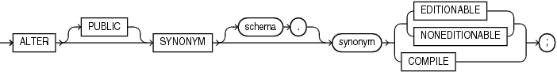

## ALTER SYNONYM

Purpose

Use the `ALTER` `SYNONYM` statement to modify an existing synonym.

Prerequisites

To modify a private synonym in another user's schema, you must have the `CREATE` `ANY` `SYNONYM` and `DROP` `ANY` `SYNONYM` system privileges.

To modify a `PUBLIC` synonym, you must have the `CREATE` `PUBLIC` `SYNONYM` and `DROP` `PUBLIC` `SYNONYM` system privileges.

Syntax

alter\_synonym::=



> ```
> ALTER [ PUBLIC ] SYNONYM [ schema. ] synonym
>   { EDITIONABLE | NONEDITIONABLE | COMPILE } ;
> ```
>
> [  
> Copyright © 1996, 2025, Oracle and/or its affiliates.](https://docs.oracle.com/en/database/oracle/oracle-database/dcommon/html/cpyr.htm)


Semantics

PUBLIC

Specify `PUBLIC` if `synonym` is a public synonym. You cannot use this clause to change a public synonym to a private synonym, or vice versa.

schema

Specify the schema containing the synonym. If you omit `schema`, then Oracle Database assumes the synonym is in your own schema.

synonym

Specify the name of the synonym to be altered.

EDITIONABLE | NONEDITIONABLE

Use these clauses to specify whether the synonym becomes an editioned or noneditioned object if editioning is later enabled for the schema object type `SYNONYM` in `schema`. The default is `EDITIONABLE`. For information about altering editioned and noneditioned objects, see [Oracle Database Development Guide](https://docs.oracle.com/pls/topic/lookup?ctx=en/database/oracle/oracle-database/21/sqlrf&id=ADFNS1287).

Restriction on EDITIONABLE | NONEDITIONABLE

You cannot specify these clauses for a public synonym because editioning is always enabled for the object type `SYNONYM` in the `PUBLIC` schema.

COMPILE

Use this clause to compile `synonym`. A synonym places a dependency on its target object and becomes invalid if the target object is changed or dropped. When you compile an invalid synonym, it becomes valid again.

Note:

You can determine if a synonym is valid or invalid by querying the `STATUS` column of the `ALL_`, `DBA_`, and `USER_OBJECTS` data dictionary views.

Examples

The following examples modify synonyms that were created in the `CREATE` `SYNONYM` " [Examples](CREATE-SYNONYM.md) ".

The following statement compiles synonym `offices`:

```
ALTER SYNONYM offices COMPILE;
```

The following statement compiles public synonym `emp_table`:

```
ALTER PUBLIC SYNONYM emp_table COMPILE;
```

The following statement causes synonym `offices` to remain a noneditioned object if editioning is later enabled for schema object type `SYNONYM` in the schema that contains the synonym `offices`:

```
ALTER SYNONYM offices NONEDITIONABLE;
```