## ALTER SYSTEM

Purpose

Use the `ALTER` `SYSTEM` statement to dynamically alter your Oracle Database instance. The settings stay in effect as long as the database is mounted.

When you use the `ALTER` `SYSTEM` statement in a multitenant container database (CDB), you can specify some clauses to alter the CDB as a whole and other clauses to alter a specific pluggable database (PDB).

See Also:

[Oracle Database Administrator's Guide](https://docs.oracle.com/pls/topic/lookup?ctx=en/database/oracle/oracle-database/21/sqlrf&id=ADMIN13652) for complete information on using the `ALTER` `SYSTEM` statement in a CDB

Prerequisites

To specify the `RELOCATE` `CLIENT` clause, you must be authenticated `AS` `SYSASM`.

To specify all other clauses, you must have the `ALTER` `SYSTEM` system privilege.

If you are connected to a CDB:

- To alter the CDB as a whole, the current container must be the root and you must have the commonly granted `ALTER` `SYSTEM` privilege.
- To alter a PDB, the current container must be the PDB and you must have the `ALTER` `SYSTEM` privilege, either granted commonly or granted locally in the PDB.

Syntax

archive\_log\_clause::=

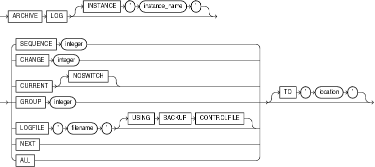

> ```
> ARCHIVE LOG
>    [  INSTANCE 'instance_name' ]
>    { { SEQUENCE integer
>      | CHANGE integer
>      | CURRENT [ NOSWITCH ]
>      | GROUP integer
>      | LOGFILE 'filename'
>           [ USING BACKUP CONTROLFILE ]
>      | NEXT
>      | ALL
>      }
>      [ TO 'location' ]
>    }
> ```
>
> [  
> Copyright © 1996, 2025, Oracle and/or its affiliates.](https://docs.oracle.com/en/database/oracle/oracle-database/dcommon/html/cpyr.htm)


checkpoint\_clause::=

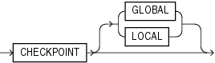

> ```
> CHECKPOINT [ GLOBAL | LOCAL ]
> ```
>
> [  
> Copyright © 1996, 2025, Oracle and/or its affiliates.](https://docs.oracle.com/en/database/oracle/oracle-database/dcommon/html/cpyr.htm)


check\_datafiles\_clause::=

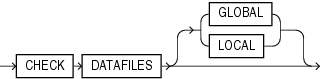

> ```
> CHECK DATAFILES [ GLOBAL | LOCAL ]
> ```
>
> [  
> Copyright © 1996, 2025, Oracle and/or its affiliates.](https://docs.oracle.com/en/database/oracle/oracle-database/dcommon/html/cpyr.htm)


distributed\_recov\_clauses::=

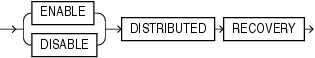

> ```
> { ENABLE | DISABLE } DISTRIBUTED RECOVERY
> ```
>
> [  
> Copyright © 1996, 2025, Oracle and/or its affiliates.](https://docs.oracle.com/en/database/oracle/oracle-database/dcommon/html/cpyr.htm)


end\_session\_clauses::=

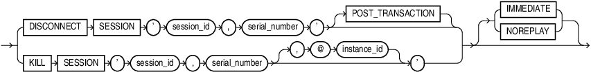

> ```
> { DISCONNECT SESSION 'session_id, serial_number'
>      [ POST_TRANSACTION ]
> | KILL SESSION 'session_id, serial_number [, @ instance_id]'
> }
> [ IMMEDIATE | NOREPLAY ]
> ```
>
> [  
> Copyright © 1996, 2025, Oracle and/or its affiliates.](https://docs.oracle.com/en/database/oracle/oracle-database/dcommon/html/cpyr.htm)


quiesce\_clauses::=

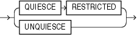

> ```
> QUIESCE RESTRICTED | UNQUIESCE
> ```
>
> [  
> Copyright © 1996, 2025, Oracle and/or its affiliates.](https://docs.oracle.com/en/database/oracle/oracle-database/dcommon/html/cpyr.htm)


rolling\_migration\_clauses::=

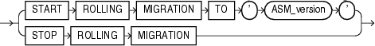

> ```
> { START ROLLING MIGRATION TO 'ASM_version'
> | STOP ROLLING MIGRATION
> }
> ```
>
> [  
> Copyright © 1996, 2025, Oracle and/or its affiliates.](https://docs.oracle.com/en/database/oracle/oracle-database/dcommon/html/cpyr.htm)


rolling\_patch\_clauses::=

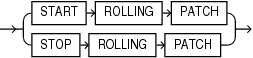

> ```
> { START ROLLING PATCH
> | STOP ROLLING PATCH
> }
> ```
>
> [  
> Copyright © 1996, 2025, Oracle and/or its affiliates.](https://docs.oracle.com/en/database/oracle/oracle-database/dcommon/html/cpyr.htm)


security\_clauses::=

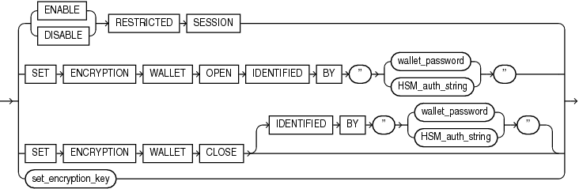

> ```
> { { ENABLE | DISABLE } RESTRICTED SESSION
>   | SET ENCRYPTION WALLET OPEN
>     IDENTIFIED BY { "wallet_password" | "HSM_auth_string" }
>   | SET ENCRYPTION WALLET CLOSE
>     [ IDENTIFIED BY { "wallet_password" | "HSM_auth_string" } ]
>   | set_encryption_key
> }
> ```
>
> [  
> Copyright © 1996, 2025, Oracle and/or its affiliates.](https://docs.oracle.com/en/database/oracle/oracle-database/dcommon/html/cpyr.htm)


affinity\_clauses::=

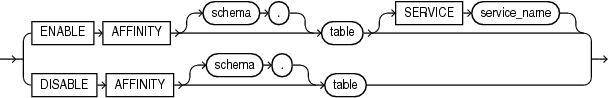

> ```
> { ENABLE AFFINITY [ schema.]table [SERVICE service_name ]
> | 
> DISABLE AFFINITY [ schema.]table   
> }
> ```
>
> [  
> Copyright © 1996, 2025, Oracle and/or its affiliates.](https://docs.oracle.com/en/database/oracle/oracle-database/dcommon/html/cpyr.htm)


set\_encryption\_key::=

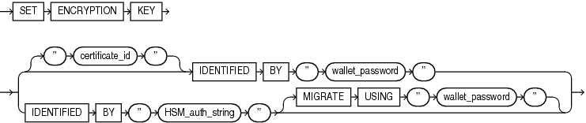

> ```
> { SET ENCRYPTION KEY
>   {
>     [ "certificate_id" ] IDENTIFIED BY "wallet_password"
>     |
>     IDENTIFIED BY "HSM_auth_string" [ MIGRATE USING "wallet_password" ]
>   }
> }
> ```
>
> [  
> Copyright © 1996, 2025, Oracle and/or its affiliates.](https://docs.oracle.com/en/database/oracle/oracle-database/dcommon/html/cpyr.htm)


shutdown\_dispatcher\_clause::=

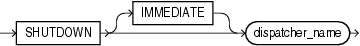

> ```
> SHUTDOWN [ IMMEDIATE ] dispatcher_name
> ```
>
> [  
> Copyright © 1996, 2025, Oracle and/or its affiliates.](https://docs.oracle.com/en/database/oracle/oracle-database/dcommon/html/cpyr.htm)


alter\_system\_set\_clause::=

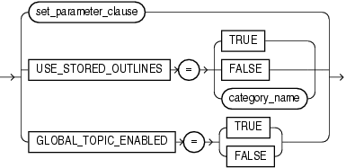

> ```
> { set_parameter_clause
> | USE_STORED_OUTLINES = (TRUE | FALSE | category_name)
> | GLOBAL_TOPIC_ENABLED = (TRUE | FALSE)
> }
> ```
>
> [  
> Copyright © 1996, 2025, Oracle and/or its affiliates.](https://docs.oracle.com/en/database/oracle/oracle-database/dcommon/html/cpyr.htm)


set\_parameter\_clause::=

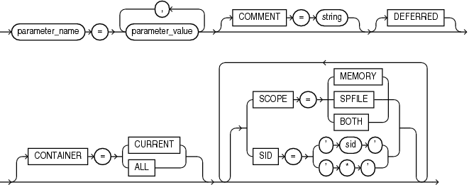

> ```
> parameter_name =
>    parameter_value [, parameter_value ]...
>    [ COMMENT = string ]
>    [ DEFERRED ]
>    [ CONTAINER = { CURRENT | ALL } ]
>    [ { SCOPE = { MEMORY | SPFILE | BOTH }
>      | SID = { 'sid' | '*' }
>      }...
>    ]
> ```
>
> [  
> Copyright © 1996, 2025, Oracle and/or its affiliates.](https://docs.oracle.com/en/database/oracle/oracle-database/dcommon/html/cpyr.htm)


alter\_system\_reset\_clause::=

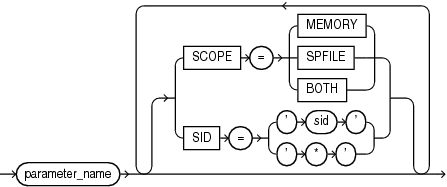

> ```
> parameter_name
>    [ { SCOPE = { MEMORY | SPFILE | BOTH }
>      | SID = { 'sid' | '*' }
>      }...
>    ]
> ```
>
> [  
> Copyright © 1996, 2025, Oracle and/or its affiliates.](https://docs.oracle.com/en/database/oracle/oracle-database/dcommon/html/cpyr.htm)


cancel\_sql\_clause::=

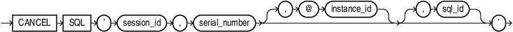

> ```
> CANCEL SQL ' session_id , serial_number [ , @ instance_id ] [ , sql_id ] '
> ```
>
> [  
> Copyright © 1996, 2025, Oracle and/or its affiliates.](https://docs.oracle.com/en/database/oracle/oracle-database/dcommon/html/cpyr.htm)


Semantics

archive\_log\_clause

The `archive_log_clause` manually archives redo log files or enables or disables automatic archiving. To use this clause, your instance must have the database mounted. The database can be either open or closed unless otherwise noted.

INSTANCE Clause

This clause is relevant only if you are using Oracle Real Application Clusters (Oracle RAC). Specify the name of the instance for which you want the redo log file group to be archived. The instance name is a string of up to 80 characters. Oracle Database automatically determines the thread that is mapped to the specified instance and archives the corresponding redo log file group. If no thread is mapped to the specified instance, then Oracle Database returns an error.

SEQUENCE Clause

Specify `SEQUENCE` to manually archive the online redo log file group identified by the log sequence number `integer` in the specified thread. If you omit the `THREAD` parameter, then Oracle Database archives the specified group from the thread assigned to your instance.

CHANGE Clause

Specify `CHANGE` to manually archive the online redo log file group containing the redo log entry with the system change number (SCN) specified by `integer` in the specified thread. If the SCN is in the current redo log file group, then Oracle Database performs a log switch. If you omit the `THREAD` parameter, then Oracle Database archives the groups containing this SCN from all enabled threads.

You can use this clause only when your instance has the database open.

CURRENT Clause

Specify `CURRENT` to manually archive the current redo log file group of the specified thread, forcing a log switch. If you omit the `THREAD` parameter, then Oracle Database archives all redo log file groups from all enabled threads, including logs previous to current logs. You can specify `CURRENT` only when the database is open.

NOSWITCH

Specify `NOSWITCH` if you want to manually archive the current redo log file group without forcing a log switch. This setting is used primarily with standby databases to prevent data divergence when the primary database shuts down. Divergence implies the possibility of data loss in case of primary database failure.

You can use the `NOSWITCH` clause only when your instance has the database mounted but not open. If the database is open, then this operation closes the database automatically. You must then manually shut down the database before you can reopen it.

GROUP Clause

Specify `GROUP` to manually archive the online redo log file group with the `GROUP` value specified by `integer`. You can determine the `GROUP` value for a redo log file group by querying the dynamic performance view `V$LOG`. If you specify both the `THREAD` and `GROUP` parameters, then the specified redo log file group must be in the specified thread.

LOGFILE Clause

Specify `LOGFILE` to manually archive the online redo log file group containing the redo log file member identified by ' `filename` '. If you specify both the `THREAD` and `LOGFILE` parameters, then the specified redo log file group must be in the specified thread.

If the database was mounted with a backup control file, then specify `USING` `BACKUP` `CONTROLFILE` to permit archiving of all online logfiles, including the current logfile.

Restriction on the LOGFILE clause

You must archive redo log file groups in the order in which they are filled. If you specify a redo log file group for archiving with the `LOGFILE` parameter, and earlier redo log file groups are not yet archived, then Oracle Database returns an error.

NEXT Clause

Specify `NEXT` to manually archive the next online redo log file group from the specified thread that is full but has not yet been archived. If you omit the `THREAD` parameter, then Oracle Database archives the earliest unarchived redo log file group from any enabled thread.

ALL Clause

Specify `ALL` to manually archive all online redo log file groups from the specified thread that are full but have not been archived. If you omit the `THREAD` parameter, then Oracle Database archives all full unarchived redo log file groups from all enabled threads.

TO location Clause

Specify `TO` ' `location` ' to indicate the primary location to which the redo log file groups are archived. The value of this parameter must be a fully specified file location following the conventions of your operating system. If you omit this parameter, then Oracle Database archives the redo log file group to the location specified by the initialization parameters `LOG_ARCHIVE_DEST` or `LOG_ARCHIVE_DEST_` `n`.

checkpoint\_clause

Specify `CHECKPOINT` to explicitly force Oracle Database to perform a checkpoint, ensuring that all changes made by committed transactions are written to data files on disk. You can specify this clause only when your instance has the database open. Oracle Database does not return control to you until the checkpoint is complete.

GLOBAL

In an Oracle Real Application Clusters (Oracle RAC) environment, this setting causes Oracle Database to perform a checkpoint for all instances that have opened the database. This is the default.

LOCAL

In an Oracle RAC environment, this setting causes Oracle Database to perform a checkpoint only for the thread of redo log file groups for the instance from which you issue the statement.

See Also:

" Forcing a Checkpoint: Example "

check\_datafiles\_clause

In a distributed database system, such as an Oracle RAC environment, this clause updates an instance's SGA from the database control file to reflect information on all online data files.

- Specify `GLOBAL` to perform this synchronization for all instances that have opened the database. This is the default.
- Specify `LOCAL` to perform this synchronization only for the local instance.

Your instance should have the database open.

distributed\_recov\_clauses

The `DISTRIBUTED` `RECOVERY` clause lets you enable or disable distributed recovery. To use this clause, your instance must have the database open.

ENABLE

Specify `ENABLE` to enable distributed recovery. In a single-process environment, you must use this clause to initiate distributed recovery.

You may need to issue the `ENABLE` `DISTRIBUTED` `RECOVERY` statement more than once to recover an in-doubt transaction if the remote node involved in the transaction is not accessible. In-doubt transactions appear in the data dictionary view `DBA_2PC_PENDING`.

See Also:

" Enabling Distributed Recovery: Example "

DISABLE

Specify `DISABLE` to disable distributed recovery.

FLUSH SHARED\_POOL Clause

The `FLUSH` `SHARED_POOL` clause lets you clear data from the shared pool in the system global area (SGA). The shared pool stores:

- Cached data dictionary information and
- Shared SQL and PL/SQL areas for SQL statements, stored procedures, functions, packages, and triggers.

This statement does not clear global application context information, nor does it clear shared SQL and PL/SQL areas for items that are currently being executed. You can use this clause regardless of whether your instance has the database dismounted or mounted, open or closed.

See Also:

" Clearing the Shared Pool: Example "

FLUSH GLOBAL CONTEXT Clause

The `FLUSH` `GLOBAL` `CONTEXT` clause lets you flush all global application context information from the shared pool in the system global area (SGA). You can use this clause regardless of whether your instance has the database dismounted or mounted, open or closed.

FLUSH BUFFER\_CACHE Clause

The `FLUSH` `BUFFER_CACHE` clause lets you clear all data from the buffer cache in the system global area (SGA), including the `KEEP`, `RECYCLE`, and `DEFAULT` buffer pools.

Note:

This clause is intended for use only on a test database. Do not use this clause on a production database, because as a result of this statement, subsequent queries will have no hits, only misses.

This clause is useful if you need to measure the performance of rewritten queries or a suite of queries from identical starting points.

FLUSH FLASH\_CACHE Clause

Use the `FLUSH` `FLASH_CACHE` clause to flush the Database Smart Flash Cache. This clause can be useful if you need to measure the performance of rewritten queries or a suite of queries from identical starting points, or if there might be corruption in the cache.

FLUSH REDO Clause

Use the `FLUSH` `REDO` clause to flush redo data from a primary database to a standby database and to optionally wait for the flushed redo data to be applied to a physical or logical standby database.

This clause can allow a failover to be performed on the target standby database without data loss, even if the primary database is not in a zero data loss data protection mode, provided that all redo data that has been generated by the primary database can be flushed to the standby database.

The `FLUSH` `REDO` clause must be issued on a mounted, but not open, primary database.

target\_db\_name

For `target_db_name`, specify the `DB_UNIQUE_NAME` of the standby database that is to receive the redo data flushed from the primary database.

The value of the `LOG_ARCHIVE_DEST_` `n` database initialization parameter that corresponds to the target standby database must contain the `DB_UNIQUE_NAME` attribute, and the value of that attribute must match the `DB_UNIQUE_NAME` of the target standby database.

NO CONFIRM APPLY

If you specify this clause, then the `ALTER` `SYSTEM` statement will not complete until the standby database has received all of the flushed redo data. You must specify this clause if the target standby database is a snapshot standby database.

CONFIRM APPLY

If you specify this clause, then the `ALTER` `SYSTEM` statement will not complete until the target standby database has received and applied all flushed redo data. This is the default behavior unless you specify `NO` `CONFIRM` `APPLY`. You cannot specify this clause if the target standby database is a snapshot standby database.

See Also:

[Oracle Data Guard Concepts and Administration](https://docs.oracle.com/pls/topic/lookup?ctx=en/database/oracle/oracle-database/21/sqlrf&id=SBYDB01222) for more information about the `FLUSH` `REDO` clause and failovers

end\_session\_clauses

The `end_session_clauses` give you several ways to end the current session.

DISCONNECT SESSION Clause

Use the `DISCONNECT` `SESSION` clause to disconnect the current session by destroying the dedicated server process (or virtual circuit if the connection was made by way of a Shared Server). To use this clause, your instance must have the database open. You must identify the session with both of the following values from the `V$SESSION` view:

- For `session_id`, specify the value of the `SID` column.
- For `serial_number`, specify the value of the `SERIAL#` column.

If system parameters are appropriately configured, then application failover will take effect.

- The `POST_TRANSACTION` setting allows ongoing transactions to complete before the session is disconnected. If the session has no ongoing transactions, then this clause has the same effect described for as `KILL` `SESSION`.
- The `IMMEDIATE` setting disconnects the session and recovers the entire session state immediately, without waiting for ongoing transactions to complete.
	- If you also specify `POST_TRANSACTION` and the session has ongoing transactions, then the `IMMEDIATE` keyword is ignored.
		- If you do not specify `POST_TRANSACTION`, or you specify `POST_TRANSACTION` but the session has no ongoing transactions, then this clause has the same effect as described for `KILL` `SESSION` `IMMEDIATE`.
		See Also:
		" Disconnecting a Session: Example "

KILL SESSION Clause

The `KILL` `SESSION` clause lets you mark a session as terminated, roll back ongoing transactions, release all session locks, and partially recover session resources. To use this clause, your instance must have the database open. Your session and the session to be terminated must be on the same instance unless you specify `integer3`.You must identify the session with the following values from the `V$SESSION` view:

- For `session_id`, specify the value of the `SID` column.
- For `serial_number`, specify the value of the `SERIAL#` column.
- For the optional `instance_id`, specify the ID of the instance where the target session to be killed exists. You can find the instance ID by querying the GV$ tables.

If the session is performing some activity that must be completed, such as waiting for a reply from a remote database or rolling back a transaction, then Oracle Database waits for this activity to complete, marks the session as terminated, and then returns control to you. If the waiting lasts a minute, then Oracle Database marks the session to be terminated and returns control to you with a message that the session is marked to be terminated. The `PMON` background process then marks the session as terminated when the activity is complete.

Whether or not the session has an ongoing transaction, Oracle Database does not recover the entire session state until the session user issues a request to the session and receives a message that the session has been terminated.

See Also:

" Terminating a Session: Example "

IMMEDIATE

Specify `IMMEDIATE` to instruct Oracle Database to roll back ongoing transactions, release all session locks, recover the entire session state, and return control to you immediately.

NOREPLAY

This clause is valid if you are using Application Continuity. When connected to a service with Application Continuity enabled (that is, `FAILOVER_TYPE` `=` `TRANSACTION`), the session is recovered after the session fails or is killed. If you do not want to recover a session after it is terminated, then specify `NOREPLAY`.

SWITCH LOGFILE Clause

The `SWITCH` `LOGFILE` clause lets you explicitly force Oracle Database to begin writing to a new redo log file group, regardless of whether the files in the current redo log file group are full. When you force a log switch, Oracle Database begins to perform a checkpoint but returns control to you immediately rather than when the checkpoint is complete. To use this clause, your instance must have the database open.

SUSPEND | RESUME

The `SUSPEND` clause lets you suspend all I/O (data file, control file, and file header) as well as queries, in all instances, enabling you to make copies of the database without having to handle ongoing transactions.

Restrictions on SUSPEND and RESUME

`SUSPEND` and `RESUME` are subject to the following restrictions:

- Do not use this clause unless you have put the database tablespaces in hot backup mode.
- Do not terminate the session that issued the `ALTER` `SYSTEM` `SUSPEND` statement. An attempt to reconnect while the system is suspended may fail because of recursive SQL that is running during the `SYS` login.
- If you start a new instance while the system is suspended, then that new instance will not be suspended.

The `RESUME` clause lets you make the database available once again for queries and I/O.

quiesce\_clauses

Use the `QUIESCE` `RESTRICTED` and `UNQUIESCE` clauses to put the database in and take it out of the quiesced state. This state enables database administrators to perform administrative operations that cannot be safely performed in the presence of concurrent transactions, queries, or PL/SQL operations.

Note:

The `QUIESCE` `RESTRICTED` clause is valid only if the Database Resource Manager is installed and only if the Resource Manager has been on continuously since database startup in any instances that have opened the database.

If multiple `QUIESCE` `RESTRICTED` or `UNQUIESCE` statements issue at the same time from different sessions or instances, then all but one will receive an error.

QUIESCE RESTRICTED

Specify `QUIESCE` `RESTRICTED` to put the database in the quiesced state. For all instances with the database open, this clause has the following effect:

- Oracle Database instructs the Database Resource Manager in all instances to prevent all inactive sessions (other than `SYS` and `SYSTEM`) from becoming active. No user other than `SYS` and `SYSTEM` can start a new transaction, a new query, a new fetch, or a new PL/SQL operation.
- Oracle Database waits for all existing transactions in all instances that were initiated by a user other than `SYS` or `SYSTEM` to finish (either commit or abort). Oracle Database also waits for all running queries, fetches, and PL/SQL procedures in all instances that were initiated by users other than `SYS` or `SYSTEM` and that are not inside transactions to finish. If a query is carried out by multiple successive OCI fetches, then Oracle Database does not wait for all fetches to finish. It waits for the current fetch to finish and then blocks the next fetch. Oracle Database also waits for all sessions (other than those of `SYS` or `SYSTEM`) that hold any shared resources (such as enqueues) to release those resources. After all these operations finish, Oracle Database places the database into quiesced state and finishes executing the `QUIESCE` `RESTRICTED` statement.
- If an instance is running in shared server mode, then Oracle Database instructs the Database Resource Manager to block logins (other than `SYS` or `SYSTEM`) on that instance. If an instance is running in non-shared-server mode, then Oracle Database does not impose any restrictions on user logins in that instance.

During the quiesced state, you cannot change the Resource Manager plan in any instance.

UNQUIESCE

Specify `UNQUIESCE` to take the database out of quiesced state. Doing so permits transactions, queries, fetches, and PL/SQL procedures that were initiated by users other than `SYS` or `SYSTEM` to be undertaken once again. The `UNQUIESCE` statement does not have to originate in the same session that issued the `QUIESCE` `RESTRICTED` statement.

rolling\_migration\_clauses

Use these clauses in a clustered Oracle Automatic Storage Management (Oracle ASM) environment to migrate one node at a time to a different Oracle ASM version without affecting the overall availability of the Oracle ASM cluster or the database clusters using Oracle ASM for storage.

START ROLLING MIGRATION

When starting rolling upgrade, for `ASM_version`, you must specify the following string:

```
'<version_num>, <release_num>, <update_num>,<port_release_num>,<port_update_num>'
```

`ASM_version` must be equal to or greater than 11.1.0.0.0. The surrounding single quotation marks are required. Oracle ASM first verifies that the current release is compatible for migration to the specified release, and then goes into limited functionality mode. Oracle ASM then determines whether any rebalance operations are under way anywhere in the cluster. If there are any such operations, then the statement fails and must be reissued after the rebalance operations are complete.

Rolling upgrade mode is a cluster-wide In-Memory persistent state. The cluster continues to be in this state until there is at least one Oracle ASM instance running in the cluster. Any new instance joining the cluster switches to migration mode immediately upon startup. If all the instances in the cluster terminate, then subsequent startup of any Oracle ASM instance will not be in rolling upgrade mode until you reissue this statement to restart rolling upgrade of the Oracle ASM instances.

STOP ROLLING MIGRATION

Use this clause to stop rolling upgrade and bring the cluster back into normal operation. Specify this clause only after all instances in the cluster have migrated to the same software version. The statement will fail if the cluster is not in rolling upgrade mode.

When you specify this clause, the Oracle ASM instance validates that all the members of the cluster are at the same software version, takes the instance out of rolling upgrade mode, and returns to full functionality of the Oracle ASM cluster. If any rebalance operations are pending because disks have gone offline, then those operations are restarted if the `ASM_POWER_LIMIT` parameter would not be violated by such a restart.

See Also:

[Oracle Automatic Storage Management Administrator's Guide](https://docs.oracle.com/pls/topic/lookup?ctx=en/database/oracle/oracle-database/21/sqlrf&id=OSTMG02400) for more information about rolling upgrade

rolling\_patch\_clauses

Use these clauses in a clustered Oracle Automatic Storage Management (Oracle ASM) environment to update one node at a time to the latest patch level without affecting the overall availability of the Oracle ASM cluster or the database clusters using Oracle ASM for storage.

START ROLLING PATCH

Use this clause to start the rolling patch operation. Oracle ASM first verifies that all live nodes in the cluster are at the same version, and then goes into rolling patch mode, which is a cluster-wide In-Memory persistent state. The cluster continues to be in this state until all live nodes have been patched to the latest patch level.

Any nodes that are down during this operation are not patched. This does not affect the success of the rolling patch operation. However, you must patch these nodes before they are started. Otherwise, they will not be allowed to join the cluster.

STOP ROLLING PATCH

use this clause to stop the rolling patch operation and bring the cluster back into normal operation. Specify this clause only after all live nodes in the cluster have been patched to the latest patch level. The statement will fail if the cluster is not in rolling patch mode.

When you specify this clause, the Oracle ASM instance validates that all members of the cluster are at the same patch level, takes the instance out of rolling patch mode, and returns full functionality of the Oracle ASM cluster. If any members of the cluster are not at the latest patch level, then this operation fails and the cluster goes into limited functionality mode.

The following queries display information about rolling patches. In order to run these queries, you must be connected to the Oracle ASM instance in the Grid home, and the Grid Infrastructure home must be configured with the Oracle Clusterware option for an Oracle RAC environment.

- You can determine whether a cluster is in rolling patch mode with the following query:
	```
	SELECT SYS_CONTEXT('SYS_CLUSTER_PROPERTIES', 'CLUSTER_STATE') FROM DUAL;
	```
- You can determine the patch level of a cluster with the following query:
	```
	SELECT SYS_CONTEXT('SYS_CLUSTER_PROPERTIES', 'CURRENT_PATCHLVL') FROM DUAL;
	```
- You can display a list of patches applied on the Oracle ASM instance, by querying the `V$PATCHES` dynamic performance view. Refer to [Oracle Database Reference](https://docs.oracle.com/pls/topic/lookup?ctx=en/database/oracle/oracle-database/21/sqlrf&id=REFRN30668) for more information.

See Also:

[Oracle Automatic Storage Management Administrator's Guide](https://docs.oracle.com/pls/topic/lookup?ctx=en/database/oracle/oracle-database/21/sqlrf&id=OSTMG95330) for more information about rolling patches

security\_clauses

The `security_clauses` let you control access to the instance. They also allow you to enable or disable access to the encrypted data in the instance.

RESTRICTED SESSION

The `RESTRICTED` `SESSION` clause lets you restrict logon to Oracle Database. You can use this clause regardless of whether your instance has the database dismounted or mounted, open or closed.

- Specify `ENABLE` to allow only users with `RESTRICTED` `SESSION` system privilege to log on to Oracle Database. Existing sessions are not terminated.
	This clause applies only to the current instance. Therefore, in an Oracle RAC environment, authorized users without the `RESTRICTED` `SESSION` system privilege can still access the database by way of other instances.
- Specify `DISABLE` to reverse the effect of the `ENABLE` `RESTRICTED` `SESSION` clause, allowing all users with `CREATE` `SESSION` system privilege to log on to Oracle Database. This is the default.

See Also:

" Restricting Sessions: Example "

affinity\_clauses

Use the affinity clauses to enable data-dependent routing to provide cache affinity on a `RAC` database. The affinity logically partitions data across `RAC` instances so that a distinct subset of data is assigned to each instance. When data is accessed with a sharding key, the request will be routed to the instance that holds the corresponding subset of data. The benefits of affinity are:
- Sharded access for shard-aware applications and transparency for non-sharded applications
- Better cache utilization and reduced block pings

shutdown\_dispatcher\_clause

The `SHUTDOWN` clause is relevant only if your system is using the shared server architecture of Oracle Database. It shuts down a dispatcher identified by `dispatcher_name`.

Note:

Do not confuse this clause with the SQL\*Plus command `SHUTDOWN`, which is used to shut down the entire database.

The `dispatcher_name` must be a string of the form ' `D` `xxx` ', where `xxx` indicates the number of the dispatcher. For a listing of dispatcher names, query the `NAME` column of the `V$DISPATCHER` dynamic performance view.

- If you specify `IMMEDIATE`, then the dispatcher stops accepting new connections immediately and Oracle Database terminates all existing connections through that dispatcher. After all sessions are cleaned up, the dispatcher process shuts down.
- If you do not specify `IMMEDIATE`, then the dispatcher stops accepting new connections immediately but waits for all its users to disconnect and for all its database links to terminate. Then it shuts down.

REGISTER Clause

Specify `REGISTER` to instruct the `PMON` background process to register the instance with the listeners immediately. If you do not specify this clause, then registration of the instance does not occur until the next time `PMON` executes the discovery routine. As a result, clients may not be able to access the services for as long as 60 seconds after the listener is started.

See Also:

[Oracle Database Concepts](https://docs.oracle.com/pls/topic/lookup?ctx=en/database/oracle/oracle-database/21/sqlrf&id=CNCPT1254) and [Oracle Database Net Services Administrator's Guide](https://docs.oracle.com/pls/topic/lookup?ctx=en/database/oracle/oracle-database/21/sqlrf&id=NETAG1080) for information on the `PMON` background process and listeners

alter\_system\_set\_clause

This clause allows you to change parameter values. The `set_parameter_clause` allows you to change the value of a specified initialization parameter. The `USE_STORED_OUTLINES` and `GLOBAL_TOPIC_ENABLED` clauses allow you to change the value of those system parameters.

set\_parameter\_clause

You can change the value of many initialization parameters for the current instance, whether you have started the database with a traditional plain-text parameter file (pfile) or with a server parameter file (spfile). [Oracle Database Reference](https://docs.oracle.com/pls/topic/lookup?ctx=en/database/oracle/oracle-database/21/sqlrf&id=REFRN001) indicates these parameters in the "Modifiable" category of each parameter description. If you are using a pfile, then the change will persist only for the duration of the instance. However, if you have started the database with an spfile, then you can change the value of the parameter in the spfile itself, so that the new value will occur in subsequent instances.

Oracle Database Reference documents all initialization parameters in full. The parameters fall into three categories:

- [Basic parameters:](https://docs.oracle.com/pls/topic/lookup?ctx=en/database/oracle/oracle-database/21/sqlrf&id=REFRN00101) Database administrators should be familiar with and consider the setting for all of the basic parameters.
- [Functional categories:](https://docs.oracle.com/pls/topic/lookup?ctx=en/database/oracle/oracle-database/21/sqlrf&id=REFRN00102) Oracle Database Reference also lists the initialization parameters by their functional category.
- Alphabetical listing: The Table of Contents of [Oracle Database Reference](https://docs.oracle.com/pls/topic/lookup?ctx=en/database/oracle/oracle-database/21/sqlrf&id=REFRN) contains all initialization parameters in alphabetical order.

The ability to change initialization parameter values depends on whether you have started up the database with a traditional plain-text initialization parameter file (pfile) or with a server parameter file (spfile). To determine whether you can change the value of a particular parameter, query the `ISSYS_MODIFIABLE` column of the `V$PARAMETER` dynamic performance view.

If you want to enforce case on parameter values that are string literals, you must enclose them within single quotes.

You can enforce the minimum password length for database user accounts across the entire CDB or individual PDBs by setting the `MANDATORY_USER_PROFILE` parameter in the `init.ora` file.

Example

This statement sets the `MANDATORY_USER_PROFILE` parameter to the mandatory profile `c##cdb_profile` for all the PDBs in the CDB:

```
ALTER SYSTEM SET MANDATORY_USER_PROFILE=c##cdb_profile;
```

Only a common user who has been commonly granted the `ALTER SYSTEM` privilege or has the `SYSDBA` administrative privilege can modify the `MANDTORY_USER_PROFILE` in the ` init.ora` file.

See Also:

- [CREATE PROFILE](CREATE-PROFILE.md)
- [Managing Security for Oracle Databases](https://docs.oracle.com/pls/topic/lookup?ctx=en/database/oracle/oracle-database/21/sqlrf&id=DBSEG-GUID-8EF7F4E6-04DD-42B8-A2C9-649923F26587)

When setting a parameter value, you can specify additional settings as follows: