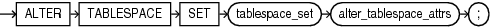
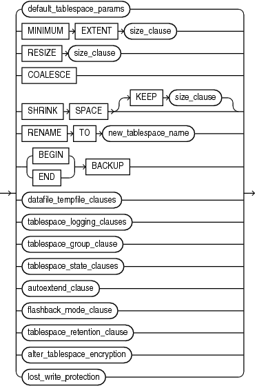

## ALTER TABLESPACE SET

Note:

This SQL statement is valid only if you are using Oracle Sharding. For more information on Oracle Sharding, refer to [Oracle Database Administrator’s Guide](https://docs.oracle.com/pls/topic/lookup?ctx=en/database/oracle/oracle-database/21/sqlrf&id=ADMIN-GUID-DE8AF949-9F68-4C0C-9B5A-45401EF3C3D1).

Purpose

Use the `ALTER` `TABLESPACE` `SET` statement to change an attribute of an existing tablespace set. The attribute change is applied to all tablespaces in the tablespace set.

See Also:

[CREATE TABLESPACE SET](CREATE-TABLESPACE-SET.md) and [DROP TABLESPACE SET](DROP-TABLESPACE-SET.md)

Prerequisites

You must be connected to a shard catalog database as an SDB user.

If you have the `ALTER` `TABLESPACE` system privilege, then you can perform any `ALTER` `TABLESPACE` `SET` operation. If you have the `MANAGE` `TABLESPACE` system privilege, then you can only perform the following operations:

- Take all tablespaces in a tablespace set online or offline
- Begin or end a backup
- Make all tablespaces in a tablespace set read only or read write
- Set the default logging mode of all tablespaces in a tablespace set to `LOGGING` or `NOLOGGING`
- Put all tablespaces in a tablespace set in force logging mode or take them out of force logging mode
- Resize all data files for a tablespace set
- Enable or disable autoextension of all data files for a tablespace set

Before you can make a tablespace set read only, the following conditions must be met:

- The tablespaces in the tablespace set must be online.
- The tablespace set must not contain any active rollback segments. Additionally, because the rollback segments of a read-only tablespace set are not accessible, Oracle recommends that you drop the rollback segments before you make a tablespace set read only.
- The tablespace set must not be involved in an open backup, because the end of a backup updates the header file of all data files in the tablespace set.

Syntax

alter\_tablespace\_set::=



> ```
> ALTER TABLESPACE SET tablespace_set alter_tablespace_attrs ;
> ```
>
> [  
> Copyright © 1996, 2025, Oracle and/or its affiliates.](https://docs.oracle.com/en/database/oracle/oracle-database/dcommon/html/cpyr.htm)


alter\_tablespace\_attrs::=



> ```
> { default_tablespace_params
> | MINIMUM EXTENT size_clause
> | RESIZE size_clause
> | COALESCE
> | SHRINK SPACE [ KEEP size_clause ]
> | RENAME TO new_tablespace_name
> | { BEGIN | END } BACKUP
> | datafile_tempfile_clauses
> | tablespace_logging_clauses
> | tablespace_group_clause
> | tablespace_state_clauses
> | autoextend_clause
> | flashback_mode_clause
> | tablespace_retention_clause
> | alter_tablespace_encryption
> }
> ```
>
> [  
> Copyright © 1996, 2025, Oracle and/or its affiliates.](https://docs.oracle.com/en/database/oracle/oracle-database/dcommon/html/cpyr.htm)


(See the following clauses of `ALTER` `TABLESPACE`: [default\_tablespace\_params::=](ALTER-TABLESPACE.md), [size\_clause::=](size_clause.md), [datafile\_tempfile\_clauses::=](ALTER-TABLESPACE.md), [tablespace\_logging\_clauses::=](ALTER-TABLESPACE.md), [tablespace\_state\_clauses::=](ALTER-TABLESPACE.md), [autoextend\_clause::=](ALTER-TABLESPACE.md), [alter\_tablespace\_encryption::=](ALTER-TABLESPACE.md))

Semantics

tablespace\_set

Specify the name of the tablespace set to be altered.

alter\_tablespace\_attrs

Use this clause to change an attribute for all tablespaces in the tablespace set.

The subclauses of `alter_tablespace_attrs` have the same semantics here as for the `ALTER` `TABLESPACE` statement, with the following exceptions:

- You cannot specify the following subclauses for tablespace sets:
	- `MINIMUM` `EXTENT` `size_clause`
		- `SHRINK` `SPACE` `[ KEEP` `size_clause` `]`
		- `tablespace_group_clause`
		- `flashback_mode_clause`
		- `tablespace_retention_clause`
- For the `datafile_tempfile_clauses`, only the following subclauses are supported for tablespace sets:
	- `RENAME` `DATAFILE`
		- `DATAFILE` `{` `ONLINE` `|` `OFFLINE` `}`
- For the `tablespace_state_clauses`, the `PERMANENT` and `TEMPORARY` subclauses are not supported for tablespace sets.

See Also:

[alter\_tablespace\_attrs](ALTER-TABLESPACE.md) in the documentation on `ALTER` `TABLESPACE` for the full semantics of this clause

Examples

Altering a Tablespace Set: Example

The following statement puts all tablespaces in tablespace set `ts1` in force logging mode:

```
ALTER TABLESPACE SET ts1
  FORCE LOGGING;
```