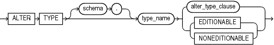

## ALTER TYPE

Purpose

Object types are defined using PL/SQL. Therefore, this section provides some general information but refers to [Oracle Database PL/SQL Language Reference](https://docs.oracle.com/pls/topic/lookup?ctx=en/database/oracle/oracle-database/21/sqlrf&id=LNPLS99995) for details of syntax and semantics.

Use the `ALTER` `TYPE` statement to add or drop member attributes or methods. You can change the existing properties (`FINAL` or `INSTANTIABLE`) of an object type, and you can modify the scalar attributes of the type.

You can also use this statement to recompile the specification or body of the type or to change the specification of an object type by adding new object member subprogram specifications.

Prerequisites

The object type must be in your own schema and you must have `CREATE` `TYPE` or `CREATE` `ANY` `TYPE` system privilege, or you must have `ALTER` `ANY` `TYPE` system privileges.

Syntax

alter\_type::=



> ```
> ALTER TYPE [ schema. ] type_name
> { alter_type_clause | { EDITIONABLE | NONEDITIONABLE } }
> ```
>
> [  
> Copyright © 1996, 2025, Oracle and/or its affiliates.](https://docs.oracle.com/en/database/oracle/oracle-database/dcommon/html/cpyr.htm)


(`alter_type_clause`: See [Oracle Database PL/SQL Language Reference](https://docs.oracle.com/pls/topic/lookup?ctx=en/database/oracle/oracle-database/21/sqlrf&id=LNPLS2186) for the syntax of this clause.)

Semantics

schema

Specify the schema that contains the type. If you omit `schema`, then Oracle Database assumes the type is in your current schema.

type\_name

Specify the name of an object type, a nested table type, or a varray type.

Restriction on type\_name

You cannot evolve an editioned object type. The `ALTER` `TYPE` statement fails with ORA-22348 if either of the following is true:

- The type is an editioned object type and the `ALTER` `TYPE` statement has no `type_compile_clause`. You can use the `ALTER` `TYPE` statement to recompile an editioned object type, but not for any other purpose.
- The type has a dependent that is an editioned object type and the `ALTER` `TYPE` statement has a `CASCADE` clause.

Refer to [Oracle Database PL/SQL Language Reference](https://docs.oracle.com/pls/topic/lookup?ctx=en/database/oracle/oracle-database/21/sqlrf&id=LNPLS1904) for more information on the `type_compile_clause` and the `CASCADE` clause.

alter\_type\_clause

See [Oracle Database PL/SQL Language Reference](https://docs.oracle.com/pls/topic/lookup?ctx=en/database/oracle/oracle-database/21/sqlrf&id=LNPLS2186) for the syntax and semantics of this clause and for complete information on creating and compiling object types.

EDITIONABLE | NONEDITIONABLE

Use these clauses to specify whether the type becomes an editioned or noneditioned object if editioning is later enabled for the schema object type `TYPE` in `schema`. The default is `EDITIONABLE`. For information about altering editioned and noneditioned objects, see [Oracle Database Development Guide](https://docs.oracle.com/pls/topic/lookup?ctx=en/database/oracle/oracle-database/21/sqlrf&id=ADFNS1287).