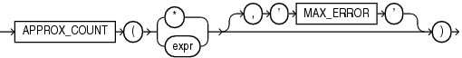

## APPROX\_COUNT

Syntax



> ```
> APPROX_COUNT ( ( * | expr ) [ , 'MAX_ERROR' ] )
> ```
>
> [  
> Copyright © 1996, 2025, Oracle and/or its affiliates.](https://docs.oracle.com/en/database/oracle/oracle-database/dcommon/html/cpyr.htm)


Purpose

`APPROX_COUNT` returns the approximate count of an expression. If you supply `MAX_ERROR` as the second argument, then the function returns the maximum error between the actual and approximate count.

You must use this function with a corresponding `APPROX_RANK` function in the `HAVING` clause. If a query uses `APPROX_COUNT`, `APPROX_SUM`, or `APPROX_RANK`, then the query must not use any other aggregation functions.

Examples

The following query returns the 10 most common jobs within every department:

```
SELECT department_id, job_id, 
       APPROX_COUNT(*) 
FROM   employees
GROUP BY department_id, job_id
HAVING 
  APPROX_RANK ( 
  PARTITION BY department_id 
  ORDER BY APPROX_COUNT(*) 
  DESC ) <= 10;
```