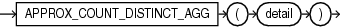

## APPROX\_COUNT\_DISTINCT\_AGG

Syntax



> ```
> APPROX_COUNT_DISTINCT_AGG( detail )
> ```
>
> [  
> Copyright © 1996, 2025, Oracle and/or its affiliates.](https://docs.oracle.com/en/database/oracle/oracle-database/dcommon/html/cpyr.htm)


Purpose

`APPROX_COUNT_DISTINCT_AGG` takes as its input a column of details containing information about approximate distinct value counts, and enables you to perform aggregations of those counts.

For `detail`, specify a column of details created by the `APPROX_COUNT_DISTINCT_DETAIL` function or the `APPROX_COUNT_DISTINCT_AGG` function. This column is of data type `BLOB`.

You can specify this function in a `SELECT` statement with a `GROUP` `BY` clause to aggregate the information contained in the details within each group of rows and return a single detail for each group.

This function returns a `BLOB` value, called a detail, which contains information about the count aggregations in a special format. You can store details returned by this function in a table or materialized view, and then again use the `APPROX_COUNT_DISTINCT_AGG` function to further aggregate those details, or use the `TO_APPROX_COUNT_DISTINCT` function to convert the detail values to human-readable `NUMBER` values.

See Also:

- [APPROX\_COUNT\_DISTINCT\_DETAIL](APPROX_COUNT_DISTINCT_DETAIL.md)
- [TO\_APPROX\_COUNT\_DISTINCT](TO_APPROX_COUNT_DISTINCT.md)

Examples

Refer to [APPROX\_COUNT\_DISTINCT\_AGG: Examples](APPROX_COUNT_DISTINCT_DETAIL.md) for examples of using the `APPROX_COUNT_DISTINCT_AGG` function in conjunction with the `APPROX_COUNT_DISTINCT_DETAIL` and `TO_APPROX_COUNT_DISTINCT` functions.