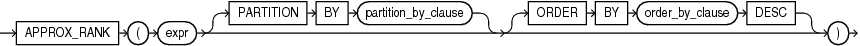

## APPROX\_RANK

Syntax



> ```
> APPROX_RANK ( expr [ PARTITION BY partition_by_clause ] [ ORDER BY order_by_clause DESC] )
> ```
>
> [  
> Copyright © 1996, 2025, Oracle and/or its affiliates.](https://docs.oracle.com/en/database/oracle/oracle-database/dcommon/html/cpyr.htm)


Purpose

`APPROX_RANK` returns the approximate value in a group of values.

This function takes an optional `PARTITION BY` clause followed by a mandatory `ORDER BY ... DESC ` clause. The `PARTITION BY` key must be a subset of the `GROUP BY` key. The `ORDER BY` clause must include either `APPROX_COUNT` or `APPROX_SUM`.

Examples

The query returns the jobs that are among the top 10 total salary per department. For each job, the total salary and ranking is also given.

```
SELECT job_id, 
            APPROX_SUM(sal), 
      APPROX_RANK(PARTITION BY department_id ORDER BY APPROX_SUM(salary) DESC) 
FROM employees
GROUP BY department_id, job_id
HAVING 
   APPROX_RANK(
   PARTITION BY department_id 
   ORDER BY APPROX_SUM (salary) 
   DESC) <= 10;
```