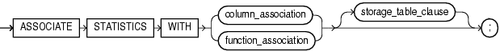
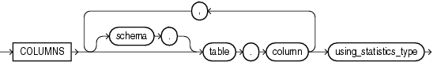
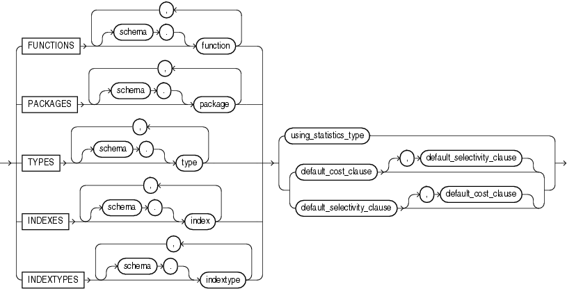
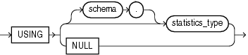
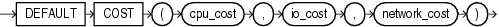
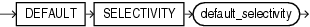
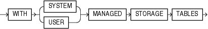

## ASSOCIATE STATISTICS

Purpose

Use the `ASSOCIATE` `STATISTICS` statement to associate a statistics type (or default statistics) containing functions relevant to statistics collection, selectivity, or cost with one or more columns, standalone functions, packages, types, domain indexes, or indextypes.

For a listing of all current statistics type associations, query the `USER_ASSOCIATIONS` data dictionary view. If you analyze the object with which you are associating statistics, then you can also query the associations in the `USER_USTATS` view.

See Also:

[ANALYZE](ANALYZE.md) for information on the order of precedence with which `ANALYZE` uses associations

Prerequisites

To issue this statement, you must have the appropriate privileges to alter the base object (table, function, package, type, domain index, or indextype). In addition, unless you are associating only default statistics, you must have execute privilege on the statistics type. The statistics type must already have been defined.

See Also:

[CREATE TYPE](CREATE-TYPE.md) for information on defining types

Syntax

associate\_statistics::=



> ```
> ASSOCIATE STATISTICS WITH
>   { column_association | function_association }
>   [ storage_table_clause ] ;
> ```
>
> [  
> Copyright © 1996, 2025, Oracle and/or its affiliates.](https://docs.oracle.com/en/database/oracle/oracle-database/dcommon/html/cpyr.htm)


column\_association::=



> ```
> COLUMNS [ schema. ]table.column
>           [, [ schema. ]table.column ]...
>    using_statistics_type
> ```
>
> [  
> Copyright © 1996, 2025, Oracle and/or its affiliates.](https://docs.oracle.com/en/database/oracle/oracle-database/dcommon/html/cpyr.htm)


function\_association::=



> ```
> { FUNCTIONS
>      [ schema. ]function [, [ schema. ]function ]...
> | PACKAGES
>      [ schema. ]package [, [ schema. ]package ]...
> | TYPES
>      [ schema. ]type [, [ schema. ]type ]...
> | INDEXES
>      [ schema. ]index [, [ schema. ]index ]...
> | INDEXTYPES
>      [ schema. ]indextype [, [ schema. ]indextype ]...
> }
> { using_statistics_type
> | { default_cost_clause [, default_selectivity_clause ]
>   | default_selectivity_clause [, default_cost_clause ]
>   }
> }
> ```


using\_statistics\_type::=



> ```
> USING { [ schema. ] statistics_type | NULL }
> ```
>
> [  
> Copyright © 1996, 2025, Oracle and/or its affiliates.](https://docs.oracle.com/en/database/oracle/oracle-database/dcommon/html/cpyr.htm)


default\_cost\_clause::=



> ```
> DEFAULT COST (cpu_cost, io_cost, network_cost)
> ```
>
> [  
> Copyright © 1996, 2025, Oracle and/or its affiliates.](https://docs.oracle.com/en/database/oracle/oracle-database/dcommon/html/cpyr.htm)


default\_selectivity\_clause::=



> ```
> DEFAULT SELECTIVITY default_selectivity
> ```
>
> [  
> Copyright © 1996, 2025, Oracle and/or its affiliates.](https://docs.oracle.com/en/database/oracle/oracle-database/dcommon/html/cpyr.htm)


storage\_table\_clause::=



> ```
> WITH {SYSTEM | USER} MANAGED STORAGE TABLES
> ```
>
> [  
> Copyright © 1996, 2025, Oracle and/or its affiliates.](https://docs.oracle.com/en/database/oracle/oracle-database/dcommon/html/cpyr.htm)


Semantics

column\_association

Specify one or more table columns. If you do not specify `schema`, then Oracle Database assumes the table is in your own schema.

function\_association

Specify one or more standalone functions, packages, user-defined data types, domain indexes, or indextypes. If you do not specify `schema`, then Oracle Database assumes the object is in your own schema.

- `FUNCTIONS` refers only to standalone functions, not to method types or to built-in functions.
- `TYPES` refers only to user-defined types, not to built-in SQL data types.

Restriction on function\_association

You cannot specify an object for which you have already defined an association. You must first disassociate the statistics from this object.

See Also:

[DISASSOCIATE STATISTICS](DISASSOCIATE-STATISTICS.md) " Associating Statistics: Example "

using\_statistics\_type

Specify the statistics type (or a synonym for the type) being associated with column, function, package, type, domain index, or indextype. The `statistics_type` must already have been created.

The `NULL` keyword is valid only when you are associating statistics with a column or an index. When you associate a statistics type with an object type, columns of that object type inherit the statistics type. Likewise, when you associate a statistics type with an indextype, index instances of the indextype inherit the statistics type.You can override this inheritance by associating a different statistics type for the column or index. Alternatively, if you do not want to associate any statistics type for the column or index, then you can specify `NULL` in the `using_statistics_type` clause.

Restriction on Specifying Statistics Type

You cannot specify `NULL` for functions, packages, types, or indextypes.

See Also:

[Oracle Database Data Cartridge Developer's Guide](https://docs.oracle.com/pls/topic/lookup?ctx=en/database/oracle/oracle-database/21/sqlrf&id=ADDCI2110) for information on creating statistics collection functions

default\_cost\_clause

Specify default costs for standalone functions, packages, types, domain indexes, or indextypes. If you specify this clause, then you must include one number each for CPU cost, I/O cost, and network cost, in that order. Each cost is for a single execution of the function or method or for a single domain index access. Accepted values are integers of zero or greater.

default\_selectivity\_clause

Specify as a percent the default selectivity for predicates with standalone functions, types, packages, or user-defined operators. The `default_selectivity_clause` must be a number between 0 and 100. Values outside this range are ignored.

Restriction on the default\_selectivity\_clause

You cannot specify `DEFAULT` `SELECTIVITY` for domain indexes or indextypes.

See Also:

" Specifying Default Cost: Example "

storage\_table\_clause

This clause is relevant only for statistics on `INDEXTYPE`.

- Specify `WITH` `SYSTEM` `MANAGED` `STORAGE` `TABLES` to indicate that the storage of statistics data is to be managed by the system. The type you specify in `statistics_type` should be storing the statistics related information in tables that are maintained by the system. Also, the indextype you specify must already have been created or altered to support the `WITH` `SYSTEM` `MANAGED` `STORAGE` `TABLES` clause.
- Specify `WITH` `USER` `MANAGED` `STORAGE` `TABLES` to indicate that the tables that store the user-defined statistics will be managed by the user. This is the default behavior.

Examples

Associating Statistics: Example

This statement creates an association for the standalone package `emp_mgmt`. See [Oracle Database PL/SQL Language Reference](https://docs.oracle.com/pls/topic/lookup?ctx=en/database/oracle/oracle-database/21/sqlrf&id=LNPLS01378) for the example that creates this package.

```
ASSOCIATE STATISTICS WITH PACKAGES emp_mgmt DEFAULT SELECTIVITY 10;
```

Specifying Default Cost: Example

This statement specifies that using the domain index `salary_index`, created in " [Using Extensible Indexing](Using-Extensible-Indexing.md) ", to implement a given predicate always has a CPU cost of 100, I/O cost of 5, and network cost of 0.

```
ASSOCIATE STATISTICS WITH INDEXES salary_index DEFAULT COST (100,5,0);
```

The optimizer will use these default costs instead of calling a cost function.