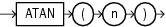

## ATAN

Syntax



> ```
> ATAN(n)
> ```
>
> [  
> Copyright © 1996, 2025, Oracle and/or its affiliates.](https://docs.oracle.com/en/database/oracle/oracle-database/dcommon/html/cpyr.htm)


Purpose

`ATAN` returns the arc tangent of `n`. The argument `n` can be in an unbounded range and returns a value in the range of -pi/2 to pi/2, expressed in radians.

This function takes as an argument any numeric data type or any nonnumeric data type that can be implicitly converted to a numeric data type. If the argument is `BINARY_FLOAT`, then the function returns `BINARY_DOUBLE`. Otherwise the function returns the same numeric data type as the argument.

See Also:

[ATAN2](ATAN2.md) for information about the `ATAN2` function and [Table 2-8](Data-Type-Comparison-Rules.md) for more information on implicit conversion

Examples

The following example returns the arc tangent of.3:

```
SELECT ATAN(.3) "Arc_Tangent"
  FROM DUAL;

Arc_Tangent
----------
.291456794
```