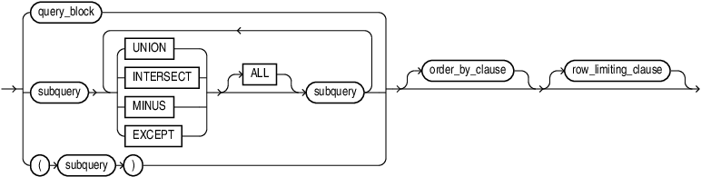
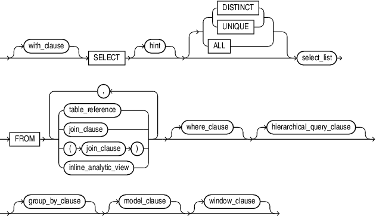

## About Queries and Subqueries

A query is an operation that retrieves data from one or more tables or views. In this reference, a top-level `SELECT` statement is called a query, and a query nested within another SQL statement is called a subquery.

This section describes some types of queries and subqueries and how to use them. The top level of the syntax is shown in this chapter. Refer to [SELECT](SELECT.md) for the full syntax of all the clauses and the semantics of this statement.

select::=


> ```
> subquery [ for_update_clause ] ;
> ```
>
> [  
> Copyright © 1996, 2025, Oracle and/or its affiliates.](https://docs.oracle.com/en/database/oracle/oracle-database/dcommon/html/cpyr.htm)


subquery::=



> ```
> { query_block
> | subquery { UNION | INTERSECT | MINUS | EXCEPT } [ALL]  subquery
>     [ { UNION  | INTERSECT | MINUS | EXCEPT } [ALL] subquery ]...
> | ( subquery )
> } [ order_by_clause ] [ row_limiting_clause ]
> ```
>
> [  
> Copyright © 1996, 2025, Oracle and/or its affiliates.](https://docs.oracle.com/en/database/oracle/oracle-database/dcommon/html/cpyr.htm)


query\_block::=



> ```
> [ with_clause ]
> SELECT [ hint ] [ { { DISTINCT | UNIQUE } | ALL } ] select_list
>   FROM { table_reference | join_clause | ( join_clause ) | inline_analytic_view }
>          [ , { table_reference | join_clause | (join_clause) | inline_analytic_view} ] ...
>   [ where_clause ]
>   [ hierarchical_query_clause ]
>   [ group_by_clause ]
>   [ model_clause ]
>   [ window_clause ]
> ```
