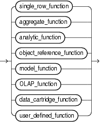
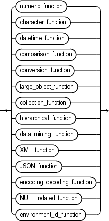

## About SQL Functions

SQL functions are built into Oracle Database and are available for use in various appropriate SQL statements. Do not confuse SQL functions with user-defined functions written in PL/SQL.

If you call a SQL function with an argument of a data type other than the data type expected by the SQL function, then Oracle attempts to convert the argument to the expected data type before performing the SQL function.

Nulls in SQL Functions

Most scalar functions return null when given a null argument. You can use the `NVL` function to return a value when a null occurs. For example, the expression `NVL(commission_pct,0)` returns 0 if `commission_pct` is null or the value of `commission_pct` if it is not null.

For information on how aggregate functions handle nulls, see [Aggregate Functions](Aggregate-Functions.md).

Syntax for SQL Functions

In the syntax diagrams for SQL functions, arguments are indicated by their data types. When the parameter `function` appears in SQL syntax, replace it with one of the functions described in this section. Functions are grouped by the data types of their arguments and their return values.

Note:

When you apply SQL functions to LOB columns, Oracle Database creates temporary LOBs during SQL and PL/SQL processing. You should ensure that temporary tablespace quota is sufficient for storing these temporary LOBs for your application.

A SQL function may be collation-sensitive, which means that character value comparison or matching that it performs is controlled by a collation. The particular collation to use by the function is determined from the collations of the function's arguments.

If the result of a SQL function has a character data type, the collation derivation rules define the collation to associate with the result.

See Also:

Appendix C in [Oracle Database Globalization Support Guide](https://docs.oracle.com/pls/topic/lookup?ctx=en/database/oracle/oracle-database/21/sqlrf&id=NLSPG-GUID-AFCE41ED-775B-4A00-AF38-C436776AE0C5) for the collation derivation and determination rules for SQL functions

The syntax showing the categories of functions follows:

function::=



> ```
> { single_row_function
> | aggregate_function
> | analytic_function
> | object_reference_function
> | model_function
> | user_defined_function
> | OLAP_function
> | data_cartridge_function
> }
> ```
>
> [  
> Copyright © 1996, 2025, Oracle and/or its affiliates.](https://docs.oracle.com/en/database/oracle/oracle-database/dcommon/html/cpyr.htm)


single\_row\_function::=



> ```
> { numeric_function
> | character_function
> | datetime_function
> | comparison_function
> | conversion_function
> | large_object_function
> | collection_function
> | hierarchical_function
> | data_mining_function
> | XML_function
> | JSON_function
> | encoding_decoding_function
> | NULL_related_function
> | environment_id_function
> }
> ```
>
> [  
> Copyright © 1996, 2025, Oracle and/or its affiliates.](https://docs.oracle.com/en/database/oracle/oracle-database/dcommon/html/cpyr.htm)


The sections that follow list the built-in SQL functions in each of the groups illustrated in the preceding diagrams except user-defined functions. All of the built-in SQL functions are then described in alphabetical order.

See Also:

[About User-Defined Functions](About-User-Defined-Functions.md) and [CREATE FUNCTION](CREATE-FUNCTION.md)