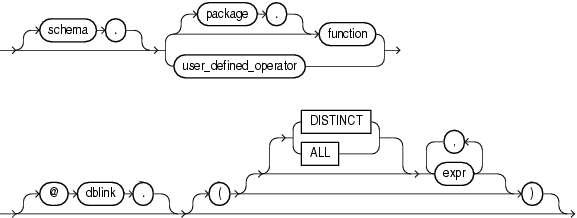

## About User-Defined Functions

You can write user-defined functions in PL/SQL, Java, or C to provide functionality that is not available in SQL or SQL built-in functions. User-defined functions can appear in a SQL statement wherever an expression can occur.

For example, user-defined functions can be used in the following:

- The select list of a `SELECT` statement
- The condition of a `WHERE` clause
- `CONNECT` `BY`, `START` `WITH`, `ORDER` `BY`, and `GROUP` `BY` clauses
- The `VALUES` clause of an `INSERT` statement
- The `SET` clause of an `UPDATE` statement

Note:

Oracle SQL does not support calling of functions with Boolean parameters or returns. Therefore, if your user-defined functions will be called from SQL statements, you must design them to return numbers (0 or 1) or character strings (' `TRUE` ' or ' `FALSE` ').

user\_defined\_function::=



> ```
> [ schema. ]
> { [ package. ]function | user_defined_operator }
> [ @ dblink. ]
> [ ( [ [ DISTINCT | ALL ] expr [, expr ]... ] ) ]
> ```
>
> [  
> Copyright © 1996, 2025, Oracle and/or its affiliates.](https://docs.oracle.com/en/database/oracle/oracle-database/dcommon/html/cpyr.htm)


The optional expression list must match attributes of the function, package, or operator.

Restriction on User-defined Functions

The `DISTINCT` and `ALL` keywords are valid only with a user-defined aggregate function.

See Also:

- [CREATE FUNCTION](CREATE-FUNCTION.md) for information on creating functions, including restrictions on user-defined functions
- [Oracle Database Development Guide](https://docs.oracle.com/pls/topic/lookup?ctx=en/database/oracle/oracle-database/21/sqlrf&id=ADFNS009) for a complete discussion of the creation and use of user functions

### Prerequisites

User-defined functions must be created as top-level functions or declared with a package specification before they can be named within a SQL statement.

To use a user function in a SQL expression, you must own or have `EXECUTE` privilege on the user function. To query a view defined with a user function, you must have the `READ` or `SELECT` privilege on the view. No separate `EXECUTE` privileges are needed to select from the view.

See Also:

[CREATE FUNCTION](CREATE-FUNCTION.md) for information on creating top-level functions and [CREATE PACKAGE](CREATE-PACKAGE.md) for information on specifying packaged functions

### Name Precedence

Within a SQL statement, the names of database columns take precedence over the names of functions with no parameters. For example, if the Human Resources manager creates the following two objects in the `hr` schema:

```
CREATE TABLE new_emps (new_sal NUMBER, ...);
CREATE FUNCTION new_sal RETURN NUMBER IS BEGIN ... END;
```

then in the following two statements, the reference to `new_sal` refers to the column `new_emps.new_sal`:

```
SELECT new_sal FROM new_emps;
SELECT new_emps.new_sal FROM new_emps;
```

To access the function `new_sal`, you would enter:

```
SELECT hr.new_sal FROM new_emps;
```

Here are some sample calls to user functions that are allowed in SQL expressions:

```
circle_area (radius)
payroll.tax_rate (empno)
hr.employees.tax_rate (dependent, empno)@remote
```

Example

To call the `tax_rate` user function from schema `hr`, execute it against the `ss_no` and `sal` columns in `tax_table`, specify the following:

```
SELECT hr.tax_rate (ss_no, sal)
    INTO income_tax
    FROM tax_table WHERE ss_no = tax_id;
```

The `INTO` clause is PL/SQL that lets you place the results into the variable `income_tax`.

#### Naming Conventions

If only one of the optional schema or package names is given, then the first identifier can be either a schema name or a package name. For example, to determine whether `PAYROLL` in the reference `PAYROLL`.`TAX_RATE` is a schema or package name, Oracle Database proceeds as follows:

1. Check for the `PAYROLL` package in the current schema.
2. If a `PAYROLL` package is not found, then look for a schema name `PAYROLL` that contains a top-level `TAX_RATE` function. If no such function is found, then return an error.
3. If the `PAYROLL` package is found in the current schema, then look for a `TAX_RATE` function in the `PAYROLL` package. If no such function is found, then return an error.

You can also refer to a stored top-level function using any synonym that you have defined for it.