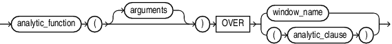
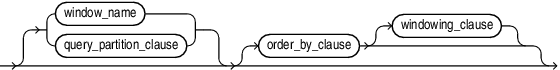
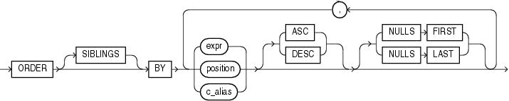
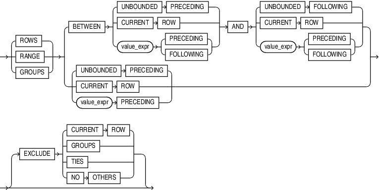

## Analytic Functions

Analytic functions compute an aggregate value based on a group of rows. They differ from aggregate functions in that they return multiple rows for each group. The group of rows is called a window and is defined by the `analytic_clause`. For each row, a sliding window of rows is defined. The window determines the range of rows used to perform the calculations for the current row. Window sizes can be based on either a physical number of rows or a logical interval such as time.

Analytic functions are the last set of operations performed in a query except for the final `ORDER` `BY` clause. All joins and all `WHERE`, `GROUP` `BY`, and `HAVING` clauses are completed before the analytic functions are processed. Therefore, analytic functions can appear only in the select list or `ORDER` `BY` clause.

Analytic functions are commonly used to compute cumulative, moving, centered, and reporting aggregates.

analytic\_function::=



> ```
> analytic_function([ arguments ]) OVER {(window_name) | (analytic_clause) }
> ```
>
> [  
> Copyright © 1996, 2025, Oracle and/or its affiliates.](https://docs.oracle.com/en/database/oracle/oracle-database/dcommon/html/cpyr.htm)


analytic\_clause::=



> ```
> { [ window_name ] | [ query_partition_clause ] }
> [ order_by_clause [ windowing_clause ] ]
> ```
>
> [  
> Copyright © 1996, 2025, Oracle and/or its affiliates.](https://docs.oracle.com/en/database/oracle/oracle-database/dcommon/html/cpyr.htm)


query\_partition\_clause::=


> ```
> PARTITION BY
>   { expr[, expr ]...
>   | ( expr[, expr ]... )
>   }
> ```
>
> [  
> Copyright © 1996, 2025, Oracle and/or its affiliates.](https://docs.oracle.com/en/database/oracle/oracle-database/dcommon/html/cpyr.htm)


order\_by\_clause::=



> ```
> ORDER [ SIBLINGS ] BY
> { expr | position | c_alias }
> [ ASC | DESC ]
> [ NULLS FIRST | NULLS LAST ]
>   [, { expr | position | c_alias }
>      [ ASC | DESC ]
>      [ NULLS FIRST | NULLS LAST ]
>   ]...
> ```
>
> [  
> Copyright © 1996, 2025, Oracle and/or its affiliates.](https://docs.oracle.com/en/database/oracle/oracle-database/dcommon/html/cpyr.htm)


windowing\_clause::=



> ```
> { ROWS | RANGE | GROUPS }
> { BETWEEN
>   { UNBOUNDED PRECEDING
>   | CURRENT ROW
>   | value_expr { PRECEDING | FOLLOWING }
>   } 
>   AND
>   { UNBOUNDED FOLLOWING
>   | CURRENT ROW
>   | value_expr { PRECEDING | FOLLOWING }
>   }
> | { UNBOUNDED PRECEDING
>   | CURRENT ROW
>   | value_expr PRECEDING
>   }
> }
>  [ EXCLUDE CURRENT ROW
>     | EXCLUDE GROUPS
>     | EXCLUDE TIES
>     | EXCLUDE NO OTHERS ]
> ```


The semantics of this syntax are discussed in the sections that follow.

analytic\_function

Specify the name of an analytic function (see the listing of analytic functions following this discussion of semantics).

arguments

Analytic functions take 0 to 3 arguments. The arguments can be any numeric data type or any nonnumeric data type that can be implicitly converted to a numeric data type. Oracle determines the argument with the highest numeric precedence and implicitly converts the remaining arguments to that data type. The return type is also that data type, unless otherwise noted for an individual function.

See Also:

[Numeric Precedence](Data-Types.md) for information on numeric precedence and [Table 2-8](Data-Type-Comparison-Rules.md) for more information on implicit conversion

analytic\_clause

Use `OVER` `analytic_clause` to indicate that the function operates on a query result set. This clause is computed after the `FROM`, `WHERE`, `GROUP` `BY`, and `HAVING` clauses. You can specify analytic functions with this clause in the select list or `ORDER` `BY` clause. To filter the results of a query based on an analytic function, nest these functions within the parent query, and then filter the results of the nested subquery.

Notes on the analytic\_clause:

The following notes apply to the `analytic_clause`:

- You cannot nest analytic functions by specifying any analytic function in any part of the `analytic_clause`. However, you can specify an analytic function in a subquery and compute another analytic function over it.
- You can specify `OVER` `analytic_clause` with user-defined analytic functions as well as built-in analytic functions. See [CREATE FUNCTION](CREATE-FUNCTION.md).
- The `PARTITION` `BY` and `ORDER` `BY` clauses in the `analytic_clause` are collation-sensitive.

See Also:

- Appendix C in [Oracle Database Globalization Support Guide](https://docs.oracle.com/pls/topic/lookup?ctx=en/database/oracle/oracle-database/21/sqlrf&id=NLSPG-GUID-AFCE41ED-775B-4A00-AF38-C436776AE0C5) for the collation determination rules for the `OVER` `(PARTITION` `BY`... `ORDER` `BY`... `)` clause of an analytic function
- [`window_clause`](SELECT.md) in the `SELECT` statement

query\_partition\_clause

Use the `PARTITION` `BY` clause to partition the query result set into groups based on one or more `value_expr`. If you omit this clause, then the function treats all rows of the query result set as a single group.

To use the `query_partition_clause` in an analytic function, use the upper branch of the syntax (without parentheses). To use this clause in a model query (in the `model_column_clauses`) or a partitioned outer join (in the `outer_join_clause`), use the lower branch of the syntax (with parentheses).

You can specify multiple analytic functions in the same query, each with the same or different `PARTITION` `BY` keys.

If the objects being queried have the parallel attribute, and if you specify an analytic function with the `query_partition_clause`, then the function computations are parallelized as well.

Valid values of `value_expr` are constants, columns, nonanalytic functions, function expressions, or expressions involving any of these.

order\_by\_clause

Use the `order_by_clause` to specify how data is ordered within a partition. For all analytic functions you can order the values in a partition on multiple keys, each defined by a `value_expr` and each qualified by an ordering sequence.

Within each function, you can specify multiple ordering expressions. Doing so is especially useful when using functions that rank values, because the second expression can resolve ties between identical values for the first expression.

Whenever the `order_by_clause` results in identical values for multiple rows, the function behaves as follows:

- `CUME_DIST`, `DENSE_RANK`, `NTILE`, `PERCENT_RANK`, and `RANK` return the same result for each of the rows.
- `ROW_NUMBER` assigns each row a distinct value even if there is a tie based on the `order_by_clause`. The value is based on the order in which the row is processed, which may be nondeterministic if the `ORDER` `BY` does not guarantee a total ordering.
- For all other analytic functions, the result depends on the window specification. If you specify a logical window with the `RANGE` keyword, then the function returns the same result for each of the rows. If you specify a physical window with the `ROWS` keyword, then the result is nondeterministic.

Restrictions on the ORDER BY Clause

The following restrictions apply to the `ORDER` `BY` clause:

- When used in an analytic function, the `order_by_clause` must take an expression (`expr`). The `SIBLINGS` keyword is not valid (it is relevant only in hierarchical queries). Position (`position`) and column aliases (`c_alias`) are also invalid. Otherwise this `order_by_clause` is the same as that used to order the overall query or subquery.
- An analytic function that uses the `RANGE` keyword can use multiple sort keys in its `ORDER` `BY` clause if it specifies any of the following windows:
	- `RANGE` `BETWEEN` `UNBOUNDED` `PRECEDING` `AND` `CURRENT` `ROW`. The short form of this is `RANGE` `UNBOUNDED` `PRECEDING`.
		- `RANGE` `BETWEEN` `CURRENT` `ROW` `AND` `UNBOUNDED` `FOLLOWING`
		- `RANGE` `BETWEEN` `CURRENT` `ROW` `AND` `CURRENT` `ROW`
		- `RANGE` `BETWEEN` `UNBOUNDED` `PRECEDING` `AND` `UNBOUNDED` `FOLLOWING`
	Window boundaries other than these four can have only one sort key in the `ORDER` `BY` clause of the analytic function. This restriction does not apply to window boundaries specified by the `ROW` keyword.

ASC | DESC

Specify the ordering sequence (ascending or descending). `ASC` is the default.

NULLS FIRST | NULLS LAST

Specify whether returned rows containing nulls should appear first or last in the ordering sequence.

`NULLS` `LAST` is the default for ascending order, and `NULLS` `FIRST` is the default for descending order.

Analytic functions always operate on rows in the order specified in the `order_by_clause` of the function. However, the `order_by_clause` of the function does not guarantee the order of the result. Use the `order_by_clause` of the query to guarantee the final result ordering.

See Also:

[order\_by\_clause](SELECT.md) of [SELECT](SELECT.md) for more information on this clause

windowing\_clause

Some analytic functions allow the `windowing_clause`. In the listing of analytic functions at the end of this section, the functions that allow the `windowing_clause` are followed by an asterisk (\*).

ROWS | RANGE | GROUPS

The keywords `ROWS`, `RANGE`, and `GROUPS` are options to define a window frame unit used for calculating the function result. The function is then applied to all the rows in the window. The window moves through the query result set or partition from top to bottom.

- Use `ROWS` to specify the window frame extent by counting rows forward or backward from the current row. `ROWS` allows any number of sort keys, of any ordered data types.
- Use `RANGE` to specify the window frame extent as a logical offset. `RANGE` allows only one sort key, and its declared data type must allow addition and subtraction operations, for example they must be numeric, datetime, or interval data types.
- Use `GROUPS` to specifiy the window frame extent with both `ROWS` and `RANGE` characteristics. Like `ROWS` a `GROUPS` window can have any number of sort keys, or any ordered types. Like `RANGE`, a `GROUPS` window does not make cutoffs between adjacent rows with the same values in the sort keys.

You cannot specify this clause unless you have specified the `order_by_clause`. Some window boundaries defined by the `RANGE` clause let you specify only one expression in the `order_by_clause`. Refer to Restrictions on the ORDER BY Clause.

The value returned by an analytic function with a logical offset is always deterministic. However, the value returned by an analytic function with a physical offset may produce nondeterministic results unless the ordering expression results in a unique ordering. You may have to specify multiple columns in the `order_by_clause` to achieve this unique ordering.

BETWEEN... AND

Use the `BETWEEN`... `AND` clause to specify a start point and end point for the window. The first expression (before `AND`) defines the start point and the second expression (after `AND`) defines the end point.

If you omit `BETWEEN` and specify only one end point, then Oracle considers it the start point, and the end point defaults to the current row.

UNBOUNDED PRECEDING

Specify `UNBOUNDED` `PRECEDING` to indicate that the window starts at the first row of the partition. This is the start point specification and cannot be used as an end point specification.

UNBOUNDED FOLLOWING

Specify `UNBOUNDED` `FOLLOWING` to indicate that the window ends at the last row of the partition. This is the end point specification and cannot be used as a start point specification.

CURRENT ROW

As a start point, `CURRENT` `ROW` specifies that the window begins at the current row or value (depending on whether you have specified `ROW` or `RANGE`, respectively). In this case the end point cannot be `value_expr` `PRECEDING`.

As an end point, `CURRENT` `ROW` specifies that the window ends at the current row or value (depending on whether you have specified `ROW` or `RANGE`, respectively). In this case the start point cannot be `value_expr` `FOLLOWING`.

value\_expr PRECEDING or value\_expr FOLLOWING

For `RANGE` or `ROW`:

- If `value_expr` `FOLLOWING` is the start point, then the end point must be `value_expr` `FOLLOWING`.
- If `value_expr` `PRECEDING` is the end point, then the start point must be `value_expr` `PRECEDING`.

If you are defining a logical window defined by an interval of time in numeric format, then you may need to use conversion functions.

See Also:

[NUMTOYMINTERVAL](NUMTOYMINTERVAL.md) and [NUMTODSINTERVAL](NUMTODSINTERVAL.md) for information on converting numeric times into intervals

If you specified `ROWS`:

- `value_expr` is a physical offset. It must be a constant or expression and must evaluate to a positive numeric value.
- If `value_expr` is part of the start point, then it must evaluate to a row before the end point.

If you specified `RANGE`:

- `value_expr` is a logical offset. It must be a constant or expression that evaluates to a positive numeric value or an interval literal. Refer to [Literals](Literals.md) for information on interval literals.
- You can specify only one expression in the `order_by_clause`.
- If `value_expr` evaluates to a numeric value, then the `ORDER` `BY` `expr` must be a numeric or `DATE` data type.
- If `value_expr` evaluates to an interval value, then the `ORDER` `BY` `expr` must be a `DATE` data type.

If you omit the `windowing_clause` entirely, then the default is `RANGE` `BETWEEN` `UNBOUNDED` `PRECEDING` `AND` `CURRENT` `ROW`.

EXCLUDE

You can remove rows, groups, and ties from the window frame with the `EXCLUDE` options:

- If you specify `EXCLUDE CURRENT ROW`, and the current row in in the window frame, then the current row is removed from the window frame.
- If you specify `EXCLUDE GROUP`, then the current row and any peers of the current row are removed from the window frame.
- If you specify `EXCLUDE TIES`, then the peers of the current row are removed from the window frame. The current row is retained. Note, that if the current row is previously removed from the window frame, it remains removed.
- If you specify `EXCLUDE NO OTHERS`, then no additional rows are removed from the window frame. This is the default option.

Analytic functions are commonly used in data warehousing environments. In the list of analytic functions that follows, functions followed by an asterisk (\*) allow the full syntax, including the `windowing_clause`.

- [AVG](AVG.md) \*
- [BIT\_AND\_AGG](BIT_AND_AGG.md) \*
- [BIT\_OR\_AGG](BIT_OR_AGG.md) \*
- [BIT\_XOR\_AGG](BIT_XOR_AGG.md) \*
- [CHECKSUM](checksum.md) \*
- [CLUSTER\_DETAILS](CLUSTER_DETAILS.md)
- [CLUSTER\_DISTANCE](CLUSTER_DISTANCE.md)
- [CLUSTER\_ID](CLUSTER_ID.md)
- [CLUSTER\_PROBABILITY](CLUSTER_PROBABILITY.md)
- [CLUSTER\_SET](CLUSTER_SET.md)
- [CORR](CORR.md) \*
- [COUNT](COUNT.md) \*
- [COVAR\_POP](COVAR_POP.md) \*
- [COVAR\_SAMP](COVAR_SAMP.md) \*
- [CUME\_DIST](CUME_DIST.md)
- [DENSE\_RANK](DENSE_RANK.md)
- [FEATURE\_DETAILS](FEATURE_DETAILS.md)
- [FEATURE\_ID](FEATURE_ID.md)
- [FEATURE\_SET](FEATURE_SET.md)
- [FEATURE\_VALUE](FEATURE_VALUE.md)
- [FIRST](FIRST.md)
- [FIRST\_VALUE](FIRST_VALUE.md) \*
- [KURTOSIS\_POP](KURTOSIS_POP.md) \*
- [KURTOSIS\_SAMP](KURTOSIS_SAMP.md) \*
- [LAG](LAG.md)
- [LAST](LAST.md)
- [LAST\_VALUE](LAST_VALUE.md) \*
- [LEAD](LEAD.md)
- [LISTAGG](LISTAGG.md)
- [MAX](MAX.md) \*
- [MIN](MIN.md) \*
- [NTH\_VALUE](NTH_VALUE.md) \*
- [NTILE](NTILE.md)
- [PERCENT\_RANK](PERCENT_RANK.md)
- [PERCENTILE\_CONT](PERCENTILE_CONT.md)
- [PERCENTILE\_DISC](PERCENTILE_DISC.md)
- [PREDICTION](PREDICTION.md)
- [PREDICTION\_COST](PREDICTION_COST.md)
- [PREDICTION\_DETAILS](PREDICTION_DETAILS.md)
- [PREDICTION\_PROBABILITY](PREDICTION_PROBABILITY.md)
- [PREDICTION\_SET](PREDICTION_SET.md)
- [RANK](RANK.md)
- [RATIO\_TO\_REPORT](RATIO_TO_REPORT.md)
- [REGR\_ (Linear Regression) Functions](REGR_-Linear-Regression-Functions.md) \*
- [ROW\_NUMBER](ROW_NUMBER.md)
- [STDDEV](STDDEV.md) \*
- [STDDEV\_POP](STDDEV_POP.md) \*
- [SKEWNESS\_POP](SKEWNESS_POP.md) \*
- [SKEWNESS\_SAMP](SKEWNESS_SAMP.md) \*
- [STDDEV\_SAMP](STDDEV_SAMP.md) \*
- [SUM](SUM.md) \*
- [VAR\_POP](VAR_POP.md) \*
- [VAR\_SAMP](VAR_SAMP.md) \*
- [VARIANCE](VARIANCE.md) \*

See Also:

[Oracle Database Data Warehousing Guide](https://docs.oracle.com/pls/topic/lookup?ctx=en/database/oracle/oracle-database/21/sqlrf&id=DWHSG021) for more information on these functions and for scenarios illustrating their use