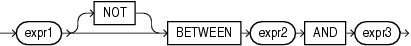

## BETWEEN Condition

A `BETWEEN` condition determines whether the value of one expression is in an interval defined by two other expressions.

between\_condition::=



> ```
> expr1 [ NOT ] BETWEEN expr2 AND expr3
> ```
>
> [  
> Copyright © 1996, 2025, Oracle and/or its affiliates.](https://docs.oracle.com/en/database/oracle/oracle-database/dcommon/html/cpyr.htm)


All three expressions must be numeric, character, or datetime expressions. In SQL, it is possible that `expr1` will be evaluated more than once. If the `BETWEEN` expression appears in PL/SQL, `expr1` is guaranteed to be evaluated only once. If the expressions are not all the same data type, then Oracle Database implicitly converts the expressions to a common data type. If it cannot do so, then it returns an error.

See Also:

[Implicit Data Conversion](Data-Type-Comparison-Rules.md) for more information on SQL data type conversion

The value of

```
expr1 NOT BETWEEN expr2 AND expr3
```

is the value of the expression

```
NOT (expr1 BETWEEN expr2 AND expr3)
```

And the value of

```
expr1 BETWEEN expr2 AND expr3
```

is the value of the boolean expression:

```
expr2 <= expr1 AND expr1 <= expr3
```

If `expr3` < `expr2`, then the interval is empty. If `expr1` is `NULL`, then the result is `NULL`. If `expr1` is not `NULL`, then the value is `FALSE` in the ordinary case and `TRUE` when the keyword `NOT` is used.

The boolean operator `AND` may produce unexpected results. Specifically, in the expression `x AND y`, the condition `x IS NULL` is not sufficient to determine the value of the expression. The second operand still must be evaluated. The result is `FALSE` if the second operand has the value `FALSE` and `NULL` otherwise. See [Logical Conditions](Logical-Conditions.md) for more information on `AND`.

Table 6-10 BETWEEN Condition

| Type of Condition | Operation | Example |
| --- | --- | --- |
| ``` [NOT] BETWEEN x AND y ``` | \[`NOT`\] (`expr2` less than or equal to `expr1` `AND` `expr1` less than or equal to `expr3`) | ``` SELECT * FROM employees   WHERE salary   BETWEEN 2000 AND 3000   ORDER BY employee_id; ``` |