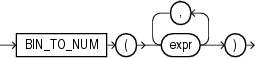

## BIN\_TO\_NUM

Syntax



> ```
> BIN_TO_NUM(expr [, expr ]... )
> ```
>
> [  
> Copyright © 1996, 2025, Oracle and/or its affiliates.](https://docs.oracle.com/en/database/oracle/oracle-database/dcommon/html/cpyr.htm)


Purpose

`BIN_TO_NUM` converts a bit vector to its equivalent number. Each argument to this function represents a bit in the bit vector. This function takes as arguments any numeric data type, or any nonnumeric data type that can be implicitly converted to `NUMBER`. Each `expr` must evaluate to 0 or 1. This function returns Oracle `NUMBER`.

`BIN_TO_NUM` is useful in data warehousing applications for selecting groups of interest from a materialized view using grouping sets.

See Also:

- [group\_by\_clause](SELECT.md) for information on `GROUPING` `SETS` syntax
- [Table 2-8](Data-Type-Comparison-Rules.md) for more information on implicit conversion
- [Oracle Database Data Warehousing Guide](https://docs.oracle.com/pls/topic/lookup?ctx=en/database/oracle/oracle-database/21/sqlrf&id=DWHSG020) for information on data aggregation in general

Examples

The following example converts a binary value to a number:

```
SELECT BIN_TO_NUM(1,0,1,0)
  FROM DUAL; 

BIN_TO_NUM(1,0,1,0)
-------------------
                 10
```

The next example converts three values into a single binary value and uses `BIN_TO_NUM` to convert that binary into a number. The example uses a PL/SQL declaration to specify the original values. These would normally be derived from actual data sources.

```
SELECT order_status
  FROM orders
  WHERE order_id = 2441;

ORDER_STATUS
------------
           5
DECLARE
  warehouse NUMBER := 1;
  ground    NUMBER := 1;
  insured   NUMBER := 1;
  result    NUMBER;
BEGIN
  SELECT BIN_TO_NUM(warehouse, ground, insured) INTO result FROM DUAL;
  UPDATE orders SET order_status = result WHERE order_id = 2441;
END;
/
PL/SQL procedure successfully completed.

SELECT order_status
  FROM orders
  WHERE order_id = 2441;

ORDER_STATUS
------------
           7
```

Refer to the examples for [BITAND](BITAND.md) for information on reversing this process by extracting multiple values from a single column value.