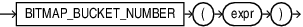

## BITMAP\_BUCKET\_NUMBER

Syntax



> ```
> BITMAP_BUCKET_NUMBER ( expr )
> ```
>
> [  
> Copyright © 1996, 2025, Oracle and/or its affiliates.](https://docs.oracle.com/en/database/oracle/oracle-database/dcommon/html/cpyr.htm)


Purpose

Use `BITMAP_BUCKET_NUMBER` to construct a one-to-one mapping between a number and a bit position in a bitmap.

The argument `expr` is of type `NUMBER`. It represents the absolute bit position in the bitmap.

`BITMAP_BUCKET_NUMBER` returns a `NUMBER`. It represents the relative bit position.

If `expr` is NULL, the function returns NULL.

If `expr` is not an integer, you will see the following error message:

```
Invalid value has been passed to a BITMAP COUNT DISTINCT related operator.
```