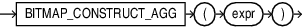

## BITMAP\_CONSTRUCT\_AGG

Syntax



> ```
> BITMAP_CONSTRUCT_AGG ( expr )
> ```
>
> [  
> Copyright © 1996, 2025, Oracle and/or its affiliates.](https://docs.oracle.com/en/database/oracle/oracle-database/dcommon/html/cpyr.htm)


Purpose

`BITMAP_CONSTRUCT_AGG ` is an aggregation function that operates on bit positions and returns the bitmap representation of the set of all input bit positions. It essentially maintains a bitmap and sets into it all the input bit positions. It returns the representation of the bitmap.

The argument `expr` is of type `NUMBER`.

The return type is of type `BLOB`.

If `expr` is NULL, the function returns NULL.

Restrictions

- The argument must be of `NUMBER` type. If the input value cannot be converted to a natural number, error `ORA-62575` is raised:
	```
	62575, 00000, "Invalid value has been passed to a BITMAP COUNT DISTINCT related operator."
	// *Cause: An attempt was made to pass an invalid value to a BITMAP COUNT DISTINCT operator.
	// *Action: Pass only natural number values to BITMAP_CONSTRUCT_AGG.
	```
- If the bitmap exceeds the maximum value of a `BLOB`, you will see error `ORA-62577`:
	```
	62577, 00000, "The bitmap size exceeds maximum size of its SQL data type."
	// *Cause: An attempt was made to construct a bitmap larger than its maximum SQL type size.
	// *Action: Break the input to BITMAP_CONSTRUCT_AGG into smaller ranges.
	```