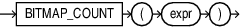

## BITMAP\_COUNT

Syntax



> ```
> BITMAP_BUCKET_NUMBER ( expr )
> ```
>
> [  
> Copyright © 1996, 2025, Oracle and/or its affiliates.](https://docs.oracle.com/en/database/oracle/oracle-database/dcommon/html/cpyr.htm)


Purpose

`BITMAP_COUNT` is a scalar function that returns the 1-bit count for the input bitmap.

The argument `expr` is of type `BLOB`.

It returns a `NUMBER` representing the count of bits set in its input.

If `expr` is NULL, it returns 0.

Restrictions

The argument must be of type `BLOB` type. The argument is expected to be a bitmap produced by `BITMAP_CONSTRUCT_AGG` or, recursively, by `BITMAP_OR_AGG`. Any other input results in `ORA-62578`:
```
62578, 00000, "The input is not a valid bitmap produced by BITMAP COUNT DISTINCT related operators."
// *Cause: An attempt was made to pass a bitmap that was not produced by one of the BITMAP COUNT DISTINCT operators.
// *Action: Only pass bitmaps constructed via BITMAP_CONSTRUCT_AGG or BITMAP_OR_AGG to BITMAP COUNT DISTINCT related operators.
```