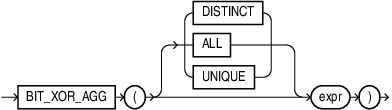

## BIT\_XOR\_AGG

Syntax



> ```
> BIT_XOR_AGG ( [DISTINCT | ALL | UNIQUE] expr )
> ```
>
> [  
> Copyright © 1996, 2025, Oracle and/or its affiliates.](https://docs.oracle.com/en/database/oracle/oracle-database/dcommon/html/cpyr.htm)


Purpose

` BIT_XOR_AGG` is a bitwise aggregation function that returns the result of a bitwise XOR operation.

You can use ` BIT_XOR_AGG` as part of a `GROUP` `BY` query, window function, or as an analytical function. The return type of ` BIT_XOR_AGG` is always a number.

Semantics

The keywords `DISTINCT` or `UNIQUE` ensure that only unique values in `expr` are used for computation. `BIT_XOR_AGG ` could potentially return a different value when `DISTINCT` is present. `UNIQUE` is an Oracle-specific keyword and not an ANSI standard.

NULL values in the `expr` column are ignored.

Returns NULL if all rows in the group have NULL `expr` values.

Floating point values are truncated to the integer prior to aggregation. For instance, the value 4.64 is converted to 4 and the value 4.4 is also converted to 4.

Negative numbers are represented in two’s complement form internally prior to performing an aggregate operation. The resultant aggregate could be a negative value.

Range of inputs supported: -2 raised to 127 to (2 raised to 127) -1

Numbers are internally converted to a 128b decimal representation prior to aggregation. The resultant aggregate is converted back into an Oracle Number.

For a given set of values, the result of a bitwise aggregate is always deterministic and independent of ordering.