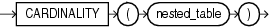

## CARDINALITY

Syntax



> ```
> CARDINALITY(nested_table)
> ```
>
> [  
> Copyright © 1996, 2025, Oracle and/or its affiliates.](https://docs.oracle.com/en/database/oracle/oracle-database/dcommon/html/cpyr.htm)


Purpose

`CARDINALITY` returns the number of elements in a nested table. The return type is `NUMBER`. If the nested table is empty, or is a null collection, then `CARDINALITY` returns `NULL`.

Examples

The following example shows the number of elements in the nested table column `ad_textdocs_ntab` of the sample table `pm.print_media`:

```
SELECT product_id, CARDINALITY(ad_textdocs_ntab) cardinality
  FROM print_media
  ORDER BY product_id;

PRODUCT_ID CARDINALITY
---------- -----------
      2056           3
      2268           3
      3060           3
      3106           3
```