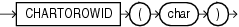

## CHARTOROWID

Syntax



> ```
> CHARTOROWID(char)
> ```
>
> [  
> Copyright © 1996, 2025, Oracle and/or its affiliates.](https://docs.oracle.com/en/database/oracle/oracle-database/dcommon/html/cpyr.htm)


Purpose

`CHARTOROWID` converts a value from `CHAR`, `VARCHAR2`, `NCHAR`, or `NVARCHAR2` data type to `ROWID` data type.

This function does not support `CLOB` data directly. However, `CLOB` s can be passed in as arguments through implicit data conversion.

See Also:

[Data Type Comparison Rules](Data-Type-Comparison-Rules.md) for more information.

Examples

The following example converts a character rowid representation to a rowid. (The actual rowid is different for each database instance.)

```
SELECT last_name
  FROM employees
  WHERE ROWID = CHARTOROWID('AAAFd1AAFAAAABSAA/');
 
LAST_NAME
-------------------------
Greene
```