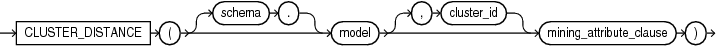
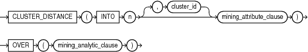
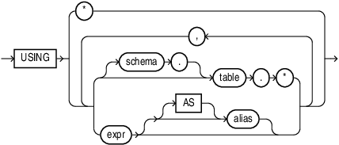
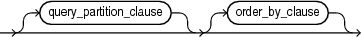

## CLUSTER\_DISTANCE

Syntax

cluster\_distance::=



> ```
> CLUSTER_DISTANCE ( [ schema . ] model [ , cluster_id ] mining_attribute_clause )
> ```
>
> [  
> Copyright © 1996, 2025, Oracle and/or its affiliates.](https://docs.oracle.com/en/database/oracle/oracle-database/dcommon/html/cpyr.htm)


Analytic Syntax

cluster\_distance\_analytic::=



> ```
> CLUSTER_DISTANCE ( INTO n [, cluster_id] mining_attribute_clause )
>                  OVER ( mining_analytic_clause )
> ```
>
> [  
> Copyright © 1996, 2025, Oracle and/or its affiliates.](https://docs.oracle.com/en/database/oracle/oracle-database/dcommon/html/cpyr.htm)


mining\_attribute\_clause::=



> ```
> USING
> { * 
> | { [ schema . ] table . * 
>   | expr [ AS alias ]
>   }
>     [, { [ schema . ] table . * 
>        | expr [ AS alias ]
>        }
>     ]...
> }
> ```
>
> [  
> Copyright © 1996, 2025, Oracle and/or its affiliates.](https://docs.oracle.com/en/database/oracle/oracle-database/dcommon/html/cpyr.htm)


mining\_analytic\_clause::=



> ```
> [ query_partition_clause ] [ order_by_clause ]
> ```
>
> [  
> Copyright © 1996, 2025, Oracle and/or its affiliates.](https://docs.oracle.com/en/database/oracle/oracle-database/dcommon/html/cpyr.htm)


See Also:

[Analytic Functions](Analytic-Functions.md) for information on the syntax, semantics, and restrictions of `mining_analytic_clause`

Purpose

`CLUSTER_DISTANCE` returns a cluster distance for each row in the selection. The cluster distance is the distance between the row and the centroid of the highest probability cluster or the specified `cluster_id`. The distance is returned as `BINARY_DOUBLE`.

Syntax Choice

`CLUSTER_DISTANCE` can score the data in one of two ways: It can apply a mining model object to the data, or it can dynamically mine the data by executing an analytic clause that builds and applies one or more transient mining models. Choose Syntax or Analytic Syntax:

- Syntax — Use the first syntax to score the data with a pre-defined model. Supply the name of a clustering model.
- Analytic Syntax — Use the analytic syntax to score the data without a pre-defined model. Include `INTO` `n`, where `n` is the number of clusters to compute, and `mining_analytic_clause`, which specifies if the data should be partitioned for multiple model builds. The `mining_analytic_clause` supports a `query_partition_clause` and an `order_by_clause`. (See [analytic\_clause::=](Analytic-Functions.md).)

The syntax of the `CLUSTER_DISTANCE` function can use an optional `GROUPING` hint when scoring a partitioned model. See [GROUPING Hint](Comments.md).

mining\_attribute\_clause

`mining_attribute_clause` identifies the column attributes to use as predictors for scoring. When the function is invoked with the analytic syntax, this data is also used for building the transient models. The `mining_attribute_clause` behaves as described for the `PREDICTION` function. (See [mining\_attribute\_clause::=](PREDICTION.md).)

See Also:

- [Oracle Machine Learning for SQL User’s Guide](https://docs.oracle.com/pls/topic/lookup?ctx=en/database/oracle/oracle-database/21/sqlrf&id=DMPRG004) for information about scoring.
- [Oracle Machine Learning for SQL Concepts](https://docs.oracle.com/pls/topic/lookup?ctx=en/database/oracle/oracle-database/21/sqlrf&id=DMCON008) for information about clustering.

Note:

The following example is excerpted from the Oracle Machine Learning for SQL sample programs. For more information about the sample programs, see Appendix A in [Oracle Machine Learning for SQL User’s Guide](https://docs.oracle.com/pls/topic/lookup?ctx=en/database/oracle/oracle-database/21/sqlrf&id=DMPRG714).

Example

This example finds the 10 rows that are most anomalous as measured by their distance from their nearest cluster centroid.

```
SELECT cust_id
  FROM (
    SELECT cust_id,
           rank() over
             (order by CLUSTER_DISTANCE(km_sh_clus_sample USING *) desc) rnk
      FROM mining_data_apply_v)
  WHERE rnk <= 11
  ORDER BY rnk;
 
   CUST_ID
----------
    100579
    100050
    100329
    100962
    101251
    100179
    100382
    100713
    100629
    100787
    101478
```