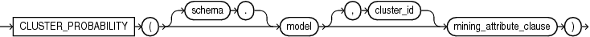
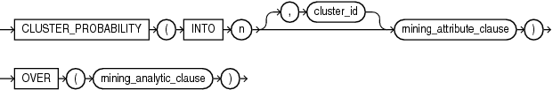

## CLUSTER\_PROBABILITY

Syntax

cluster\_probability::=



> ```
> CLUSTER_PROBABILITY ( [ schema . ] model [, cluster_id ] mining_attribute_clause )
> ```
>
> [  
> Copyright © 1996, 2025, Oracle and/or its affiliates.](https://docs.oracle.com/en/database/oracle/oracle-database/dcommon/html/cpyr.htm)


Analytic Syntax

cluster\_prob\_analytic::=



> ```
> CLUSTER_PROBABILITY ( INTO n [, cluster_id] mining_attribute_clause )
>                     OVER ( mining_analytic_clause )
> ```
>
> [  
> Copyright © 1996, 2025, Oracle and/or its affiliates.](https://docs.oracle.com/en/database/oracle/oracle-database/dcommon/html/cpyr.htm)


mining\_attribute\_clause::=


> ```
> USING
> { * 
> | { [ schema . ] table . * 
>   | expr [ AS alias ]
>   }
>     [, { [ schema . ] table . * 
>        | expr [ AS alias ]
>        }
>     ]...
> }
> ```
>
> [  
> Copyright © 1996, 2025, Oracle and/or its affiliates.](https://docs.oracle.com/en/database/oracle/oracle-database/dcommon/html/cpyr.htm)


mining\_analytic\_clause::=


> ```
> [ query_partition_clause ] [ order_by_clause ]
> ```
>
> [  
> Copyright © 1996, 2025, Oracle and/or its affiliates.](https://docs.oracle.com/en/database/oracle/oracle-database/dcommon/html/cpyr.htm)


See Also:

[Analytic Functions](Analytic-Functions.md) for information on the syntax, semantics, and restrictions of `mining_analytic_clause`

Purpose

`CLUSTER_PROBABILITY` returns a probability for each row in the selection. The probability refers to the highest probability cluster or to the specified `cluster_id`. The cluster probability is returned as `BINARY_DOUBLE`.

Syntax Choice

`CLUSTER_PROBABILITY` can score the data in one of two ways: It can apply a mining model object to the data, or it can dynamically mine the data by executing an analytic clause that builds and applies one or more transient mining models. Choose Syntax or Analytic Syntax:

- Syntax — Use the first syntax to score the data with a pre-defined model. Supply the name of a clustering model.
- Analytic Syntax — Use the analytic syntax to score the data without a pre-defined model. Include `INTO` `n`, where `n` is the number of clusters to compute, and mining\_analytic\_clause, which specifies if the data should be partitioned for multiple model builds. The `mining_analytic_clause` supports a `query_partition_clause` and an `order_by_clause`. (See [analytic\_clause::=](Analytic-Functions.md).)

The syntax of the `CLUSTER_PROBABILITY` function can use an optional `GROUPING` hint when scoring a partitioned model. See [GROUPING Hint](Comments.md).

mining\_attribute\_clause

`mining_attribute_clause` identifies the column attributes to use as predictors for scoring. When the function is invoked with the analytic syntax, these predictors are also used for building the transient models. The `mining_attribute_clause` behaves as described for the `PREDICTION` function. (See [mining\_attribute\_clause::=](PREDICTION.md).)

See Also:

- [Oracle Machine Learning for SQL User’s Guide](https://docs.oracle.com/pls/topic/lookup?ctx=en/database/oracle/oracle-database/21/sqlrf&id=DMPRG004) for information about scoring.
- [Oracle Machine Learning for SQL Concepts](https://docs.oracle.com/pls/topic/lookup?ctx=en/database/oracle/oracle-database/21/sqlrf&id=DMCON008) for information about clustering.

Note:

The following example is excerpted from the Oracle Machine Learning for SQL sample programs. For more information about the sample programs, see Appendix A in [Oracle Machine Learning for SQL User’s Guide](https://docs.oracle.com/pls/topic/lookup?ctx=en/database/oracle/oracle-database/21/sqlrf&id=DMPRG714).

Example

The following example lists the ten most representative customers, based on likelihood, of cluster 2.

```
SELECT cust_id
  FROM (SELECT cust_id, rank() OVER (ORDER BY prob DESC, cust_id) rnk_clus2
    FROM (SELECT cust_id, CLUSTER_PROBABILITY(km_sh_clus_sample, 2 USING *) prob
          FROM mining_data_apply_v))
WHERE rnk_clus2 <= 10
ORDER BY rnk_clus2;
 
   CUST_ID
----------
    100256
    100988
    100889
    101086
    101215
    100390
    100985
    101026
    100601
    100672
```