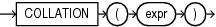

## COLLATION

Syntax



> ```
> COLLATION(expr)
> ```
>
> [  
> Copyright © 1996, 2025, Oracle and/or its affiliates.](https://docs.oracle.com/en/database/oracle/oracle-database/dcommon/html/cpyr.htm)


Purpose

`COLLATION` returns the name of the derived collation for `expr`. This function returns named collations and pseudo-collations. If the derived collation is a Unicode Collation Algorithm (UCA) collation, then the function returns the long form of its name. This function is evaluated during compilation of the SQL statement that contains it. If the derived collation is undefined due to a collation conflict while evaluating `expr`, then the function returns null.

`expr` must evaluate to a character string of type `CHAR`, `VARCHAR2`, `LONG`, `NCHAR`, or `NVARCHAR2`.

This function returns a `VARCHAR2` value.

Note:

The `COLLATION` function returns only the data-bound collation, and not the dynamic collation set by the `NLS_SORT` parameter. Thus, for a column declared as `COLLATE` `USING_NLS_SORT`, the function returns the character value `'USING_NLS_SORT'`, not the actual value of the session parameter `NLS_SORT`. You can use the built-in function `SYS_CONTEXT('USERENV','NLS_SORT')` to get the actual value of the session parameter `NLS_SORT`.

See Also:

Appendix C in [Oracle Database Globalization Support Guide](https://docs.oracle.com/pls/topic/lookup?ctx=en/database/oracle/oracle-database/21/sqlrf&id=NLSPG-GUID-AFCE41ED-775B-4A00-AF38-C436776AE0C5) for the collation derivation rules, which define the collation assigned to the character return value of `COLLATION`

Examples

The following example returns the derived collation of columns `name` and `id` in table `id_table`:

```
CREATE TABLE id_table
  (name VARCHAR2(64) COLLATE BINARY_AI,
   id VARCHAR2(8) COLLATE BINARY_CI);

INSERT INTO id_table VALUES('Christopher', 'ABCD1234');

SELECT COLLATION(name), COLLATION(id)
  FROM id_table;

COLLATION COLLATION
--------- ---------
BINARY_AI BINARY_CI
```