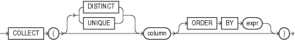

## COLLECT

Syntax



> ```
> COLLECT( [ DISTINCT | UNIQUE ] column [ ORDER BY expr ] )
> ```
>
> [  
> Copyright © 1996, 2025, Oracle and/or its affiliates.](https://docs.oracle.com/en/database/oracle/oracle-database/dcommon/html/cpyr.htm)


Purpose

`COLLECT` is an aggregate function that takes as its argument a column of any type and creates a nested table of the input type out of the rows selected. To get accurate results from this function you must use it within a `CAST` function.

If `column` is itself a collection, then the output of `COLLECT` is a nested table of collections. If `column` is of a user-defined type, then `column` must have a `MAP` or `ORDER` method defined on it in order for you to use the optional `DISTINCT`, `UNIQUE`, and `ORDER` `BY` clauses.

See Also:

- [CAST](CAST.md) and [Aggregate Functions](Aggregate-Functions.md)
- Appendix C in [Oracle Database Globalization Support Guide](https://docs.oracle.com/pls/topic/lookup?ctx=en/database/oracle/oracle-database/21/sqlrf&id=NLSPG-GUID-AFCE41ED-775B-4A00-AF38-C436776AE0C5) for the collation determination rules, which define the collation `COLLECT` uses to compare character values for the `DISTINCT` and `ORDER` `BY` clauses

Examples

The following example creates a nested table from the varray column of phone numbers in the sample table `oe.customers`. The nested table includes only the phone numbers of customers with an income level of `L`: `300,000` `and` `above`.

```
CREATE TYPE phone_book_t AS TABLE OF phone_list_typ;
/

SELECT CAST(COLLECT(phone_numbers) AS phone_book_t) "Income Level L Phone Book"
  FROM customers
  WHERE income_level = 'L: 300,000 and above';

Income Level L Phone Book
--------------------------------------------------------------------------------
PHONE_BOOK_T(PHONE_LIST_TYP('+1 414 123 4307'), PHONE_LIST_TYP('+1 608 123 4344'
), PHONE_LIST_TYP('+1 814 123 4696'), PHONE_LIST_TYP('+1 215 123 4721'), PHONE_L
IST_TYP('+1 814 123 4755'), PHONE_LIST_TYP('+91 11 012 4817', '+91 11 083 4817')
, PHONE_LIST_TYP('+91 172 012 4837'), PHONE_LIST_TYP('+41 31 012 3569', '+41 31
083 3569'))
```

The following example creates a nested table from the column of warehouse names in the sample table `oe`.`warehouses`. It uses `ORDER` `BY` to order the warehouse names.

```
CREATE TYPE warehouse_name_t AS TABLE OF VARCHAR2(35);
/

SELECT CAST(COLLECT(warehouse_name ORDER BY warehouse_name)
       AS warehouse_name_t) "Warehouses"
   FROM warehouses;

Warehouses
--------------------------------------------------------------------------------
WAREHOUSE_NAME_TYP('Beijing', 'Bombay', 'Mexico City', 'New Jersey', 'San Franci
sco', 'Seattle, Washington', 'Southlake, Texas', 'Sydney', 'Toronto')
```