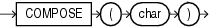

## COMPOSE

Syntax



> ```
> COMPOSE(char)
> ```
>
> [  
> Copyright © 1996, 2025, Oracle and/or its affiliates.](https://docs.oracle.com/en/database/oracle/oracle-database/dcommon/html/cpyr.htm)


Purpose

`COMPOSE` takes as its argument a character value `char` and returns the result of applying the Unicode canonical composition, as described in the Unicode Standard definition D117, to it. If the character set of the argument is not one of the Unicode character sets, COMPOSE returns its argument unmodified.

`COMPOSE` does not directly return strings in any of the Unicode normalization forms. To get a string in the NFC form, first call `DECOMPOSE` with the `CANONICAL` setting and then `COMPOSE`. To get a string in the NFKC form, first call `DECOMPOSE` with the `COMPATIBILITY` setting and then `COMPOSE`.

`char` can be of any of the data types: `CHAR`, `VARCHAR2`, `NCHAR`, or `NVARCHAR2`. Other data types are allowed if they can be implicitly converted to `VARCHAR2` or `NVARCHAR2`. The return value of `COMPOSE` is in the same character set as its argument.

`CLOB` and `NCLOB` values are supported through implicit conversion. If `char` is a character LOB value, then it is converted to a `VARCHAR2` value before the `COMPOSE` operation. The operation will fail if the size of the LOB value exceeds the supported length of the `VARCHAR2` in the particular execution environment.

See Also:

- [Oracle Database Globalization Support Guide](https://docs.oracle.com/pls/topic/lookup?ctx=en/database/oracle/oracle-database/21/sqlrf&id=NLSPG006) for information on Unicode character sets and character semantics
- Appendix C in [Oracle Database Globalization Support Guide](https://docs.oracle.com/pls/topic/lookup?ctx=en/database/oracle/oracle-database/21/sqlrf&id=NLSPG-GUID-AFCE41ED-775B-4A00-AF38-C436776AE0C5) for the collation derivation rules, which define the collation assigned to the character return value of `COMPOSE`
- [DECOMPOSE](DECOMPOSE.md)

Examples

The following example returns the o-umlaut code point:

```
SELECT COMPOSE( 'o' || UNISTR('\0308') )
  FROM DUAL; 

CO 
-- 
ö
```

See Also:

[UNISTR](UNISTR.md)