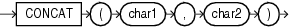

## CONCAT

Syntax



> ```
> CONCAT(char1, char2)
> ```
>
> [  
> Copyright © 1996, 2025, Oracle and/or its affiliates.](https://docs.oracle.com/en/database/oracle/oracle-database/dcommon/html/cpyr.htm)


Purpose

`CONCAT` returns `char1` concatenated with `char2`. Both `char1` and `char2` can be any of the data types `CHAR`, `VARCHAR2`, `NCHAR`, `NVARCHAR2`, `CLOB`, or `NCLOB`. The string returned is in the same character set as `char1`. Its data type depends on the data types of the arguments.

In concatenations of two different data types, Oracle Database returns the data type that results in a lossless conversion. Therefore, if one of the arguments is a LOB, then the returned value is a LOB. If one of the arguments is a national data type, then the returned value is a national data type. For example:

- `CONCAT` (`CLOB`, `NCLOB`) returns `NCLOB`
- `CONCAT` (`NCLOB`, `NCHAR`) returns `NCLOB`
- `CONCAT` (`NCLOB`, `CHAR`) returns `NCLOB`
- `CONCAT` (`NCHAR`, `CLOB`) returns `NCLOB`

This function is equivalent to the concatenation operator (||).

See Also:

- [Concatenation Operator](Concatenation-Operator.md) for information on the `CONCAT` operator
- Appendix C in [Oracle Database Globalization Support Guide](https://docs.oracle.com/pls/topic/lookup?ctx=en/database/oracle/oracle-database/21/sqlrf&id=NLSPG-GUID-AFCE41ED-775B-4A00-AF38-C436776AE0C5) for the collation derivation rules, which define the collation assigned to the character return value of `CONCAT`

Examples

This example uses nesting to concatenate three character strings:

```
SELECT CONCAT(CONCAT(last_name, '''s job category is '), job_id) "Job" 
  FROM employees 
  WHERE employee_id = 152;
 
Job
------------------------------------------------------
Hall's job category is SA_REP
```