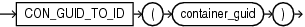

## CON\_GUID\_TO\_ID

Syntax



> ```
> CON_GUID_TO_ID(container_guid)
> ```
>
> [  
> Copyright © 1996, 2025, Oracle and/or its affiliates.](https://docs.oracle.com/en/database/oracle/oracle-database/dcommon/html/cpyr.htm)


Purpose

`CON_GUID_TO_ID` takes as its argument a container GUID (globally unique identifier) and returns the container ID. For `container_guid`, specify a raw value. The function returns a `NUMBER` value.

This function is useful in a multitenant container database (CDB). If you use this function in a non-CDB, then it returns 0.

Example

The following query displays the ID and GUID for all containers in a CDB. The GUID is stored as a 16-byte `RAW` value in the `V$CONTAINERS` view. The query returns the 32-character hexadecimal representation of the GUID. The sample output shown is for the purpose of this example.

```
SELECT CON_ID, GUID
  FROM V$CONTAINERS;

    CON_ID GUID
---------- --------------------------------
         1 DB0A9F33DF99567FE04305B4F00A667D
         2 D990C280C309591EE04305B4F00A593E
         4 D990F4BD938865C1E04305B4F00ACA18
```

The following statement returns the ID for the container whose GUID is represented by the hexadecimal value `D990F4BD938865C1E04305B4F00ACA18`. The `HEXTORAW` function converts the GUID's hexadecimal representation to a raw value.

```
SELECT CON_GUID_TO_ID(HEXTORAW('D990F4BD938865C1E04305B4F00ACA18')) "Container ID"
  FROM DUAL;

Container ID
------------
           4
```