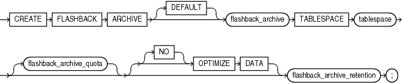
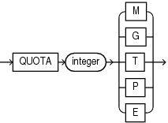
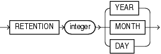

## CREATE FLASHBACK ARCHIVE

Purpose

Use the `CREATE` `FLASHBACK` `ARCHIVE` statement to create a flashback archive, which provides the ability to automatically track and archive transactional data changes to specified database objects. A flashback archive consists of multiple tablespaces and stores historic data from all transactions against tracked tables. The data is stored in internal history tables.

Flashback data archives retain historical data for the time duration specified using the `RETENTION` parameter. Historical data can be queried using the Flashback Query `AS` `OF` clause. Archived historic data that has aged beyond the specified retention period is automatically purged.

Flashback data archives retain historical data across data definition language (DDL) changes to tables enabled for flashback archive. Flashback data archives supports many common DDL statements, including some DDL statements that alter table definitions or incur data movement. DDL statements that are not supported result in error ORA-55610.

See Also:

- [Oracle Database Development Guide](https://docs.oracle.com/pls/topic/lookup?ctx=en/database/oracle/oracle-database/21/sqlrf&id=ADFNS01011) for general information on using Flashback Time Travel
- The `CREATE` `TABLE` [flashback\_archive\_clause](CREATE-TABLE.md) for information on designating a table as a tracked table
- [ALTER FLASHBACK ARCHIVE](ALTER-FLASHBACK-ARCHIVE.md) for information on changing the quota and retention attributes of the flashback archive, as well as adding or changing tablespace storage for the flashback archive

Prerequisites

You must have the `FLASHBACK` `ARCHIVE` `ADMINISTER` system privilege to create a flashback archive. In addition, you must have the `CREATE` `TABLESPACE` system privilege to create a flashback archive, as well as sufficient quota on the tablespace in which the historical information will reside. To designate a flashback archive as the system default flashback archive, you must be logged in as `SYSDBA`.

Syntax

create\_flashback\_archive::=



> ```
> CREATE FLASHBACK ARCHIVE [DEFAULT] flashback_archive
>   TABLESPACE tablespace
>   [flashback_archive_quota]
>   [ [NO] OPTIMIZE DATA ]
>   flashback_archive_retention
> ;
> ```
>
> [  
> Copyright © 1996, 2025, Oracle and/or its affiliates.](https://docs.oracle.com/en/database/oracle/oracle-database/dcommon/html/cpyr.htm)


flashback\_archive\_quota::=



> ```
> QUOTA integer { M | G | T | P | E }
> ```
>
> [  
> Copyright © 1996, 2025, Oracle and/or its affiliates.](https://docs.oracle.com/en/database/oracle/oracle-database/dcommon/html/cpyr.htm)


flashback\_archive\_retention::=



> ```
> RETENTION integer {YEAR | MONTH | DAY}
> ```
>
> [  
> Copyright © 1996, 2025, Oracle and/or its affiliates.](https://docs.oracle.com/en/database/oracle/oracle-database/dcommon/html/cpyr.htm)


Semantics

DEFAULT

You must be logged in as `SYSDBA` to specify `DEFAULT`. Use this clause to designate this flashback archive as the default flashback archive for the database. When a `CREATE` `TABLE` or `ALTER` `TABLE` statement specifies the `flashback_archive_clause` without specifying a flashback archive name, the database uses the default flashback archive to store data from that table.

You cannot specify this clause if a default flashback archive already exists. However, you can replace an existing default flashback archive using the `ALTER` `FLASHBACK` `ARCHIVE`... `SET` `DEFAULT` clause.

See Also:

The `CREATE` `TABLE` [flashback\_archive\_clause](CREATE-TABLE.md) for more information

flashback\_archive

Specify the name of the flashback archive. The name must satisfy the requirements specified in " [Database Object Naming Rules](Database-Object-Names-and-Qualifiers.md) ".

TABLESPACE Clause

Specify the tablespace where the archived data for this flashback archive is to be stored. You can specify only one tablespace with this clause. However, you can subsequently add tablespaces to the flashback archive with an `ALTER` `FLASHBACK` `ARCHIVE` statement.

flashback\_archive\_quota

Specify the amount of space in the initial tablespace to be reserved for the archived data. If the space for archiving in a flashback archive becomes full, then DML operations on tracked tables that use this flashback archive will fail. The database issues an out-of-space alert when the content of the flashback archive is 90% of the specified quota, to allow time to purge old data or add additional quota. If you omit this clause, then the flashback archive has unlimited quota on the specified tablespace.

\[NO\] OPTIMIZE DATA

Specify `OPTIMIZE` `DATA` to enable optimization for flashback archive history tables. This instructs the database to optimize the storage of data in history tables using any of the following features: Advanced Row Compression, Advanced LOB Compression, Advanced LOB Deduplication, segment-level compression tiering, and row-level compression tiering. To specify this clause, you must have a license for the Advanced Compression option.

Specify `NO` `OPTIMIZE` `DATA` to instruct the database not to optimize the storage of data in history tables. This is the default.

flashback\_archive\_retention

Specify the length of time in months, days, or years that the archived data should be retained in the flashback archive. If the length of time causes the flashback archive to become full, then the database responds as described in flashback\_archive\_quota.

Examples

The following statement creates two flashback archives for testing purposes. The first is designated as the default for the database. For both of them, the space quota is 1 megabyte, and the archive retention is one day.

```
CREATE FLASHBACK ARCHIVE DEFAULT test_archive1
   TABLESPACE example
   QUOTA 1 M
   RETENTION 1 DAY;

CREATE FLASHBACK ARCHIVE test_archive2
   TABLESPACE example
   QUOTA 1 M
   RETENTION 1 DAY;
```

The next statement alters the default flashback archive to extend the retention period to 1 month:

```
ALTER FLASHBACK ARCHIVE test_archive1
   MODIFY RETENTION 1 MONTH;
```

The next statement specifies tracking for the `oe.customers` table. The flashback archive is not specified, so data will be archived in the default flashback archive, `test_archive1`:

```
ALTER TABLE oe.customers
   FLASHBACK ARCHIVE;
```

The next statement specifies tracking for the `oe.orders` table. In this case, data will be archived in the specified flashback archive, `test_archive2`:

```
ALTER TABLE oe.orders
   FLASHBACK ARCHIVE test_archive2;
```

The next statement drops `test_archive2` flashback archive:

```
DROP FLASHBACK ARCHIVE test_archive2;
```