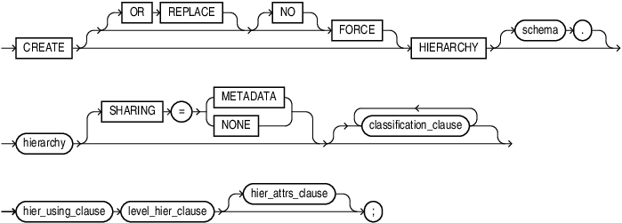
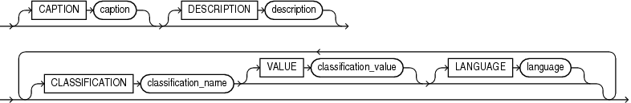
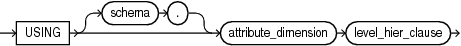
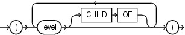
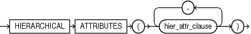
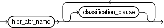
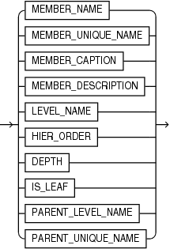

## CREATE HIERARCHY

Purpose

Use the `CREATE` `HIERARCHY` statement to create a hierarchy. A hierarchy specifies the hierarchical relationships among the levels of an attribute dimension.

Prerequisites

To create a hierarchy in your own schema, you must have the `CREATE` `HIERARCHY` system privilege. To create a hierarchy in another user's schema, you must have the `CREATE` `ANY` `HIERARCHY` system privilege.

Syntax

create\_hierarchy::=



> ```
> CREATE [ OR REPLACE ] [ FORCE | NOFORCE ] 
>   HIERARCHY [ schema. ] hierarchy 
>   [ SHARING "=" ( METADATA | NONE ) ]
>   [ classification_clause ]... ]
>   hier_using_clause
>   level_hier_clause
>   [ hier_attrs_clause ]
> ;
> ```
>
> [  
> Copyright © 1996, 2025, Oracle and/or its affiliates.](https://docs.oracle.com/en/database/oracle/oracle-database/dcommon/html/cpyr.htm)


classification\_clause::=



> ```
> [ CAPTION caption ]
> [ DESCRIPTION description ]
> [ CLASSIFICATION classification_name
>   [ VALUE classification_value ] 
>   [ LANGUAGE language ]
> ]...
> ```
>
> [  
> Copyright © 1996, 2025, Oracle and/or its affiliates.](https://docs.oracle.com/en/database/oracle/oracle-database/dcommon/html/cpyr.htm)


hier\_using\_clause::=



> ```
> USING [ schema. ] attribute_dimension level_hier_clause
> ```
>
> [  
> Copyright © 1996, 2025, Oracle and/or its affiliates.](https://docs.oracle.com/en/database/oracle/oracle-database/dcommon/html/cpyr.htm)


level\_hier\_clause::=



> ```
> ( level [ CHILD  OF level ]... )
> ```
>
> [  
> Copyright © 1996, 2025, Oracle and/or its affiliates.](https://docs.oracle.com/en/database/oracle/oracle-database/dcommon/html/cpyr.htm)


hier\_attrs\_clause::=



> ```
> HIERARCHICAL ATTRIBUTES ( hier_attr_clause [, hier_attr_clause ]... )
> ```
>
> [  
> Copyright © 1996, 2025, Oracle and/or its affiliates.](https://docs.oracle.com/en/database/oracle/oracle-database/dcommon/html/cpyr.htm)


hier\_attr\_clause::=



> ```
> hier_attr_name [ classification_clause ]...
> ```
>
> [  
> Copyright © 1996, 2025, Oracle and/or its affiliates.](https://docs.oracle.com/en/database/oracle/oracle-database/dcommon/html/cpyr.htm)


hier\_attr\_name::=



> ```
> {   MEMBER_NAME
>   | MEMBER_UNIQUE_NAME
>   | MEMBER_CAPTION
>   | MEMBER_DESCRIPTION
>   | LEVEL_NAME
>   | HIER_ORDER
>   | DEPTH
>   | IS_LEAF
>   | PARENT_LEVEL_NAME
>   | PARENT_UNIQUE_NAME
> }
> ```
>
> [  
> Copyright © 1996, 2025, Oracle and/or its affiliates.](https://docs.oracle.com/en/database/oracle/oracle-database/dcommon/html/cpyr.htm)


Semantics

OR REPLACE

Specify `OR` `REPLACE` to replace an existing definition of a hierarchy with a different definition.

FORCE and NOFORCE

Specify `FORCE` to force the creation of the hierarchy even if it does not successfully compile. If you specify `NOFORCE`, then the hierarchy must compile successfully, otherwise an error occurs. The default is `NOFORCE`.

schema

Specify the schema in which to create the hierarchy. If you do not specify a schema, then Oracle Database creates the hierarchy in your own schema.

hierarchy

Specify a name for the hierarchy.

SHARING

Use the sharing clause if you want to create the object in an application root in the context of an application maintenance. This type of object is called an application common object and it can be shared with the application PDBs that belong to the application root.

You can specify how the object is shared using one of the following sharing attributes:

- `METADATA` - A metadata link shares the metadata, but its data is unique to each container. This type of object is referred to as a metadata-linked application common object.
- `NONE` - The object is not shared and can only be accessed in the application root.

classification\_clause

Use the classification clause to specify values for the `CAPTION` or `DESCRIPTION` classifications and to specify user-defined classifications. Classifications provide descriptive metadata that applications may use to provide information about analytic views and their components.

You may specify any number of classifications for the same object. A classification can have a maximum length of 4000 bytes.

For the `CAPTION` and `DESCRIPTION` classifications, you may use the DDL shortcuts `CAPTION` `'` `caption` `'` and `DESCRIPTION` `'` `description` `'` or the full classification syntax.

You may vary the classification values by language. To specify a language for the `CAPTION` or `DESCRIPTION` classification, you must use the full syntax. If you do not specify a language, then the language value for the classification is `NULL`. The language value must either be `NULL` or a valid `NLS_LANGUAGE` value.

hier\_using\_clause

Specify the attribute dimension that has the members of the hierarchy.

level\_hier\_clause

Specify the organization of the hierarchy levels.

hier\_attrs\_clause

Specify classifications that contain descriptive metadata for the hierarchical attributes. A `hier_attr_clause` for a given `hier_attr_name` may appear only once in the list.

All hierarchies always contain all of the hierarchical attributes, but a hierarchical attribute does not have descriptive metadata associated with it unless you specify it with this clause.

hier\_attr\_clause

Specify a hierarchical attribute and provide one or more classifications for it.

hier\_attr\_name

Specify a hierarchical attribute.

Examples

The following example creates the `TIME_HIER` hierarchy:

```
CREATE OR REPLACE HIERARCHY time_hier  -- Hierarchy name
USING time_attr_dim               -- Refers to TIME_ATTR_DIM attribute dimension
 (month CHILD OF                  -- Months in the attribute dimension
 quarter CHILD OF
 year);
```

The following example creates the `PRODUCT_HIER` hierarchy:

```
CREATE OR REPLACE HIERARCHY product_hier
USING product_attr_dim
 (category
  CHILD OF department);
```

The following example creates the `GEOGRAPHY_HIER` hierarchy:

```
CREATE OR REPLACE HIERARCHY geography_hier
USING geography_attr_dim
 (state_province
  CHILD OF country
  CHILD OF region);
```