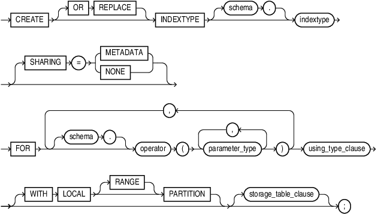
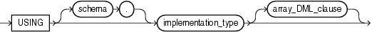
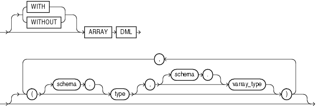

## CREATE INDEXTYPE

Purpose

Use the `CREATE` `INDEXTYPE` statement to create an indextype, which is an object that specifies the routines that manage a domain (application-specific) index. Indextypes reside in the same namespace as tables, views, and other schema objects. This statement binds the indextype name to an implementation type, which in turn specifies and refers to user-defined index functions and procedures that implement the indextype.

See Also:

[Oracle Database Data Cartridge Developer's Guide](https://docs.oracle.com/pls/topic/lookup?ctx=en/database/oracle/oracle-database/21/sqlrf&id=ADDCI210) for more information on implementing indextypes

Prerequisites

To create an indextype in your own schema, you must have the `CREATE` `INDEXTYPE` system privilege. To create an indextype in another schema, you must have the `CREATE` `ANY` `INDEXTYPE` system privilege. In either case, you must have the `EXECUTE` object privilege on the implementation type and the supported operators.

An indextype supports one or more operators, so before creating an indextype, you must first design the operator or operators to be supported and provide functional implementation for those operators.

See Also:

[CREATE OPERATOR](CREATE-OPERATOR.md)

Syntax

create\_indextype::=



> ```
> CREATE [ OR REPLACE ] INDEXTYPE [ schema. ] indextype
>   [ SHARING "=" ( METADATA | NONE ) ]
>   FOR [ schema. ] operator (parameter_type [, parameter_type ]...)
>         [, [ schema. ] operator (parameter_type [, parameter_type ]...)
>         ]...
>   using_type_clause
>   [WITH LOCAL [RANGE] PARTITION ]
>   [ storage_table_clause ]
> ;
> ```
>
> [  
> Copyright © 1996, 2025, Oracle and/or its affiliates.](https://docs.oracle.com/en/database/oracle/oracle-database/dcommon/html/cpyr.htm)


using\_type\_clause::=



> ```
> USING [ schema. ] implementation_type [ array_DML_clause ]
> ```
>
> [  
> Copyright © 1996, 2025, Oracle and/or its affiliates.](https://docs.oracle.com/en/database/oracle/oracle-database/dcommon/html/cpyr.htm)


array\_DML\_clause::=



> ```
> [ WITH | WITHOUT ]
> ARRAY DML
> [ ([ schema. ]type
>    [, [ schema. ]varray_type ])
>     [, ([ schema. ]type
>         [, [ schema. ]varray_type ])...
> ]
> ```
>
> [  
> Copyright © 1996, 2025, Oracle and/or its affiliates.](https://docs.oracle.com/en/database/oracle/oracle-database/dcommon/html/cpyr.htm)


storage\_table\_clause::=


> ```
> WITH {SYSTEM | USER} MANAGED STORAGE TABLES
> ```
>
> [  
> Copyright © 1996, 2025, Oracle and/or its affiliates.](https://docs.oracle.com/en/database/oracle/oracle-database/dcommon/html/cpyr.htm)


Semantics

schema

Specify the name of the schema in which the indextype resides. If you omit `schema`, then Oracle Database creates the indextype in your own schema.

indextype

Specify the name of the indextype to be created. The name must satisfy the requirements listed in " [Database Object Naming Rules](Database-Object-Names-and-Qualifiers.md) ".

SHARING

Use the sharing clause if you want to create the object in an application root in the context of an application maintenance. This type of object is called an application common object and it can be shared with the application PDBs that belong to the application root.

You can specify how the object is shared using one of the following sharing attributes:

- `METADATA` - A metadata link shares the metadata, but its data is unique to each container. This type of object is referred to as a metadata-linked application common object.
- `NONE` - The object is not shared and can only be accessed in the application root.

FOR Clause

Use the `FOR` clause to specify the list of operators supported by the indextype.

- For `schema`, specify the schema containing the operator. If you omit `schema`, then Oracle assumes the operator is in your own schema.
- For `operator`, specify the name of the operator supported by the indextype.
	All the operators listed in this clause must be valid operators.
- For `parameter_type`, list the types of parameters to the operator.

using\_type\_clause

The `USING` clause lets you specify the type that provides the implementation for the new indextype.

For `implementation_type`, specify the name of the type that implements the appropriate Oracle Data Cartridge Interface (ODCI).

- You must specify a valid type that implements the routines in the ODCI.
- The implementation type must reside in the same schema as the indextype.

See Also:

[Oracle Database Data Cartridge Developer's Guide](https://docs.oracle.com/pls/topic/lookup?ctx=en/database/oracle/oracle-database/21/sqlrf&id=ADDCI3150) for additional information on this interface

WITH LOCAL PARTITION

Use this clause to indicate that the indextype can be used to create local domain indexes on range-, list-, hash-, and interval-partitioned tables. You use this clause in combination with the `storage_table_clause` in several ways (see storage\_table\_clause).

- The recommended method is to specify `WITH` `LOCAL` `PARTITION` `WITH` `SYSTEM` `MANAGED` `STORAGE` `TABLES`. This combination uses system-managed storage tables, which are the preferred storage management, and lets you create local domain indexes on range-, list-, hash-, and interval-partitioned tables. In this case the `RANGE` keyword is optional and ignored, because it is no longer needed if you specify `WITH` `LOCAL` `PARTITION` `WITH` `SYSTEM` `MANAGED` `STORAGE` `TABLES`.
- You can specify `WITH` `LOCAL` `RANGE` `PARTITION` (including the `RANGE` keyword) and omit the `storage_table` clause. Local domain indexes on range-partitioned tables are supported with user-managed storage tables for backward compatibility. Oracle does not recommend this combination because it uses the less efficient user-managed storage tables.

If you omit this clause entirely, then you cannot subsequently use this indextype to create a local domain index on a range, list-, hash-, or interval-partitioned table.

storage\_table\_clause

Use this clause to specify how storage tables and partition maintenance operations for indexes built on this indextype are managed:

- Specify `WITH` `SYSTEM` `MANAGED` `STORAGE` `TABLES` to indicate that the storage of statistics data is to be managed by the system. The type you specify in `statistics_type` should be storing the statistics related information in tables that are maintained by the system. Also, the indextype you specify must already have been created or altered to support the `WITH` `SYSTEM` `MANAGED` `STORAGE` `TABLES` clause.
- Specify `WITH` `USER` `MANAGED` `STORAGE` `TABLES` to indicate that the tables that store the user-defined statistics will be managed by the user. This is the default behavior.

See Also:

[Oracle Database Data Cartridge Developer's Guide](https://docs.oracle.com/pls/topic/lookup?ctx=en/database/oracle/oracle-database/21/sqlrf&id=ADDCI290) for more information about storage tables for domain indexes

array\_DML\_clause

Use this clause to let the indextype support the array interface for the `ODCIIndexInsert` method.

type and varray\_type

If the data type of the column to be indexed is a user-defined object type, then you must specify this clause to identify the varray `varray_type` that Oracle should use to hold column values of `type`. If the indextype supports a list of types, then you can specify a corresponding list of varray types. If you omit `schema` for either `type` or `varray_type`, then Oracle assumes the type is in your own schema.

If the data type of the column to be indexed is a built-in system type, then any varray type specified for the indextype takes precedence over the ODCI types defined by the system.

See Also:

[Oracle Database Data Cartridge Developer's Guide](https://docs.oracle.com/pls/topic/lookup?ctx=en/database/oracle/oracle-database/21/sqlrf&id=ADDCI025) for more information on the ODCI array interface

Examples

Creating an Indextype: Example

The following statement creates an indextype named `position_indextype` and specifies the `position_between` operator that is supported by the indextype and the `position_im` type that implements the index interface. Refer to " [Using Extensible Indexing](Using-Extensible-Indexing.md) " for an extensible indexing scenario that uses this indextype:

```
CREATE INDEXTYPE position_indextype
   FOR position_between(NUMBER, NUMBER, NUMBER)
   USING position_im;
```