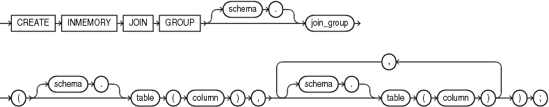

## CREATE INMEMORY JOIN GROUP

Purpose

Use the `CREATE` `INMEMORY` `JOIN` `GROUP` statement to create a join group, which is an object that specifies frequently joined columns from the same table or different tables. Such columns typically contain values of compatible data types that fall in similar ranges. When you create a join group, Oracle Database stores special metadata for the columns in the global dictionary, which enables the database to optimize join queries for the columns. In order to achieve this optimization, the table columns must be populated in the In-Memory Column Store (IM column store).

Creating a join group for tables causes the current In-Memory contents of these tables to be invalidated. Subsequent repopulation causes the In-Memory Compression Units (IMCUs) of the tables to be re-encoded with the global dictionary. Thus, Oracle recommends that you first create the join group, and then populate the tables.

See Also:

- [ALTER INMEMORY JOIN GROUP](ALTER-INMEMORY-JOIN-GROUP.md) and [DROP INMEMORY JOIN GROUP](DROP-INMEMORY-JOIN-GROUP.md)
- [Oracle Database In-Memory Guide](https://docs.oracle.com/pls/topic/lookup?ctx=en/database/oracle/oracle-database/21/sqlrf&id=INMEM-GUID-3E5491C4-B345-4A8E-8B1B-8DC150C8A797) for more information on join groups

Prerequisites

To create a join group in another user's schema, or to include in the join group a column in a table in another user’s schema, you must have the `CREATE` `ANY` `TABLE` system privilege.

Syntax

create\_inmemory\_join\_group::=



> ```
> CREATE INMEMORY JOIN GROUP [ schema. ] join_group
>   ( [ schema. ] table ( column ) , [ schema. ] table ( column )
>     [, [ schema. ] table ( column ) ]... ) ;
> ```
>
> [  
> Copyright © 1996, 2025, Oracle and/or its affiliates.](https://docs.oracle.com/en/database/oracle/oracle-database/dcommon/html/cpyr.htm)


Semantics

schema

Specify the schema to contain the join group. If you omit `schema`, then the database creates the join group in your own schema.

join\_group

Specify the name of the join group to be created. The name must satisfy the requirements listed in “ [Database Object Naming Rules](Database-Object-Names-and-Qualifiers.md) ”.

schema

Specify the schema of the table that contains a column to be included in the join group If you omit `schema`, then Oracle Database assumes the table is in your own schema.

table

Specify the name of the table that contains a column to be included in the join group.

column

Specify the name of a column to be included in the join group. A join group can contain columns in the same table or different tables.

Restrictions on Join Groups

The following restrictions apply to join groups:

- A join group must contain at least 1 column.
- A join group can contain at most 255 columns.
- A table column can be a member of at most one join group.
- Oracle Active Data Guard does not support join groups.

Examples

The following statement creates a join group named `prod_id1` in the `oe` schema. Both tables involved in this join group reside in the `oe` schema.

```
CREATE INMEMORY JOIN GROUP prod_id1
  (inventories(product_id), order_items(product_id));
```

The following statement creates a join group named `prod_id2` in the `oe` schema. The table `inventories` resides in the `oe` schema and the table `online_media` resides in the `pm` schema.

```
CREATE INMEMORY JOIN GROUP prod_id2
  (inventories(product_id), pm.online_media(product_id));
```