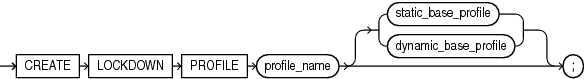
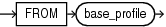
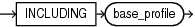

## CREATE LOCKDOWN PROFILE

Purpose

Use the `CREATE` `LOCKDOWN` `PROFILE` statement to create a PDB lockdown profile. You can use PDB lockdown profiles in a multitenant container database (CDB) to restrict user operations in PDBs.

After you create a PDB lockdown profile, you can add restrictions to the profile with the `ALTER` `LOCKDOWN` `PROFILE` statement. You can restrict user operations associated with certain database features, options, and SQL statements.

When a lockdown profile is assigned to a PDB, users in that PDB cannot perform the operations that are the disabled for the profile. To assign a lockdown profile, set its name for the value of the `PDB_LOCKDOWN` initialization parameter. You can assign a lockdown profile to individual PDBs, or to all PDBs in a CDB or application container, as follows:

- If you set `PDB_LOCKDOWN` while connected to a CDB root, then the lockdown profile applies to all PDBs in the CDB. It does not apply to the CDB root.
- If you set `PDB_LOCKDOWN` while connected to an application root, then the lockdown profile applies to the application root and all PDBs in the application container.
- If you set `PDB_LOCKDOWN` while connected to a particular PDB, then the lockdown profile applies to that PDB and overrides the lockdown profile for the CDB or application container, if one exists.

See Also:

- [ALTER LOCKDOWN PROFILE](ALTER-LOCKDOWN-PROFILE.md) and [DROP LOCKDOWN PROFILE](DROP-LOCKDOWN-PROFILE.md)
- [Oracle Database Security Guide](https://docs.oracle.com/pls/topic/lookup?ctx=en/database/oracle/oracle-database/21/sqlrf&id=DBSEG-GUID-AB5E62DB-7E2A-4B5A-BA96-A2BD2DF15275) for more information on PDB lockdown profiles

Prerequisites

- The `CREATE` `LOCKDOWN` `PROFILE` statement must be issued from the CDB or the Application Root.
- You must have the `CREATE` `LOCKDOWN` `PROFILE` system privilege in the container in which the statement is issued.
- The PDB lockdown profile name must be unique in the container in which the statement is issued.

Syntax

create\_lockdown\_profile::=



> ```
> CREATE LOCKDOWN PROFILE profile_name 
>    { static_base_profile | dynamic_base_profile };
> ```
>
> [  
> Copyright © 1996, 2025, Oracle and/or its affiliates.](https://docs.oracle.com/en/database/oracle/oracle-database/dcommon/html/cpyr.htm)


static\_base\_profile::=



> ```
> FROM base_profile
> ```
>
> [  
> Copyright © 1996, 2025, Oracle and/or its affiliates.](https://docs.oracle.com/en/database/oracle/oracle-database/dcommon/html/cpyr.htm)


dynamic\_base\_profile::=



> ```
> INCLUDING base_profile
> ```
>
> [  
> Copyright © 1996, 2025, Oracle and/or its affiliates.](https://docs.oracle.com/en/database/oracle/oracle-database/dcommon/html/cpyr.htm)


Semantics

profile\_name

You can create a new PDB lockdown profile with a name that you specify. The name must satisfy the requirements listed in “ [Database Object Naming Rules](Database-Object-Names-and-Qualifiers.md) ”. The lockdown profile can be derived from a static, or dynamic base profile.

static\_base\_profile

Use this option to create a new lockdown profile with a base profile. The rules of the base profile in effect at profile creation time will be copied to the new lockdown profile. Changes to the base profile after the lockdown profile is created will not apply to the lockdown profile.

dynamic\_base\_profile

Use this option to create a new lockdown profile that will change with changes to the base profile. The new lockdown profile will inherit `DISABLE` rules of the base profile as well and subsequent changes to the base profile. The rules of the base profile have precedence in any conflict with rules that may be explicitly added to the lockdown profile. For example, the `OPTION_VALUE` clause of the base profile takes precedence over the `OPTION_VALUE` clause of the dynamic base profile.

Example

The following statement creates PDB lockdown profile `hr_prof` with a dynamic base profile `PRIVATE_DBAAS`:

```
CREATE LOCKDOWN PROFILE hr_prof INCLUDING PRIVATE_DBAAS;
```