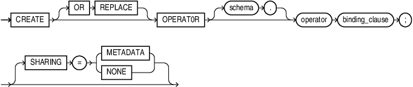
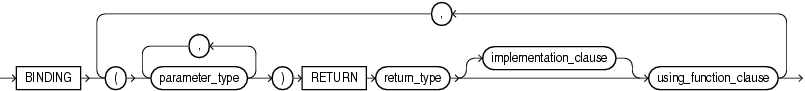
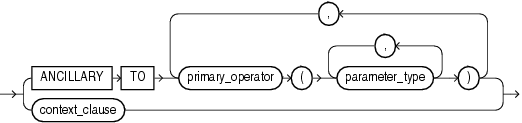
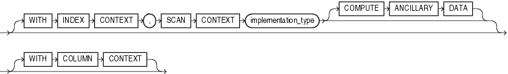
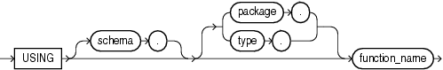

## CREATE OPERATOR

Purpose

Use the `CREATE` `OPERATOR` statement to create a new operator and define its bindings.

Operators can be referenced by indextypes and by SQL queries and DML statements. The operators, in turn, reference functions, packages, types, and other user-defined objects.

See Also:

[Oracle Database Data Cartridge Developer's Guide](https://docs.oracle.com/pls/topic/lookup?ctx=en/database/oracle/oracle-database/21/sqlrf&id=ADDCI2100) and [Oracle Database Concepts](https://docs.oracle.com/pls/topic/lookup?ctx=en/database/oracle/oracle-database/21/sqlrf&id=CNCPT1859) for a discussion of these dependencies and of operators in general

Prerequisites

To create an operator in your own schema, you must have the `CREATE` `OPERATOR` system privilege. To create an operator in another schema, you must have the `CREATE` `ANY` `OPERATOR` system privilege. In either case, you must also have the `EXECUTE` object privilege on the functions and operators referenced.

Syntax

create\_operator::=



> ```
> CREATE [ OR REPLACE ] OPERATOR
>    [ schema. ] operator binding_clause ; [ SHARING "=" ( METADATA | NONE )]
> ```
>
> [  
> Copyright © 1996, 2025, Oracle and/or its affiliates.](https://docs.oracle.com/en/database/oracle/oracle-database/dcommon/html/cpyr.htm)


binding\_clause::=



> ```
> BINDING
>    (parameter_type [, parameter_type ]...)
>    RETURN return_type
>    [ implementation_clause ]
>    using_function_clause
>     [, (parameter_type [, parameter_type ]...)
>        RETURN return_type
>        [ implementation_clause ]
>        using_function_clause
>     ]...
> ```
>
> [  
> Copyright © 1996, 2025, Oracle and/or its affiliates.](https://docs.oracle.com/en/database/oracle/oracle-database/dcommon/html/cpyr.htm)


implementation\_clause::=



> ```
> { ANCILLARY TO primary_operator
>     ( parameter_type [, parameter_type ]...)
>       [, primary_operator
>          ( parameter_type [, parameter_type ]...)
>       ]...
> | context_clause
> }
> ```
>
> [  
> Copyright © 1996, 2025, Oracle and/or its affiliates.](https://docs.oracle.com/en/database/oracle/oracle-database/dcommon/html/cpyr.htm)


context\_clause::=



> ```
> [ WITH INDEX CONTEXT,
>   SCAN CONTEXT implementation_type
>   [ COMPUTE ANCILLARY DATA ]
> ]
> [ WITH COLUMN CONTEXT ]
> ```
>
> [  
> Copyright © 1996, 2025, Oracle and/or its affiliates.](https://docs.oracle.com/en/database/oracle/oracle-database/dcommon/html/cpyr.htm)


using\_function\_clause::=



> ```
> USING [ schema. ] [ package. | type. ] function_name
> ```
>
> [  
> Copyright © 1996, 2025, Oracle and/or its affiliates.](https://docs.oracle.com/en/database/oracle/oracle-database/dcommon/html/cpyr.htm)


Semantics

OR REPLACE

Specify `OR` `REPLACE` to replace the definition of the operator schema object.

Restriction on Replacing an Operator

You can replace the definition only if the operator has no dependent objects, such as indextypes supporting the operator.

schema

Specify the schema containing the operator. If you omit `schema`, then the database creates the operator in your own schema.

operator

Specify the name of the operator to be created. The name must satisfy the requirements listed in " [Database Object Naming Rules](Database-Object-Names-and-Qualifiers.md) ".

binding\_clause

Use the `binding_clause` to specify one or more parameter data types (`parameter_type`) for binding the operator to a function. The signature of each binding—the sequence of the data types of the arguments to the corresponding function—must be unique according to the rules of overloading.

The `parameter_type` can itself be an object type. If it is, then you can optionally qualify it with its schema.

Restriction on Binding Operators

You cannot specify a `parameter_type` of `REF`, `LONG`, or `LONG` `RAW`.

See Also:

[Oracle Database PL/SQL Language Reference](https://docs.oracle.com/pls/topic/lookup?ctx=en/database/oracle/oracle-database/21/sqlrf&id=LNPLS00807) for more information about overloading

RETURN Clause

Specify the return data type for the binding.

The `return_type` can itself be an object type. If so, then you can optionally qualify it with its schema.

Restriction on Binding Return Data Type

You cannot specify a `return_type` of `REF`, `LONG`, or `LONG` `RAW`.

SHARING

Use the sharing clause if you want to create the object in an application root in the context of an application maintenance. This type of object is called an application common object and it can be shared with the application PDBs that belong to the application root.

You can specify how the object is shared using one of the following sharing attributes:

- `METADATA` - A metadata link shares the metadata, but its data is unique to each container. This type of object is referred to as a metadata-linked application common object.
- `NONE` - The object is not shared and can only be accessed in the application root.

implementation\_clause

Use this clause to describe the implementation of the binding.

ANCILLARY TO Clause

Use the `ANCILLARY` `TO` clause to indicate that the operator binding is ancillary to the specified primary operator binding (`primary_operator`). If you specify this clause, then do not specify a previous binding with just one number parameter.

context\_clause

Use the `context_clause` to describe the functional implementation of a binding that is not ancillary to a primary operator binding.

WITH INDEX CONTEXT, SCAN CONTEXT

Use this clause to indicate that the functional evaluation of the operator uses the index and a scan context that is specified by the implementation type.

COMPUTE ANCILLARY DATA

Specify `COMPUTE` `ANCILLARY` `DATA` to indicate that the operator binding computes ancillary data.

WITH COLUMN CONTEXT

Specify `WITH` `COLUMN` `CONTEXT` to indicate that Oracle Database should pass the column information to the functional implementation for the operator.

If you specify this clause, then the signature of the function implemented must include one extra `ODCIFuncCallInfo` structure.

See Also:

[Oracle Database Data Cartridge Developer's Guide](https://docs.oracle.com/pls/topic/lookup?ctx=en/database/oracle/oracle-database/21/sqlrf&id=ADDCI024) for instructions on using the `ODCIFuncCallInfo` routine

using\_function\_clause

The `using_function_clause` lets you specify the function that provides the implementation for the binding. The `function_name` can be a standalone function, packaged function, type method, or a synonym for any of these.

If the function is subsequently dropped, then the database marks all dependent objects `INVALID`, including the operator. However, if you then subsequently issue an `ALTER` `OPERATOR`... `DROP` `BINDING` statement to drop the binding, then subsequent queries and DML will revalidate the dependent objects.

Examples

Creating User-Defined Operators: Example

This example creates a very simple functional implementation of equality and then creates an operator that uses the function. For a more complete set of examples, see [Oracle Database Data Cartridge Developer's Guide](https://docs.oracle.com/pls/topic/lookup?ctx=en/database/oracle/oracle-database/21/sqlrf&id=ADDCI2100).

```
CREATE FUNCTION eq_f(a VARCHAR2, b VARCHAR2) RETURN NUMBER AS
BEGIN
   IF a = b THEN RETURN 1;
   ELSE RETURN 0;
   END IF;
END;
/

CREATE OPERATOR eq_op
   BINDING (VARCHAR2, VARCHAR2) 
   RETURN NUMBER 
   USING eq_f;
```