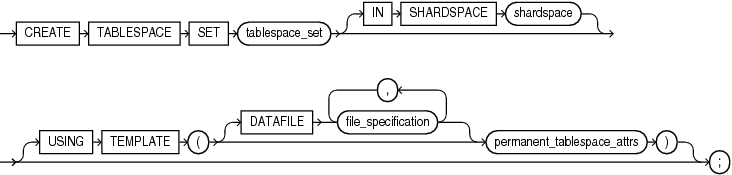
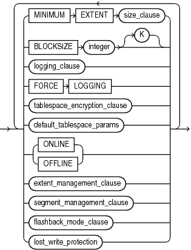

## CREATE TABLESPACE SET

Note:

This SQL statement is valid only if you are using Oracle Sharding. For more information on Oracle Sharding, refer to [Oracle Database Administrator’s Guide](https://docs.oracle.com/pls/topic/lookup?ctx=en/database/oracle/oracle-database/21/sqlrf&id=ADMIN-GUID-DE8AF949-9F68-4C0C-9B5A-45401EF3C3D1).

Purpose

Use the `CREATE` `TABLESPACE` `SET` statement to create a tablespace set. A tablespace set can be used in a sharded database as a logical storage unit for one or more sharded tables and indexes.

A tablespace set consists of multiple tablespaces distributed across shards in a shardspace. The database automatically creates the tablespaces in a tablespace set. The number of tablespaces is determined automatically and is equal to the number of chunks in the corresponding shardspace.

All tablespaces in a tablespace set are permanent bigfile tablespaces; a tablespace set does not contain `SYSTEM`, undo, or temporary tablespaces. The database automatically creates one data file for each tablespace. All tablespaces in a tablespace set share the same attributes. You can modify attributes for all tablespaces in a tablespace set with the `ALTER` `TABLESPACE` `SET` statement.

See Also:

[ALTER TABLESPACE SET](ALTER-TABLESPACE-SET.md) and [DROP TABLESPACE SET](DROP-TABLESPACE-SET.md)

Prerequisites

You must be connected to a shard catalog database as an SDB user.

You must have the `CREATE` `TABLESPACE` system privilege.

Syntax

create\_tablespace\_set::=



> ```
> CREATE TABLESPACE SET tablespace_set
>   [ IN SHARDSPACE shardspace ]
>   [ USING TEMPLATE 
>     ( { DATAFILE [, file_specification ]... ] permanent_tablespace_attrs )
>   ] ;
> ```
>
> [  
> Copyright © 1996, 2025, Oracle and/or its affiliates.](https://docs.oracle.com/en/database/oracle/oracle-database/dcommon/html/cpyr.htm)


permanent\_tablespace\_attrs::=



> ```
> { MINIMUM EXTENT size_clause
> | BLOCKSIZE integer [ K ]
> | logging_clause
> | FORCE LOGGING
> | tablespace_encryption_clause
> | default_tablespace_params
> | { ONLINE | OFFLINE }
> | extent_management_clause
> | segment_management_clause
> | flashback_mode_clause
> }...
> ```
>
> [  
> Copyright © 1996, 2025, Oracle and/or its affiliates.](https://docs.oracle.com/en/database/oracle/oracle-database/dcommon/html/cpyr.htm)


([file\_specification::=](file_specification.md), See the following clauses of `CREATE` `TABLESPACE`: [logging\_clause::=](CREATE-TABLESPACE.md), [tablespace\_encryption\_clause::=](CREATE-TABLESPACE.md), [default\_tablespace\_params::=](CREATE-TABLESPACE.md), [extent\_management\_clause::=](CREATE-TABLESPACE.md), [segment\_management\_clause::=](CREATE-TABLESPACE.md), [flashback\_mode\_clause::=](CREATE-TABLESPACE.md))

Semantics

tablespace\_set

Specify the name of the tablespace set to be created. The name must satisfy the requirements listed in [Database Object Naming Rules](Database-Object-Names-and-Qualifiers.md).

IN SHARDSPACE

Specify this clause if you are using composite sharding. For `shardspace_name`, specify the name of the shardspace in which the tablespace set is to be created.

Omit this clause if you are using system-managed sharding. In this case, the tablespace set is created in the default shardspace for the sharded database.

USING TEMPLATE

The `USING` `TEMPLATE` clause allows you to specify attributes for the tablespaces in the tablespace set.

The `DATAFILE` and `permanent_tablespace_attrs` clauses have the same semantics here as for the `CREATE` `TABLESPACE` statement, with the following exceptions:

- For the `DATAFILE` `file_specification` clause, you can specify only the `SIZE` clause and the `autoextend_clause`.
- You cannot specify the `MINIMUM` `EXTENT` `size_clause`.
- For the `segment_management_clause`, you can specify only `SEGMENT` `SPACE` `MANAGEMENT` `AUTO`. The `MANUAL` setting is not supported.

See Also:

[file\_specification](file_specification.md) and [permanent\_tablespace\_attrs](CREATE-TABLESPACE.md) in the documentation on `CREATE` `TABLESPACE` for the full semantics of these clauses

Examples

Creating a Tablespace Set: Example

The following statement creates tablespace set `ts1`:

```
CREATE TABLESPACE SET ts1
  IN SHARDSPACE sgr1 
  USING TEMPLATE
  ( DATAFILE SIZE 100m
    EXTENT MANAGEMENT LOCAL
    SEGMENT SPACE MANAGEMENT AUTO
  );
```