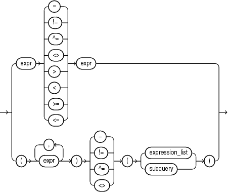
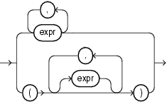
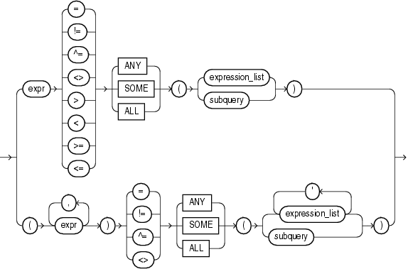

## Comparison Conditions

Comparison conditions compare one expression with another. The result of such a comparison can be `TRUE`, `FALSE`, or `UNKNOWN`.

Large objects (LOBs) are not supported in comparison conditions. However, you can use PL/SQL programs for comparisons on `CLOB` data.

When comparing numeric expressions, Oracle uses numeric precedence to determine whether the condition compares `NUMBER`, `BINARY_FLOAT`, or `BINARY_DOUBLE` values. Refer to [Numeric Precedence](Data-Types.md) for information on numeric precedence.

When comparing character expressions, Oracle uses the rules described in [Data Type Comparison Rules](Data-Type-Comparison-Rules.md). The rules define how the character sets of the expressions are aligned before the comparison, the use of binary or linguistic comparison (collation), the use of blank-padded comparison semantics, and the restrictions resulting from limits imposed on collation keys, including reporting of the error `ORA-12742:` `unable` `to` `create` `the` `collation` `key`.

Two objects of nonscalar type are comparable if they are of the same named type and there is a one-to-one correspondence between their elements. In addition, nested tables of user-defined object types, even if their elements are comparable, must have `MAP` methods defined on them to be used in equality or `IN` conditions.

See Also:

[Oracle Database Object-Relational Developer's Guide](https://docs.oracle.com/pls/topic/lookup?ctx=en/database/oracle/oracle-database/21/sqlrf&id=ADOBJ00202) for information on using `MAP` methods to compare objects

Table 6-2 lists comparison conditions.

Table 6-2 Comparison Conditions

| Type of Condition | Purpose | Example |
| --- | --- | --- |
| `=` | Equality test. | ``` SELECT *   FROM employees   WHERE salary = 2500   ORDER BY employee_id; ``` |
| `!=`  `^=`  `<>` | Inequality test. | ``` SELECT *   FROM employees   WHERE salary != 2500   ORDER BY employee_id; ``` |
| `>`  `<` | Greater-than and less-than tests. | ``` SELECT * FROM employees   WHERE salary > 2500   ORDER BY employee_id; SELECT * FROM employees   WHERE salary < 2500   ORDER BY employee_id; ``` |
| `>=`  `<=` | Greater-than-or-equal-to and less-than-or-equal-to tests. | ``` SELECT * FROM employees   WHERE salary >= 2500   ORDER BY employee_id; SELECT * FROM employees   WHERE salary <= 2500   ORDER BY employee_id; ``` |
| `op ANY`  `op SOME` | "op" must be one of =,!=, >, <, <=, or >=.  `op ANY` compares a value on the left side either to each value in a list, or to each value returned by a query, whichever is specified on the right side, using the condition `op`.  If any of these comparisons returns TRUE, `op ANY` returns `TRUE`.  If all of these comparisons return `FALSE`, or the subquery on the right side returns no rows, `op ANY` returns `FALSE`. Otherwise, the return value is `UNKNOWN`.  `op ANY` and `op SOME` are synonymous. | ``` SELECT * FROM employees   WHERE salary = ANY   (SELECT salary     FROM employees   WHERE department_id = 30)   ORDER BY employee_id; ``` |
| ` op ALL` | "op" must be one of =,!=, >, <, <=, or >=.  `op ALL` compares a value on the left side either to each value in a list, or to each value returned by a subquery, whichever is specified on the right side, using the condition `op`.  If any of these comparisons returns `FALSE`,` op ALL` returns `FALSE`.  If all of these comparisons return `TRUE`, or the subquery on the right side returns no rows, `op ALL` returns `TRUE`. Otherwise, the return value is `UNKNOWN`. | ``` SELECT * FROM employees   WHERE salary >=   ALL (1400, 3000)   ORDER BY employee_id; ``` |

### Simple Comparison Conditions

A simple comparison condition specifies a comparison with expressions or subquery results.

simple\_comparison\_condition::=



> ```
> { expr 
>   { = | != | ^= |  | < | >= |  }
>   ( expression_list | subquery )
> }
> ```
>
> [  
> Copyright © 1996, 2025, Oracle and/or its affiliates.](https://docs.oracle.com/en/database/oracle/oracle-database/dcommon/html/cpyr.htm)


expression\_list::=



> ```
> { expr [, expr ]...
> | ( [expr [, expr ]] ...)
> }
> ```
>
> [  
> Copyright © 1996, 2025, Oracle and/or its affiliates.](https://docs.oracle.com/en/database/oracle/oracle-database/dcommon/html/cpyr.htm)


If you use the lower form of this condition with a single expression to the left of the operator, then you can use the upper or lower form of `expression_list`. If you use the lower form of this condition with multiple expressions to the left of the operator, then you must use the lower form of `expression_list`. In either case, the expressions in `expression_list` must match in number and data type the expressions to the left of the operator. If you specify `subquery`, then the values returned by the subquery must match in number and data type the expressions to the left of the operator.

See Also:

[Expression Lists](Expression-Lists.md) for more information about combining expressions and [SELECT](SELECT.md) for information about subqueries

### Group Comparison Conditions

A group comparison condition specifies a comparison with any or all members in a list or subquery.

group\_comparison\_condition::=



> ```
> { expr
>      { = | != | ^= |  | < | >= | ANY | SOME | ALL }
>      ({ expression_list | subquery })
> | ( expr [, expr ]... )
>   { = | != | ^= | ANY | SOME | ALL }
>   ({ expression_list
>      [, expression_list ]...
>    | subquery
>    }
>   )
> }
> ```


expression\_list::=


> ```
> { expr [, expr ]...
> | ( [expr [, expr ]] ...)
> }
> ```
>
> [  
> Copyright © 1996, 2025, Oracle and/or its affiliates.](https://docs.oracle.com/en/database/oracle/oracle-database/dcommon/html/cpyr.htm)


If you use the upper form of this condition (with a single expression to the left of the operator), then you must use the upper form of `expression_list`. If you use the lower form of this condition (with multiple expressions to the left of the operator), then you must use the lower form of `expression_list`, and the expressions in each `expression_list` must match in number and data type the expressions to the left of the operator. If you specify `subquery`, then the values returned by the subquery must match in number and data type the expressions to the left of the operator.

See Also:

- [Expression Lists](Expression-Lists.md)
- [SELECT](SELECT.md)
- Appendix C in [Oracle Database Globalization Support Guide](https://docs.oracle.com/pls/topic/lookup?ctx=en/database/oracle/oracle-database/21/sqlrf&id=NLSPG-GUID-AFCE41ED-775B-4A00-AF38-C436776AE0C5) for the collation determination rules for comparison conditions