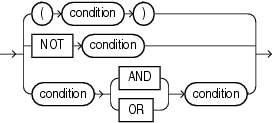

## Compound Conditions

A compound condition specifies a combination of other conditions.

compound\_condition::=



> ```
> { (condition)
> | NOT condition
> | condition { AND | OR } condition
> }
> ```
>
> [  
> Copyright © 1996, 2025, Oracle and/or its affiliates.](https://docs.oracle.com/en/database/oracle/oracle-database/dcommon/html/cpyr.htm)


See Also:

[Logical Conditions](Logical-Conditions.md) for more information about `NOT`, `AND`, and `OR` conditions