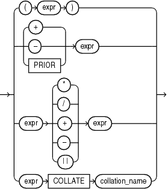

## Compound Expressions

A compound expression specifies a combination of other expressions.

compound\_expression::=



> ```
> { (expr)
> | { + | - | PRIOR } expr
> | expr { * | / | + | - | || } expr
> | expr COLLATE collation_name
> }
>
> Note: The double vertical bars are part of the syntax
>       (indicating concatenation) rather than BNF notation.
> ```
>
> [  
> Copyright © 1996, 2025, Oracle and/or its affiliates.](https://docs.oracle.com/en/database/oracle/oracle-database/dcommon/html/cpyr.htm)


You can use any built-in function as an expression ([Function Expressions](Function-Expressions.md)). However, in a compound expression, some combinations of functions are inappropriate and are rejected. For example, the `LENGTH` function is inappropriate within an aggregate function.

The `PRIOR` operator is used in `CONNECT` `BY` clauses of hierarchical queries.

The `COLLATE` operator determines the collation for an expression. This operator overrides the collation that the database would have derived for the expression using standard collation derivation rules.

See Also:

- [Operator Precedence](About-SQL-Operators.md)
- [Hierarchical Queries](Hierarchical-Queries.md)
- [COLLATE Operator](COLLATE-Operator.md)

Some valid compound expressions are:

```
('CLARK' || 'SMITH') 
LENGTH('MOOSE') * 57 
SQRT(144) + 72 
my_fun(TO_CHAR(sysdate,'DD-MMM-YY'))
name COLLATE BINARY_CI
```