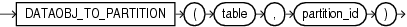

## DATAOBJ\_TO\_PARTITION

Syntax



> ```
> DATAOBJ_TO_PARTITION( table, partition_id )
> ```
>
> [  
> Copyright © 1996, 2025, Oracle and/or its affiliates.](https://docs.oracle.com/en/database/oracle/oracle-database/dcommon/html/cpyr.htm)


Purpose

`DATAOBJ_TO_PARTITION` is useful only to Data Cartridge developers who are performing data maintenance or query operations on system-partitioned tables that are used to store domain index data. The DML or query operations are triggered by corresponding operations on the base table of the domain index.

This function takes as arguments the name of the base table and the partition ID of the base table partition, both of which are passed to the function by the appropriate ODCIIndex method. The function returns the absolute partition number of the corresponding system-partitioned table, which can be used to perform the operation (DML or query) on that partition of the system-partitioned table.

Note:

If the base table is interval partitioned, then Oracle recommends that you instead use the `DATAOBJ_TO_MAT_PARTITION` function. Refer to [DATAOBJ\_TO\_MAT\_PARTITION](DATAOBJ_TO_MAT_PARTITION.md) for more information.

See Also:

[Oracle Database Data Cartridge Developer's Guide](https://docs.oracle.com/pls/topic/lookup?ctx=en/database/oracle/oracle-database/21/sqlrf&id=ADDCI290) for information on the use of the `DATAOBJ_TO_PARTITION` function, including examples