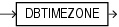

## DBTIMEZONE

Syntax



> ```
> DBTIMEZONE
> ```
>
> [  
> Copyright © 1996, 2025, Oracle and/or its affiliates.](https://docs.oracle.com/en/database/oracle/oracle-database/dcommon/html/cpyr.htm)


Purpose

`DBTIMEZONE` returns the value of the database time zone. The return type is a time zone offset (a character type in the format `'[+|-]TZH:TZM'`) or a time zone region name, depending on how the user specified the database time zone value in the most recent `CREATE` `DATABASE` or `ALTER` `DATABASE` statement.

See Also:

Appendix C in [Oracle Database Globalization Support Guide](https://docs.oracle.com/pls/topic/lookup?ctx=en/database/oracle/oracle-database/21/sqlrf&id=NLSPG-GUID-AFCE41ED-775B-4A00-AF38-C436776AE0C5) for the collation derivation rules, which define the collation assigned to the character return value of `DBTIMEZONE`

Examples

The following example assumes that the database time zone is set to UTC time zone:

```
SELECT DBTIMEZONE
  FROM DUAL;

DBTIME
------
+00:00
```