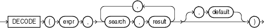

## DECODE

Syntax



> ```
> DECODE(expr, search, result [, search, result ]...  [, default ])
> ```
>
> [  
> Copyright © 1996, 2025, Oracle and/or its affiliates.](https://docs.oracle.com/en/database/oracle/oracle-database/dcommon/html/cpyr.htm)


Purpose

`DECODE` compares `expr` to each `search` value one by one. If `expr` is equal to a `search`, then Oracle Database returns the corresponding `result`. If no match is found, then Oracle returns `default`. If `default` is omitted, then Oracle returns null.

The arguments can be any of the numeric types (`NUMBER`, `BINARY_FLOAT`, or `BINARY_DOUBLE`) or character types.

- If `expr` and `search` are character data, then Oracle compares them using nonpadded comparison semantics. `expr`, `search`, and `result` can be any of the data types `CHAR`, `VARCHAR2`, `NCHAR`, or `NVARCHAR2`. The string returned is of `VARCHAR2` data type and is in the same character set as the first `result` parameter.
- If the first `search-result` pair are numeric, then Oracle compares all `search-result` expressions and the first `expr` to determine the argument with the highest numeric precedence, implicitly converts the remaining arguments to that data type, and returns that data type.

The `search`, `result`, and `default` values can be derived from expressions. Oracle Database uses short-circuit evaluation. The database evaluates each `search` value only before comparing it to `expr`, rather than evaluating all `search` values before comparing any of them with `expr`. Consequently, Oracle never evaluates a `search` if a previous `search` is equal to `expr`.

Oracle automatically converts `expr` and each `search` value to the data type of the first `search` value before comparing. Oracle automatically converts the return value to the same data type as the first `result`. If the first `result` has the data type `CHAR` or if the first `result` is null, then Oracle converts the return value to the data type `VARCHAR2`.

In a `DECODE` function, Oracle considers two nulls to be equivalent. If `expr` is null, then Oracle returns the `result` of the first `search` that is also null.

The maximum number of components in the `DECODE` function, including `expr`, `searches`, `results`, and `default`, is 255.

See Also:

- [Data Type Comparison Rules](Data-Type-Comparison-Rules.md) for information on comparison semantics
- [Data Conversion](Data-Type-Comparison-Rules.md) for information on data type conversion in general
- [Floating-Point Numbers](Data-Types.md) for information on floating-point comparison semantics
- [Implicit and Explicit Data Conversion](Data-Type-Comparison-Rules.md) for information on the drawbacks of implicit conversion
- [COALESCE](COALESCE.md) and [CASE Expressions](CASE-Expressions.md), which provide functionality similar to that of `DECODE`
- Appendix C in [Oracle Database Globalization Support Guide](https://docs.oracle.com/pls/topic/lookup?ctx=en/database/oracle/oracle-database/21/sqlrf&id=NLSPG-GUID-AFCE41ED-775B-4A00-AF38-C436776AE0C5) for the collation determination rules, which define the collation `DECODE` uses to compare characters from `expr` with characters from `search`, and for the collation derivation rules, which define the collation assigned to the return value of this function when it is a character value

Examples

This example decodes the value `warehouse_id`. If `warehouse_id` is 1, then the function returns ' `Southlake` '; if `warehouse_id` is 2, then it returns ' `San Francisco` '; and so forth. If `warehouse_id` is not 1, 2, 3, or 4, then the function returns ' `Non domestic` '.

```
SELECT product_id,
       DECODE (warehouse_id, 1, 'Southlake', 
                             2, 'San Francisco', 
                             3, 'New Jersey', 
                             4, 'Seattle',
                                'Non domestic') "Location" 
  FROM inventories
  WHERE product_id < 1775
  ORDER BY product_id, "Location";
```