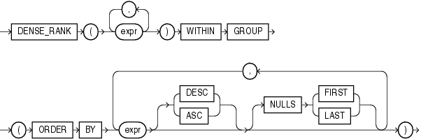
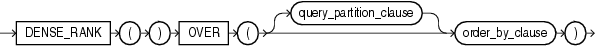

## DENSE\_RANK

Aggregate Syntax

dense\_rank\_aggregate::=



> ```
> DENSE_RANK(expr [, expr ]...) WITHIN GROUP
>   (ORDER BY expr [ DESC | ASC ]
>                  [ NULLS { FIRST | LAST } ]
>             [,expr [ DESC | ASC ]
>                    [ NULLS { FIRST | LAST } ]
>             ]...
>   )
> ```
>
> [  
> Copyright © 1996, 2025, Oracle and/or its affiliates.](https://docs.oracle.com/en/database/oracle/oracle-database/dcommon/html/cpyr.htm)


Analytic Syntax

dense\_rank\_analytic::=



> ```
> DENSE_RANK( ) OVER([ query_partition_clause ] order_by_clause)
> ```
>
> [  
> Copyright © 1996, 2025, Oracle and/or its affiliates.](https://docs.oracle.com/en/database/oracle/oracle-database/dcommon/html/cpyr.htm)


See Also:

[Analytic Functions](Analytic-Functions.md) for information on syntax, semantics, and restrictions

Purpose

`DENSE_RANK` computes the rank of a row in an ordered group of rows and returns the rank as a `NUMBER`. The ranks are consecutive integers beginning with 1. The largest rank value is the number of unique values returned by the query. Rank values are not skipped in the event of ties. Rows with equal values for the ranking criteria receive the same rank. This function is useful for top-N and bottom-N reporting.

This function accepts as arguments any numeric data type and returns `NUMBER`.

- As an aggregate function, `DENSE_RANK` calculates the dense rank of a hypothetical row identified by the arguments of the function with respect to a given sort specification. The arguments of the function must all evaluate to constant expressions within each aggregate group, because they identify a single row within each group. The constant argument expressions and the expressions in the `order_by_clause` of the aggregate match by position. Therefore, the number of arguments must be the same and types must be compatible.
- As an analytic function, `DENSE_RANK` computes the rank of each row returned from a query with respect to the other rows, based on the values of the `value_exprs` in the `order_by_clause`.

See Also:

Appendix C in [Oracle Database Globalization Support Guide](https://docs.oracle.com/pls/topic/lookup?ctx=en/database/oracle/oracle-database/21/sqlrf&id=NLSPG-GUID-AFCE41ED-775B-4A00-AF38-C436776AE0C5) for the collation determination rules, which define the collation `DENSE_RANK` uses to compare character values for the `ORDER` `BY` clause

Aggregate Example

The following example computes the ranking of a hypothetical employee with the salary $15,500 and a commission of 5% in the sample table `oe.employees`:

```
SELECT DENSE_RANK(15500, .05) WITHIN GROUP 
  (ORDER BY salary DESC, commission_pct) "Dense Rank" 
  FROM employees;

Dense Rank
----------
         3
```

Analytic Example

The following statement ranks the employees in the sample `hr` schema in department 60 based on their salaries. Identical salary values receive the same rank. However, no rank values are skipped. Compare this example with the analytic example for [RANK](RANK.md).

```
SELECT department_id, last_name, salary,
       DENSE_RANK() OVER (PARTITION BY department_id ORDER BY salary) DENSE_RANK
  FROM employees WHERE department_id = 60
  ORDER BY DENSE_RANK, last_name;
 
DEPARTMENT_ID LAST_NAME                     SALARY DENSE_RANK
------------- ------------------------- ---------- ----------
           60 Lorentz                         4200          1
           60 Austin                          4800          2
           60 Pataballa                       4800          2
           60 Ernst                           6000          3
           60 Hunold                          9000          4
```