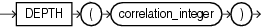

## DEPTH

Syntax



> ```
> DEPTH(correlation_integer)
> ```
>
> [  
> Copyright © 1996, 2025, Oracle and/or its affiliates.](https://docs.oracle.com/en/database/oracle/oracle-database/dcommon/html/cpyr.htm)


Purpose

`DEPTH` is an ancillary function used only with the `UNDER_PATH` and `EQUALS_PATH` conditions. It returns the number of levels in the path specified by the `UNDER_PATH` condition with the same correlation variable.

The `correlation_integer` can be any `NUMBER` integer. Use it to correlate this ancillary function with its primary condition if the statement contains multiple primary conditions. Values less than 1 are treated as 1.

Examples

The `EQUALS_PATH` and `UNDER_PATH` conditions can take two ancillary functions, `DEPTH` and `PATH`. The following example shows the use of both ancillary functions. The example assumes the existence of the XMLSchema `warehouses.xsd` (created in [Using XML in SQL Statements](Using-XML-in-SQL-Statements.md)).

```
SELECT PATH(1), DEPTH(2)
  FROM RESOURCE_VIEW
  WHERE UNDER_PATH(res, '/sys/schemas/OE', 1)=1
    AND UNDER_PATH(res, '/sys/schemas/OE', 2)=1;

PATH(1)                          DEPTH(2)
-------------------------------- --------
. . .
www.example.com                         1
www.example.com/xwarehouses.xsd         2
. . .
```