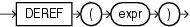

## DEREF

Syntax



> ```
> DEREF(expr)
> ```
>
> [  
> Copyright © 1996, 2025, Oracle and/or its affiliates.](https://docs.oracle.com/en/database/oracle/oracle-database/dcommon/html/cpyr.htm)


Purpose

`DEREF` returns the object reference of argument `expr`, where `expr` must return a `REF` to an object. If you do not use this function in a query, then Oracle Database returns the object ID of the `REF` instead, as shown in the example that follows.

See Also:

[MAKE\_REF](MAKE_REF.md)

Examples

The sample schema `oe` contains an object type `cust_address_typ`. The [REF Constraint Examples](constraint.md) create a similar type, `cust_address_typ_new`, and a table with one column that is a `REF` to the type. The following example shows how to insert into such a column and how to use `DEREF` to extract information from the column:

```
INSERT INTO address_table VALUES
  ('1 First', 'G45 EU8', 'Paris', 'CA', 'US');

INSERT INTO customer_addresses
  SELECT 999, REF(a) FROM address_table a;

SELECT address
  FROM customer_addresses
  ORDER BY address;

ADDRESS
--------------------------------------------------------------------------------
000022020876B2245DBE325C5FE03400400B40DCB176B2245DBE305C5FE03400400B40DCB1

SELECT DEREF(address)
  FROM customer_addresses;

DEREF(ADDRESS)(STREET_ADDRESS, POSTAL_CODE, CITY, STATE_PROVINCE, COUNTRY_ID)
--------------------------------------------------------------------------------
CUST_ADDRESS_TYP_NEW('1 First', 'G45 EU8', 'Paris', 'CA', 'US')
```