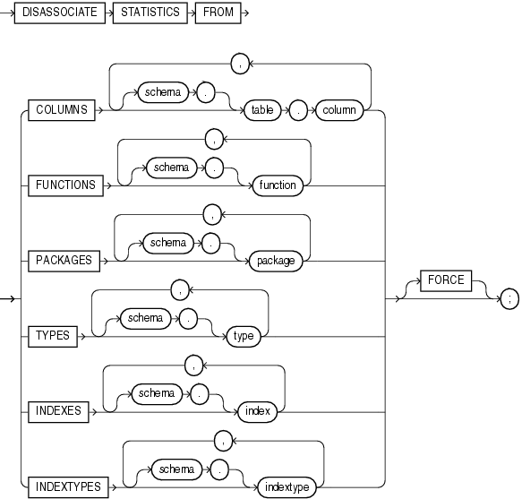

## DISASSOCIATE STATISTICS

Purpose

Use the `DISASSOCIATE` `STATISTICS` statement to disassociate default statistics or a statistics type from columns, standalone functions, packages, types, domain indexes, or indextypes.

See Also:

[ASSOCIATE STATISTICS](ASSOCIATE-STATISTICS.md) for more information on statistics type associations

Prerequisites

To issue this statement, you must have the appropriate privileges to alter the underlying table, function, package, type, domain index, or indextype.

Syntax

disassociate\_statistics::=



> ```
> DISASSOCIATE STATISTICS FROM
>    { COLUMNS [ schema. ]table.column
>                [, [ schema. ]table.column ]...
>    | FUNCTIONS [ schema. ]function
>                  [, [ schema. ]function ]...
>    | PACKAGES [ schema. ]package
>                 [, [ schema. ]package ]...
>    | TYPES [ schema. ]type
>              [, [ schema. ]type ]...
>    | INDEXES [ schema. ]index
>                [, [ schema. ]index ]...
>    | INDEXTYPES [ schema. ]indextype
>                   [, [ schema. ]indextype ]...
>    }
>    [ FORCE ] ;
> ```


Semantics

FROM COLUMNS | FUNCTIONS | PACKAGES | TYPES | INDEXES | INDEXTYPES

Specify one or more columns, standalone functions, packages, types, domain indexes, or indextypes from which you are disassociating statistics.

If you do not specify `schema`, then Oracle Database assumes the object is in your own schema.

If you have collected user-defined statistics on the object, then the statement fails unless you specify `FORCE`.

FORCE

Specify `FORCE` to remove the association regardless of whether any statistics exist for the object using the statistics type. If statistics do exist, then the statistics are deleted before the association is deleted.

Note:

When you drop an object with which a statistics type has been associated, Oracle Database automatically disassociates the statistics type with the `FORCE` option and drops all statistics that have been collected with the statistics type.

Examples

Disassociating Statistics: Example

This statement disassociates statistics from the `emp_mgmt` package. See [Oracle Database PL/SQL Language Reference](https://docs.oracle.com/pls/topic/lookup?ctx=en/database/oracle/oracle-database/21/sqlrf&id=LNPLS01378) for the example that creates this package in the `hr` schema.

```
DISASSOCIATE STATISTICS FROM PACKAGES hr.emp_mgmt;
```