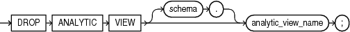

## DROP ANALYTIC VIEW

Purpose

Use the `DROP` `ANALYTIC` `VIEW` statement to drop an analytic view. An `ANALYTIC` `VIEW` object is a component of analytic views.

Prerequisites

To drop an analytic view in your own schema, you must have the `DROP` `ANALYTIC` `VIEW` system privilege. To drop an analytic view in another user's schema, you must have the `DROP` `ANY` `ANALYTIC` `VIEW` system privilege.

Syntax

drop\_analytic\_view::=



> ```
> DROP ANALYTIC VIEW [ schema. ] analytic_view_name;
> ```
>
> [  
> Copyright © 1996, 2025, Oracle and/or its affiliates.](https://docs.oracle.com/en/database/oracle/oracle-database/dcommon/html/cpyr.htm)


Semantics

schema

Specify the schema in which the analytic view exists. If you do not specify a schema, then Oracle Database looks for the analytic view in your own schema.

analytic\_view\_name

Specify the name of the analytic view to drop.

Example

The following statement drops the specified analytic view object:

```
DROP ANALYTIC VIEW sales_av;
```