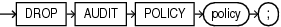

## DROP AUDIT POLICY (Unified Auditing)

This section describes the `DROP` `AUDIT` `POLICY` statement for unified auditing. This type of auditing is new beginning with Oracle Database 12c and provides a full set of enhanced auditing features. Refer to [Oracle Database Security Guide](https://docs.oracle.com/pls/topic/lookup?ctx=en/database/oracle/oracle-database/21/sqlrf&id=DBSEG630) for more information on unified auditing.

Purpose

Use the `DROP` `AUDIT` `POLICY` statement to remove a unified audit policy from the database.

Prerequisites

You must have the `AUDIT` `SYSTEM` system privilege or the `AUDIT_ADMIN` role.

To drop a common unified audit policy, the current container must be the root and you must have the commonly granted `AUDIT` `SYSTEM` privilege or the `AUDIT_ADMIN` common role. To drop a local unified audit policy, the current container must be the container in which the audit policy was created and you must have the commonly granted `AUDIT` `SYSTEM` privilege or the `AUDIT_ADMIN` common role, or you must have the locally granted `AUDIT` `SYSTEM` privilege or the `AUDIT_ADMIN` local role in the container.

Syntax

drop\_audit\_policy::=



> ```
> DROP AUDIT POLICY policy ;
> ```
>
> [  
> Copyright © 1996, 2025, Oracle and/or its affiliates.](https://docs.oracle.com/en/database/oracle/oracle-database/dcommon/html/cpyr.htm)


Semantics

policy

Specify the name of the unified audit policy you want to drop. The policy must have been created using the `CREATE` `AUDIT` `POLICY` statement.

You can find the names of all unified audit policies by querying the `AUDIT_UNIFIED_POLICIES` view and the names of all enabled unified audit policies by querying the `AUDIT_UNIFIED_ENABLED_POLICIES` view

Restriction on Dropping Unified Audit Policies

You cannot drop an enabled unified audit policy. You must first disable the policy using the `NOAUDIT` statement.

See Also:

- [CREATE AUDIT POLICY (Unified Auditing)](CREATE-AUDIT-POLICY-Unified-Auditing.md)
- Oracle Database Reference for more information on the [`AUDIT_UNIFIED_POLICIES`](https://docs.oracle.com/pls/topic/lookup?ctx=en/database/oracle/oracle-database/21/sqlrf&id=REFRN29157) and [`AUDIT_UNIFIED_ENABLED_POLICIES`](https://docs.oracle.com/pls/topic/lookup?ctx=en/database/oracle/oracle-database/21/sqlrf&id=REFRN29158) views

Examples

Dropping a Unified Audit Policy: Example

The following statement drops unified audit policy `table_pol`:

```
DROP AUDIT POLICY table_pol;
```