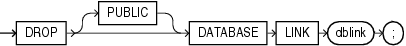

## DROP DATABASE LINK

Purpose

Use the `DROP` `DATABASE` `LINK` statement to remove a database link from the database.

See Also:

[CREATE DATABASE LINK](CREATE-DATABASE-LINK.md) for information on creating database links

Prerequisites

A private database link must be in your own schema. To drop a `PUBLIC` database link, you must have the `DROP` `PUBLIC` `DATABASE` `LINK` system privilege.

Syntax

drop\_database\_link::=



> ```
> DROP [ PUBLIC ] DATABASE LINK dblink ;
> ```
>
> [  
> Copyright © 1996, 2025, Oracle and/or its affiliates.](https://docs.oracle.com/en/database/oracle/oracle-database/dcommon/html/cpyr.htm)


Semantics

PUBLIC

You must specify `PUBLIC` to drop a `PUBLIC` database link.

dblink

Specify the name of the database link to be dropped.

Restriction on Dropping Database Links

You cannot drop a database link in another user's schema, and you cannot qualify `dblink` with the name of a schema, because periods are permitted in names of database links. Therefore, Oracle Database interprets the entire name, such as `ralph.linktosales`, as the name of a database link in your schema rather than as a database link named `linktosales` in the schema `ralph`.

Examples

Dropping a Database Link: Example

The following statement drops the public database link named `remote`, which was created in " [Defining a Public Database Link: Example](CREATE-DATABASE-LINK.md) ":

```
DROP PUBLIC DATABASE LINK remote;
```